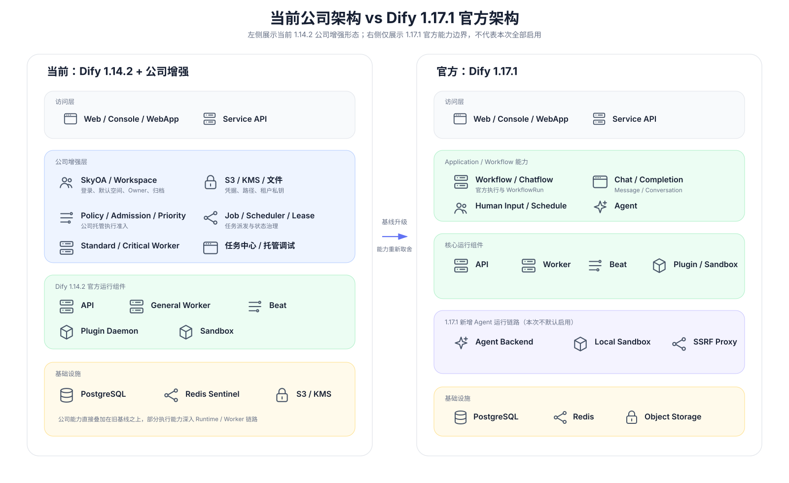
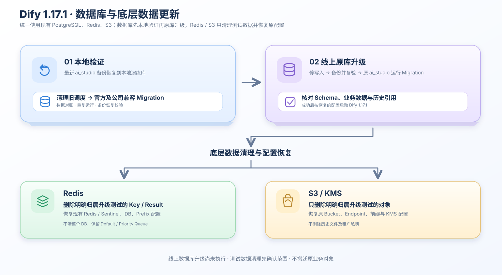
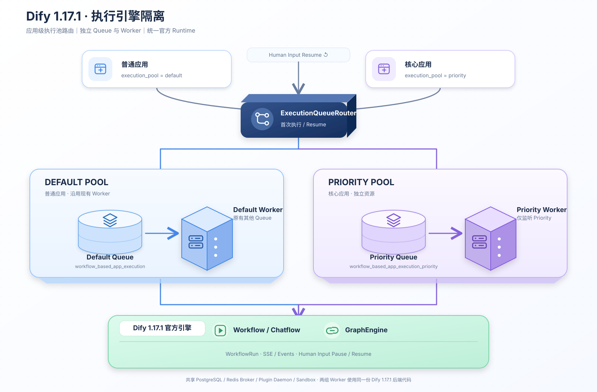
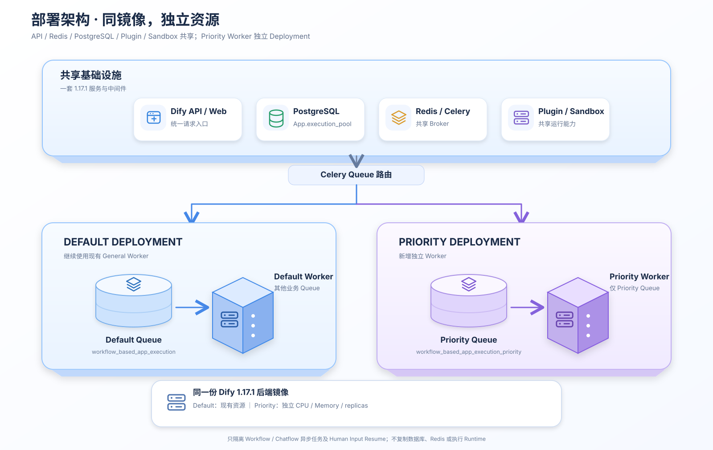

# Dify 1.17.1 基线升级方案

## 一、升级目标

当前平台基于 Dify 1.14.2，并扩展了 SkyOA、工作空间治理、S3/KMS、文件与租户私钥、托管执行调度等公司能力。本次升级以 Dify 1.17.1 为新基线，分三个阶段完成现有能力迁移、新版本能力升级和执行引擎隔离。底层沿用现有 PostgreSQL、Redis、S3 等组件；数据库按“最新备份本地验证 → 线上原 `ai_studio` 就地升级”执行，Redis 和 S3 仅清理升级测试数据并恢复原配置。

| 目标 | 内容 |
| --- | --- |
| 基线升级 | 平台基础版本由 Dify 1.14.2 升级到 Dify 1.17.1 |
| 现有能力迁移 | 将 SkyOA、工作空间、S3/KMS、文件与私钥等现有公司能力适配到 1.17.1 |
| 新能力升级 | 在阶段一形成的 1.17.1 版本上增加确定要启用的新功能及对应运行组件 |
| 执行引擎隔离 | 不迁原公司托管调度；以 1.17.1 官方 Workflow / Chatflow 异步执行为基础，增加应用执行池、Queue Router 和独立 Priority Worker |
| 数据库与资源更新 | 使用最新 `ai_studio` 备份先做本地演练，再在线上原库完成 1.17.1 Schema 升级；Redis / S3 清理升级测试数据后恢复原有连接与存储配置 |

---

## 二、升级架构

### 2.1 当前架构与 Dify 1.17.1 官方架构



### 2.2 数据库升级及 Redis / S3 清理



---

## 三、阶段一：现有能力迁移

### 3.1 功能迁移

业务功能按依赖顺序迁移：**S3/KMS → 文件路径与密钥公共操作 → 默认工作空间与自动注册 → 工作空间管理 → 邀请注册 → 管理员初始化**。SkyOA 登录和通用 SSE 修复可独立迁移。各功能新增的表、字段和索引直接接在 1.17.1 当前 Migration Head 之后，旧公司 Migration 只作为结构和数据修复规则来源，不直接复制旧父版本或调度链。

| 能力 | 主要迁移内容 | 1.17.1 适配位置 |
| --- | --- | --- |
| SkyOA 登录 | Provider、POST 回调、state/nonce、账号匹配、OA 绑定、Provider 展示与日志脱敏 | Account / Identity / OAuth / AccountIntegrationService |
| S3 / KMS | 公司 KMS 协议、凭据选择与刷新、S3 Client、失败重试 | Storage Provider / AWS S3 Storage |
| 文件路径与租户私钥 | 对象前缀、Tenant/App 文件目录、app_id 透传、私钥路径与缓存 | Storage / FileService / RSA Provider |
| 默认工作空间与自动注册 | `is_default`、可信 SkyOA 建号、默认空间加入、current workspace 恢复 | AccountService / Tenant / CurrentTenantResolver |
| 工作空间管理 | 创建、指定 owner、幂等、额度、切换、归档、成员治理和管理页面 | Workspace Service / RBAC / WorkspaceCard |
| 邀请注册 | 数据库邀请、SkyOA 接受邀请、邮箱校验、成员加入 | Account / Workspace / Invitation |
| 管理员初始化 | SkyOA 首次安装、管理员和默认空间创建、失败清理 | Setup / Workspace Provisioning |
| 通用 SSE | 系统 Header 与自定义 Header 合并 | Web Request / SSE |
| Workflow 请求参数 | 会话 ID、父消息 ID 去空格，空白值转为 None 后再做 UUID 校验 | Workflow Console Request |

#### 3.1.1 SkyOA 登录

**来源：** `origin/feature/20260701`；账号邮箱匹配与资料补充来自 `origin/feature/20260825_S3`。

| 项目 | 1.14.2 公司能力 | 1.17.1 变化 | 迁移方案 |
| --- | --- | --- | --- |
| Provider 与登录入口 | SkyOA 与官方 Provider 并存 | 官方 OAuth 登录改由新版服务承接 | 保留官方 Provider，增加独立 SkyOA 分支 |
| 回调协议 | 前端 POST `code`、`state`、`currentUrl` | 官方 Provider 采用自身回调流程 | 保留 SkyOA POST 回调，官方回调不改 |
| state / nonce | 300 秒 Cookie 保存登录上下文 | 官方有独立 state 处理 | SkyOA 继续使用原 state / nonce 与 Cookie 生命周期 |
| Token / userinfo | 使用 SkyOA Token 和 userinfo 协议解析身份 | 官方无 SkyOA Provider | 保留公司请求、身份解析及离职/停用等校验 |
| 账号匹配 | 先查 OA 绑定，未命中再按邮箱匹配 | 新版使用 Repository、显式 Session 和 `normalized_email` | 保留“绑定优先、邮箱兜底、重复邮箱拒绝”，改用新版 Repository / Session |
| OA 绑定 | 登录后将 openId 关联原账号 | 身份关联接口变化 | 使用新版 Repository.link，保留原 account_id |
| Provider 展示 | 登录页和账号页按已配置 Provider 展示 | 新版绑定列表由 AccountIntegrationService 提供 | 将 SkyOA 加入 Provider 名单，在登录页和 `/account` 展示 |
| 配置 | Client ID、Secret、授权、Token、userinfo、scope | 官方无 SkyOA 配置 | 按 1.17.1 配置结构增加六项参数 |
| 日志 | 公司摘要脱敏 | HTTP 客户端日志可能打印 URL 中的敏感参数 | 在控制台和文件日志输出前脱敏 SkyOA Token URL 中的 Secret 和授权码 |

SkyOA 新用户建号和默认空间加入统一由 3.1.4 处理，不在登录逻辑中重复实现注册流程。

#### 3.1.2 S3 / KMS

**来源：** `origin/feature/20260825_S3` 的最终 KMS / S3 实现。

| 项目 | 1.14.2 公司能力 | 1.17.1 变化 | 迁移方案 |
| --- | --- | --- | --- |
| KMS Provider | 公司 KMS 获取临时 S3 凭据 | 官方无公司 KMS 协议 | 在新版 Storage 增加公司 KMS Credential Provider |
| KMS 协议 | 最终使用 `data/signature` | 历史分支存在多版中间协议 | 只迁最终 `data/signature` 协议 |
| 凭据选择 | IAM、KMS、静态 AK/SK 分流 | 官方支持 IAM 与静态凭据 | IAM 优先；KMS 配置完整时使用 KMS；全空时使用静态凭据 |
| 定时刷新 | 临时凭据按时区周期刷新 | 官方无公司刷新线程 | 保留刷新时区、周期检查和文件操作前到期检查 |
| 刷新失败 | 保留旧 Client 并延迟重试 | 官方无该逻辑 | 新凭据成功后再替换 Client，失败时继续使用旧 Client |
| 多进程 | fork 后重新初始化刷新状态 | Worker 仍可能多进程 | 保留进程级锁、线程和状态重建 |
| 请求失败 | 认证类错误刷新 Client 后重试一次 | 官方按普通 S3 错误处理 | KMS 模式下刷新凭据并受控重试一次 |
| exists | 只有对象不存在返回 false | 官方错误路径不同 | 保留不存在与其他异常的区分 |
| 新版能力 | 旧基线缺少部分预签名和流式能力 | 1.17.1 已提供 | 保留官方能力，只让其使用当前有效 S3 Client |
| 环境配置 | 公司测试环境使用 S3 / KMS | 1.17.1 配置项发生变化 | 按新版配置结构维护 endpoint、bucket、region、寻址方式、刷新时区及 KMS 参数 |

#### 3.1.3 文件路径与租户私钥

**来源：** `origin/feature/20260701` 与 `origin/feature/20260825_S3` 的文件路径、RSA 私钥和公共密钥操作。

| 项目 | 1.14.2 公司能力 | 1.17.1 变化 | 迁移方案 |
| --- | --- | --- | --- |
| 对象前缀 | 对象存储统一使用 `Dify/` | 官方公共 Storage 直接使用业务 Key | save/load/download/exists/delete/scan/签名统一应用前缀；Local / Volume 不加 |
| 文件目录 | 按 Tenant 和可选 App 组织对象 | 新版 FileService 无公司 `app_id` 参数 | 文件保存为 `Dify/upload_files/{tenant_id}/{app_id?}/{uuid}` |
| App 归属校验 | 传入 app_id 时校验应用属于当前 Tenant | 新版无公司校验 | FileService 增加可选 app_id，并校验 UUID 与租户归属 |
| 上传入口 | Console、Service API、WebApp、Workflow 传 App 身份 | 新版上传链路重新组织 | 从已鉴权上下文透传真实 App ID；RemoteFileService 同步增加 app_id |
| Workflow 文件 | 节点结果和草稿结果按应用归档 | 新版仍会将结果落文件 | Repository 和 Draft Variable Service 传入所属 App ID |
| 私钥路径 | `Dify/RSA_privateKey/{tenant_id}/private.pem` | 官方默认私钥路径和 Provider 不同 | 新 Tenant 使用公司路径，并在 Tenant 记录实际私钥引用 |
| 私钥缓存 | 按 Tenant 缓存私钥 | 新版缓存键不同 | 使用公司最终缓存键规则，只影响私钥缓存 |
| 密钥操作 | 创建空间时分步生成、保存和失败清理 | 新版通过 Provider 统一生成 | 在新版 Provider 上保留生成、保存、删除的分步能力，供 Workspace Provisioning 使用 |
| 数据结构 | Tenant 保存私钥路径 | 1.17.1 无公司字段 | 在当前 1.17.1 Migration Head 后增加私钥字段及所需结构 |
| 历史数据 | 旧文件和私钥已有真实对象 | 新路径结构不同 | 不搬迁历史对象，沿用原 S3 对象与私钥引用；升级时仅清理测试对象并恢复原存储配置（见 3.3.7） |

#### 3.1.4 默认工作空间与自动注册

**来源：** `origin/feature/20260701` 的默认空间、自动注册、current workspace 和默认 owner 保护。

| 项目 | 1.14.2 公司能力 | 1.17.1 变化 | 迁移方案 |
| --- | --- | --- | --- |
| 默认空间 | Tenant 增加 `is_default` | 官方无公司默认空间语义 | 在新版 Tenant 增加 `is_default`，建立唯一默认空间约束 |
| SkyOA 自动注册 | 已验证 OA 用户可在普通注册关闭时建号 | 新版普通注册受系统开关限制 | 给注册/建号链路增加可信 OA 参数，仅 SkyOA 验证成功时允许绕过普通注册关闭 |
| 个人空间 | SkyOA 用户不创建无意义个人空间 | 新版普通注册可创建个人空间 | SkyOA 注册后直接加入默认 Workspace |
| 成员加入 | 无空间用户自动加入默认空间 | 新版成员操作使用显式 Session | 使用同一 Session 写入成员关系；已有成员保留角色，新成员使用入口指定角色 |
| current workspace | 有效 current 优先，否则正常空间，最后默认空间 | 新版只维护当前空间上下文 | 引入 CurrentTenantResolver，按公司顺序选择并保存唯一 current |
| 角色恢复 | 切换/恢复后使用对应空间成员角色 | 新版保存空间和角色 | 复用新版角色字段，恢复时同步更新最近使用时间 |
| 默认 owner 保护 | 默认空间唯一 owner 不允许删除、降级或转移 | 官方无公司保护 | 保留 owner 删除、角色变更、转移和归档保护方法 |
| 设置默认空间 | CLI 指定默认 Tenant | 官方无对应命令 | 保留 `set-default-tenant`，校验唯一 owner 和确认邮箱 |
| 数据结构 | 默认标记、唯一 current、查询索引 | 官方缺少公司约束 | 在新环境 Migration 中创建字段、约束和索引，不复制旧 revision 链 |

#### 3.1.5 工作空间管理

**来源：** `origin/feature/20260701` 及 `origin/feature/20260825_S3` 的公司 Workspace 管理能力。

| 项目 | 1.14.2 公司能力 | 1.17.1 变化 | 迁移方案 |
| --- | --- | --- | --- |
| 管理入口 | 公司管理员创建和管理 Workspace | 新版主导航改为 WorkspaceCard | 在 `WorkspaceCard` 的 WorkspaceSwitcher 下接入“创建空间”和“管理空间”按钮 |
| 管理员可见性 | `is_system_admin` 控制入口 | 新版资料通过 userProfileQueryOptions 获取 | 在 AccountResponse 增加公司管理员字段并生成前端类型 |
| 创建 Workspace | 公司统一创建服务 | 新版无公司创建事务 | 保留 WorkspaceProvisioningService，统一处理来源、幂等、额度、owner、插件策略、密钥和事件 |
| 指定 owner | 选择已有账号或填写新邮箱 | 新版账号增加 `normalized_email` | 复用有效账号；新邮箱创建 PENDING 账号并补 normalized_email |
| 幂等 | 同一请求重试复用请求编号 | 官方无公司创建请求记录 | 保留 WorkspaceCreationRequest、摘要和唯一键 |
| 额度 | 创建前执行公司额度锁和判断 | 新版许可证读取接口变化 | 使用新版 License 读取方式，保留原锁和计数顺序 |
| 列表与筛选 | 分页、创建时间、owner 展示 | 新版无公司管理列表 | 在管理弹窗中保留分页、日期筛选、owner 信息和缓存刷新 |
| 切换 | 校验空间、账号和成员关系 | 新版切换方法使用显式 Session | 保留公司锁定和检查顺序，并更新新版 last_opened_at |
| 归档 | 逻辑归档，记录时间、操作者、原因 | 官方只有基础状态字段 | 保留归档服务、首次审计信息和 current workspace 恢复 |
| 成员治理 | 默认 owner 删除/改角色/转移保护 | 新版调用位置变化 | 在新版删除服务、成员接口和 owner 转移流程接入公司保护 |
| 前端组件 | 旧版使用 WorkplaceSelector | 新版组件体系变化 | 管理入口迁到 WorkspaceCard；弹窗使用新版 Dialog、SegmentedControl、Input 等组件 |

#### 3.1.6 邀请注册

**来源：** `origin/feature/20260701` 的数据库邀请和 SkyOA 接受邀请流程。

| 项目 | 1.14.2 公司能力 | 1.17.1 变化 | 迁移方案 |
| --- | --- | --- | --- |
| 邀请模型 | 数据库存储 Token 摘要、状态、有效期、角色和接受信息 | 官方无公司邀请表 | 在新环境增加 WorkspaceInvitation 表、唯一约束和索引 |
| 邀请入口 | 管理员生成邀请 | 新版保留复制邀请链接能力 | 保留链接分享；邮件发送依赖现有邮件服务配置 |
| 接受方式 | 受邀人通过 SkyOA 登录 | 官方激活流程不同 | 邀请页面只走 SkyOA，不使用密码注册直接激活 |
| 邮箱校验 | OA 邮箱必须等于邀请邮箱 | 新版 OAuth 与激活链路分离 | 在接受邀请时继续校验 SkyOA 邮箱 |
| 账号处理 | 不存在则创建，存在则复用 | 新版 Account / Session 变化 | 使用新版账号能力，保留原 account_id 和账号状态 |
| 成员加入 | 按邀请角色加入 Workspace | 新版成员接口变化 | 使用新版成员模型写入邀请角色 |
| 邀请状态 | pending / accepted / cancelled / expired | 官方无公司状态机 | 保留状态、有效期、重发和幂等规则 |
| 普通登录 | 旧混合逻辑包含密码邀请参数 | 新版登录服务已变化 | 邀请逻辑从普通密码登录移除，只保留 SkyOA 邀请流程 |

#### 3.1.7 管理员初始化

**来源：** `origin/feature/20260701` 的 SkyOA 首次安装与公司初始化流程。

| 项目 | 1.14.2 公司能力 | 1.17.1 变化 | 迁移方案 |
| --- | --- | --- | --- |
| Setup 入口 | SkyOA 身份初始化管理员 | 新版 Setup 服务和数据结构变化 | 在新版 Setup 增加 SkyOA 初始化分支 |
| 管理员账号 | 使用 SkyOA 资料创建初始管理员 | Account 创建与 Session 变化 | 使用新版账号接口，保留 OA 身份和公司管理员标记 |
| 默认 Workspace | 初始化时创建默认空间 | Workspace 创建逻辑已集中到公司服务 | 复用 3.1.5 WorkspaceProvisioningService 创建默认空间 |
| owner / 成员 | 初始化管理员成为默认空间 owner | 新版成员写入方式变化 | 使用公司统一创建事务保存 owner 成员 |
| 公私钥 | 创建空间同时生成并记录密钥 | 新版 Key Provider 变化 | 复用 3.1.3 已迁入的 RSA 分步接口 |
| 失败清理 | 初始化失败只清理本次新建内容 | 新版事务与外部 Storage 操作分离 | 回滚数据库，并只删除本次创建的私钥和初始化对象 |
| 安装状态 | 初始化完成后记录系统已安装 | 新版安装记录增加字段 | 使用 1.17.1 安装记录结构，不另建公司状态模型 |

#### 3.1.8 通用 SSE 请求

**来源：** `origin/feature/20260825_S3` 的通用请求头修复。

| 项目 | 1.14.2 公司能力 | 1.17.1 情况 | 迁移方案 |
| --- | --- | --- | --- |
| Header 合并 | 自定义 Header 与认证、CSRF、分享身份 Header 合并 | `fetchOptions.headers` 可能覆盖系统 Header | 系统 Header 优先，保留不冲突的自定义 Header |
| GET / POST | 两类 SSE 请求均使用相同合并规则 | 新版请求封装位置变化 | 在新版 Request 层统一处理 GET / POST |
| 调度代码 | 原提交混有公司调度测试路径 | 阶段一不迁公司调度 | 只提取通用 Header 修复，不迁调度接口和测试依赖 |

#### 3.1.9 Workflow 请求参数兼容

**来源：** `origin/feature/20260825_S3` 混合提交 `e2e06e69` 中独立于公司调度的请求参数处理。

| 项目 | 1.14.2 公司处理 | 1.17.1 情况 | 迁移方案 |
| --- | --- | --- | --- |
| 会话 ID | 去除两端空格，纯空白转为 None | 新版 `uuid_value()` 已接受空字符串，但纯空格行为不同 | 先 trim，空白转 None，其余值继续交给新版 UUID 校验 |
| 父消息 ID | 与会话 ID 使用同一规范化 | 新版未加入同一处理 | 使用相同 trim / None 规则 |
| 调度调试代码 | 同一提交包含公司 Console 调度修改 | 阶段一不迁公司调度 | 只迁请求模型处理，调度服务及对应测试排除 |

### 3.2 1.17.1 基线与组件部署

#### 3.2.1 分支、流水线与 DevOps 部署

| 对象 | 升级处理 |
| --- | --- |
| 基线分支 | 以 `release/1.17.1` 为新基线，迁移开发使用 `feature/20260920_1.17.1_UPGRADE` |
| 测试发布 | 使用 `test_1.17.1_UPGRADE` 及对应流水线构建 1.17.1 制品 |
| DevOps 部署 | 沿用现有 `dify-api`、`dify-web`、`dify-worker`、`dify-worker-beat` 等应用及按需新增的运行角色 |
| 底层组件 | 统一使用公司现有 PostgreSQL、Redis 和 S3 / KMS 服务，不为版本升级新建底层存储实例 |
| 配置 | 以现有数据库、Redis、S3 / KMS 配置为准，适配 1.17.1 参数；升级测试数据在 3.3 中清理后恢复原配置 |

#### 3.2.2 平台构建与启动

**来源：** `origin/feature/20260624_test_1` 的平台部署支持，以及 1.17.1 在公司基础镜像上的兼容要求。

| 项目 | 原公司实现 | 1.17.1 变化 | 阶段一处理 |
| --- | --- | --- | --- |
| Web 启动参数 | 使用 npm 参数 | 新版改为 pnpm | 使用新版 pnpm 参数 |
| Web 监听地址 | 未指定时读取 `SERVER_HOST` | 新版默认读取系统 `HOSTNAME` | 保留 `SERVER_HOST`，避免容器名成为监听地址 |
| Node 版本 | 支持较宽 Node 22 / 24 范围 | 1.17.1 使用新版 Node 要求 | 采用 1.17.1 官方 Node 版本约束 |
| UUIDv7 Migration | 已有 `uuidv7()` 时旧逻辑可能提前退出 | 新版继续创建缺失的 `uuidv7_boundary()` | 使用 1.17.1 官方 Migration 行为 |
| build.sh | 公司脚本生成部署制品 | 新版依赖、目录和构建产物变化 | 保留公司制品入口，适配 1.17.1 构建依赖和产物 |
| Git 兼容 | 旧版 `flask-restx` 从 PyPI 安装，运行环境不要求 Git | 1.17.1 从 Git 仓库获取指定提交，`uv sync --dev` 需要 Git | DevOps 初始化脚本在 `uv sync --dev` 前检查并安装 Git；正式环境由运维固化到 `.init/init_shell.sh` 或预装 Git 的后端基础镜像 |
| API / Worker / Beat | 共用后端代码 | 1.17.1 继续按运行角色区分 | 共用同一后端制品，通过不同启动角色运行 |
| Web | 独立前端制品 | 前端构建方式变化 | 使用 1.17.1 Web 制品独立发布 |

#### 3.2.3 基础运行组件

| 组件 | 升级处理 |
| --- | --- |
| API | 现有 `dify-api` 应用运行 1.17.1 API 制品 |
| General Worker | 现有 `dify-worker` 运行 1.17.1 官方 Worker |
| Beat | 现有 `dify-worker-beat` 运行 1.17.1 Beat |
| Web | 现有 `dify-web` 应用运行 1.17.1 Web |
| Plugin Daemon | 沿用现有服务和配置，适配 1.17.1 对应版本 |
| Sandbox | 沿用现有服务和配置，适配 1.17.1 对应版本 |

#### 3.2.4 PostgreSQL、Redis、Celery 与 S3 配置

所有升级工作基于**公司现有的 PostgreSQL、Redis、S3 / KMS 服务**。数据库在原 `ai_studio` 上执行 Schema Migration；Redis 和 S3 恢复现有配置，不复制底层资源或将开发数据覆盖原业务数据。执行引擎的 Default / Priority 仅通过 **Queue + Worker** 区分，不依赖部署两套 Redis。

| 组件 | 更新方式 |
| --- | --- |
| PostgreSQL | 原 `ai_studio` 按 3.3 完成本地演练及线上就地升级；1.17.1 使用升级后的原库 |
| Redis Cache / Session | 恢复现有 Redis / Sentinel 地址、认证、DB 和 Key Prefix 的 1.17.1 对应配置，仅清理升级期间产生的测试 Key |
| Celery Broker / Result | 沿用现有 Redis Broker 连接；保留官方 Queue 及执行隔离的 Default / Priority Queue，清除明确归属的测试消息和 Result |
| Redis Pub/Sub | 沿用原有 Event Bus / Socket.IO 连接和频道前缀；频道不通过 Redis DB 隔离 |
| S3 / KMS | 恢复原 Endpoint、Bucket、Region、Key Prefix 和 KMS 凭据来源，历史对象不搬迁，只删除明确归属升级测试的对象 |
| Plugin Daemon | 沿用现有服务及相关配置，按 1.17.1 运行协议适配 |

具体数据清理、配置恢复和检查项统一放在 **3.3.6 Redis** 与 **3.3.7 S3**。

#### 3.2.5 Event Bus、Socket.IO 与 WebSocket 地址适配

| 项目 | 1.17.1 变化 | 阶段一处理 |
| --- | --- | --- |
| Event Bus | 开启 Sentinel 时仍可能按空 Event Bus URL 建立本机连接 | Sentinel 模式复用已初始化的远程 Redis Client；非 Sentinel 使用显式 Event Bus URL |
| Socket.IO Redis | 新增独立 `RedisManager`，不复用 Event Bus Client | 使用 Sentinel 节点、Service Name、DB 和认证构造 `redis+sentinel://` |
| Client 边界 | Event Bus 与 Socket.IO 是两套 Redis Client | 共用同一 Sentinel 基础设施，但保持独立 Client |
| Channel | Redis Pub/Sub 不按逻辑 DB 隔离 | 发布和订阅使用当前环境的既有频道前缀，按 1.17.1 客户端配置统一 |
| Socket 地址 | 未显式配置时官方可回退到 localhost | 优先使用显式 `SOCKET_URL`；未配置时从 API 地址推导 ws/wss，并去掉路径、查询串和 fragment；解析失败再回退 localhost |
| 新版协作逻辑 | 新版客户端根据最终 Socket 地址判断草稿回退 | 保留 1.17.1 客户端判断，只替换地址推导逻辑 |

### 3.3 数据库迁移：本地验证 → 线上原库升级

本节统一处理 PostgreSQL、Redis 和 S3：先用原测试库 `ai_studio` 的最新备份在本地验证，再将已验证的官方与公司兼容 Migration 应用于线上**原 `ai_studio`**；随后清理 Redis、S3 在升级调试期间产生的测试数据，恢复现有连接与存储配置。**不以本地演练数据覆盖原库，也不再执行第二次数据搬迁。**

根据 2026-10-07 整理的数据库迁移方案，历史备份的本地演练已经完成，**远程原库升级尚未执行**。升级期间统一复用现有底层服务；Redis、S3 的测试数据清理与配置恢复作为本次更新的收尾操作。

#### 3.3.1 本地验证

| 顺序 | 操作 | 产出 |
| --- | --- | --- |
| 1 | 获取线上 `ai_studio` **最新备份**，恢复到本地独立演练库，核对表、字段、历史 Migration 版本及账号权限 | 可重复使用的真实数据演练环境 |
| 2 | 整理正式的“**Dify 1.17.1 官方 Migration + 公司兼容 Migration**”，检查旧版分叉历史和重复字段，不通过改 `alembic_version` 跳过迁移 | 随应用代码发布的正式迁移链 |
| 3 | 按 **3.3.3 旧公司调度清理清单**清除旧调度结构，再运行新版 Schema / 必要数据转换 | 原数据库结构升级到 1.17.1 |
| 4 | 对账保留的业务数据、关系、权限与迁移版本；再次运行迁移确认无新变更，并在独立库实际演练备份恢复 | 可执行迁移包与演练结论 |

已有历史演练表明：备份恢复、清理旧调度、Schema 升级、数据对账、重复升级及残留引用检查均已通过；密码登录、原应用读取、新文件上传下载和无模型 Workflow 已完成本地验证。**仍需用最新备份复验，并把本地演练脚本整理为正式可执行版本**；不能只修改演练脚本的连接地址便直接操作线上库。

#### 3.3.2 线上更新

| 顺序 | 操作 | 要求 |
| --- | --- | --- |
| 1. 停服务 | 核对远程实例与库名 `ai_studio`；停止连接该库的新旧 API、Worker、Beat、旧 Scheduler 等写入进程 | 即使测试环境暂时无人使用，也要避免后台任务继续写入 |
| 2. 全库备份 | 对线上原库执行完整 `pg_dump`，恢复到另一独立库，核对数据**及应用账号权限** | 确认备份可实际恢复，而不仅是文件存在 |
| 3. 清理旧调度 | 只处理 **3.3.3** 中列明的 14 张公司调度表及指定列、索引、序列 | 保留官方 Trigger / Schedule 和业务数据；禁止扩大删除范围 |
| 4. 原库升级 | 由**单个迁移进程**在原 `ai_studio` 运行已复验的官方及公司兼容 Migration | 不能让多个应用实例启动时同时执行 Migration |
| 5. 清理并启动 | 核对数据和新版 Schema，按 **3.3.6 / 3.3.7** 清理 Redis、S3 测试数据并恢复原配置，再启用 1.17.1 API、Web、Default / Priority Worker；验收后恢复**单实例 Beat** | 旧 Scheduler、旧 Managed Worker 不再启动 |

整个过程是**原库就地升级**，不是清空原库后导入开发库。线上若出现新备份与历史演练不一致、预期外删重或字段冲突，先排查并重新演练，不继续执行。

#### 3.3.3 旧公司调度清理范围

仅删除旧公司托管执行留下的专用结构，新执行隔离仍走 Dify 1.17.1 官方 Runtime。以下行数来自 **2026-10-01 备份的本地演练**，不代表当前线上数量，线上执行前需重新统计。

| 旧公司专用表 | 历史演练行数 |
| --- | ---: |
| `app_execution_console_debug_idempotency` | 11 |
| `app_execution_generations` | 1,178 |
| `app_execution_input_snapshots` | 1,178 |
| `app_execution_jobs` | 1,178 |
| `app_execution_outbox` | 1,227 |
| `app_execution_policies` | 1 |
| `app_execution_policy_audits` | 1 |
| `app_execution_priority_overrides` | 0 |
| `app_execution_resource_slots` | 2 |
| `app_execution_results` | 1,054 |
| `app_execution_scheduler_leases` | 1 |
| `app_execution_scheduling_audits` | 1 |
| `app_execution_worker_config_audits` | 0 |
| `app_execution_worker_configs` | 2 |
| **合计 14 张表** | **5,834** |

同时删除如下旧公司结构：

| 对象 | 处理 |
| --- | --- |
| `workflow_trigger_logs.schedule_id` | 删除旧调度关联列 |
| `workflow_trigger_logs.scheduled_for` | 删除旧计划时间列 |
| `ux_workflow_trigger_logs_schedule_occurrence` | 删除相应唯一索引 |
| `app_execution_enqueue_sequence_seq` | 删除旧调度入队序列 |

两列在历史演练中各有 741 个非空值，**不等于额外删除 1,482 行**。`workflow_trigger_logs` 官方表仍保留（历史演练 2,011 行），包括 `queue_name`。保留账号、Workspace、邀请、应用、官方 Workflow、官方 Trigger / Schedule、会话消息、凭据和私钥引用。**本步骤不处理 Redis、S3 或私钥实体**；后续仅按 3.3.6 / 3.3.7 清理已确认的升级测试数据，保留真实业务 Key、S3 对象、私钥和插件数据。遇到清单之外的依赖应停止处理，不能用宽泛 `CASCADE` 扩大删除。

#### 3.3.4 官方与公司兼容 Migration

| 类型 | 迁移处理 |
| --- | --- |
| 官方 Schema | 执行 1.14.2 → 1.17.1 官方结构变更，新增必要的表、字段、索引和函数 |
| 历史公司字段 | 如私钥路径字段已存在，先比对类型、约束和定义；一致则保留，缺失才补齐，定义冲突则停止 |
| Migration 衔接 | 正确连接旧公司历史与 1.17.1 新迁移链，迁移文件纳入新版代码；不得仅修改 `alembic_version` |
| 邮箱 | 补齐 `accounts.normalized_email`，不修改原 `email` |
| 维护人 | `apps.maintainer` / `datasets.maintainer` 按 `created_by` 回填 |
| 终端用户类型 | `end_users.type` 中 `service_api` 转为 `service-api` |
| 模型类型 | 根据官方新枚举映射（例如 `text-generation` → `llm`），不做无依据的数据转换 |
| 执行隔离 | 增加 `apps.execution_pool` 等本次确定保留的公司字段，历史 App 默认 `default` |

历史备份演练为：清理后 122 张表，升级后 146 张表，原表新增 24 列；数据总行数 **16,694 → 10,860 → 10,860**，减少的 5,834 行均来自明确列出的旧公司调度表。这些数字只用作**历史演练参考**，不能当作最新线上预期值。

#### 3.3.5 迁移核对与恢复

数据核对先于产生新记录的功能操作，至少核对：保留表的逐表逐字段差异、账号与 Workspace 关系、应用/Workflow/历史运行记录、文件引用及私钥解密、列与索引、序列、Migration Head；重复运行迁移应无待执行变更。之后核对 OA 登录、空间切换、历史文件访问、插件和必要模型调用，这些依赖远程环境的项目**不能被本地结果替代**。

失败时按 **停止新版服务 → 用线上升级前备份恢复 `ai_studio` → 核对数据与权限 → 恢复匹配的旧版本服务**执行。只回退镜像无法恢复已删除调度数据；恢复前保留失败现场和日志。恢复会失去备份时间点之后的新写入。


#### 3.3.6 Redis：清理测试数据并恢复原配置

不做 Redis 数据迁移，也不重新部署 Redis。停止升级测试产生消息的 API、Worker、Beat 等写入方后，按测试时使用的 Redis DB、Key Prefix、Queue 名称列出待删 Key，只清理**能明确归属本次升级测试**的缓存、Session、Celery 测试任务、Result 等数据。

| 操作 | 处理 |
| --- | --- |
| 清理测试数据 | 先核对 Key / Queue 清单与是否仍有消费端，仅删除测试 Key、已确认可丢弃的测试任务和 Result；不执行 `FLUSHDB` / `FLUSHALL` |
| 恢复原配置 | 1.17.1 的 Cache、Celery Broker / Result、Event Bus、Socket.IO 重新使用原有 Redis / Sentinel 地址、认证、DB、Key Prefix 与频道配置，并按新版参数格式配置 |
| 保留运行队列 | 保留官方普通队列，以及 `workflow_based_app_execution` 和 `workflow_based_app_execution_priority`；不删除仍在运行的任务和其他应用的数据 |
| 确认结果 | 新请求使用恢复后的 Redis 连接，Default / Priority Queue 仍各自被对应 Worker 消费 |

Redis Pub/Sub 频道本身无需搬迁或清除；恢复原连接及前缀即可。**不能按整个 DB 清空**，也不能以测试 Key 前缀推断其他业务 Key 可删除。

#### 3.3.7 S3：清理测试对象并恢复原配置

S3 保持原存储服务、Bucket、KMS 体系，不搬迁历史对象。先核对升级调试期间实际写入的对象清单（Bucket、完整 Key、测试前缀），仅删除已确认属于升级测试的数据，再恢复原有 S3 / KMS 配置。

| 操作 | 处理 |
| --- | --- |
| 清理测试对象 | 按明确的测试 Bucket / Key 清单删除新增测试文件；若与业务对象共用 Bucket，必须逐项核对，不能按 `Dify/` 等通用业务前缀整批删除 |
| 恢复原配置 | 按 1.17.1 配置格式恢复原 Endpoint、Bucket、Region、寻址方式、对象 Key Prefix、KMS 凭据来源和密钥路径 |
| 保留历史内容 | 不删除原账号、Workspace、应用、知识库和历史文件所引用的 S3 对象，不删除 Tenant RSA 私钥，也不重新生成历史密钥 |
| 确认结果 | 使用原有数据库文件引用核对历史对象可读、可下载，既有私钥能够正常解密 |

Redis、S3 完成测试数据清理与配置恢复后，后续新功能升级和执行引擎隔离都直接使用**统一的现有底层组件**，不再安排单独的数据或资源切换阶段。

---

## 四、阶段二：1.17.1 新能力启用与配置

阶段二基于已经迁移的 Dify 1.17.1 代码和现有 PostgreSQL、Redis、S3 / KMS、Plugin Daemon 等底层组件，**按实际要使用的功能补齐配置与运行组件**。不是所有新版能力都需要新服务；区分前端功能开关、API / Worker 配置、Agent Runtime 配置和必须新增的独立运行角色。

### 4.1 新能力为什么需要配置

| 功能 | 启用原因与架构变化 | 配置或依赖 | 启用条件 |
| --- | --- | --- | --- |
| **新 Agent App（Agent V2）** | 新版 Agent App 的执行由 Agent Backend 提供运行能力，不能仅启动旧版 API / Worker 就认为新版 Agent 可用 | Web 的 \`NEXT_PUBLIC_ENABLE_AGENT_V2\`；API / Worker 的 \`AGENT_BACKEND_BASE_URL\`、\`AGENT_BACKEND_API_TOKEN\`；Agent Backend 的 Redis、Plugin Daemon、内部 API、Runtime 与鉴权配置 | **使用新 Agent App 时启用** |
| **Workflow 中的 Agent 节点** | 节点可以依赖模型、Tool / Skill 及其执行策略；应与独立的 Agent App 区分，不能把“出现 Agent 节点”直接等同于“必须部署全部 Agent 服务” | 配置节点使用的模型、工具/插件与执行策略；若所选实现走 Agent V2 Runtime，再补齐对应 Agent Backend 配置 | **使用该节点时按实际执行模式配置** |
| Agent Skills / Home Snapshot / Shell | Agent 需要访问技能、保存 Home 状态或执行 Shell 时，依赖具体的 Runtime 后端和工作区；这不是仅打开 Web 开关即可完成的能力 | \`DIFY_AGENT_RUNTIME_BACKEND\`；选 Local Runtime 时配置 Local Sandbox 地址、鉴权、工作区持久化、文件访问地址和出网代理 | **需要这些 Agent Runtime 能力时启用** |
| Workflow / Chatflow 实时协作 | 编辑器实时协作需要独立的 WebSocket 长连接，不是普通 API 请求 | \`api_websocket\` 的启动方式与代理路由、\`NEXT_PUBLIC_SOCKET_URL\`、Socket.IO / Redis Sentinel 连接；沿用阶段一已适配的客户端地址规则 | **使用实时协作时启用** |
| Unified / Knowledge Tracing | 新版内部追踪与对外 OpenTelemetry 导出是两类配置，不应混为一个开关 | 内部统一追踪按 \`OPS_TRACE_UNIFIED_ENABLED\` 配置；需要外送 Trace 时配置 \`ENABLE_OTEL\`、\`OTLP_TRACE_ENDPOINT\`、导出协议和采样率 | **需要对应追踪能力时启用** |
| Knowledge / 检索增强 | Excel 图片、ODT、混合检索等需要对应解析、模型或向量存储 Provider 支持 | 检查 Plugin Daemon、文档解析器、Embedding / Vision 模型与 Vector Store；TiDB 混合检索仅在采用该后端时配置 | **按使用的数据源和检索后端启用** |
| Workflow 生成、LLM Environment、节点定位与运行导出 | 主要是 1.17.1 已提供的 API / Web / Worker 功能，不应额外搭一套执行服务 | 复用官方功能，按实际调用配置模型、模型凭据和必要的 LLM 环境变量 | **使用对应功能时配置** |
| WebApp / 多模态 / Tool 增强 | 主要依赖现有页面、模型、插件与文件链路 | 复用 Web / API、Plugin Daemon 和阶段一 S3 / KMS；多模态模型能力、工具参数按具体 Provider 配置 | **使用对应模型或工具时配置** |
| Human Input（富表单、Loop / Iteration） | 依赖官方 Workflow 暂停、表单和恢复执行链路 | 使用官方 Workflow Runtime 与任务恢复配置；不重建公司原有 Human Input 调度层 | **在 Workflow 使用 Human Input 时启用** |
| 外部 KMS、会话治理、difyctl | 属于既有服务配置复用或命令行运维能力，不需要为它们常驻部署新 Agent 组件 | KMS 沿用阶段一配置；会话治理复用既有定时任务；\`difyctl\` 按需运行 | **按运维与治理需求使用** |

这里的 **Agent App、Workflow Agent 节点、Agent Local Runtime 是三个不同层次**。是否部署 \`agent_backend\`、\`local_sandbox\`、\`agent_ssrf_proxy\`，以实际开启的 Agent 执行方式为准；不能把三者当作统一的必选套餐。

### 4.2 具体配置与组件部署

#### 新 Agent App：API / Web 与 Agent Backend

| 配置位置 | 关键配置 | 作用 |
| --- | --- | --- |
| Web | \`NEXT_PUBLIC_ENABLE_AGENT_V2\` | 控制新版 Agent V2 页面/入口功能开关；仅有开关不等于后端可执行 |
| API / General Worker | \`AGENT_BACKEND_BASE_URL\`、\`AGENT_BACKEND_API_TOKEN\` | 调用 Agent Backend；后者必须与 Agent Backend 的 \`DIFY_AGENT_API_TOKEN\` 一致 |
| Agent Backend | \`DIFY_AGENT_REDIS_URL\`、\`DIFY_AGENT_PLUGIN_DAEMON_URL\`、\`DIFY_AGENT_PLUGIN_DAEMON_API_KEY\` | 接入现有 Redis 与 Plugin Daemon |
| Agent Backend | \`DIFY_AGENT_INNER_API_URL\`、\`DIFY_AGENT_INNER_API_KEY\` | 与 Dify API 内部通信；内部 Key 应按官方要求与 API / Worker 的 \`INNER_API_KEY_FOR_PLUGIN\` 对齐 |
| Agent Backend | \`DIFY_AGENT_RUNTIME_BACKEND\`、\`DIFY_AGENT_SERVER_SECRET_KEY\`、\`DIFY_AGENT_API_TOKEN\` | 选择 Agent Runtime，配置服务认证和令牌加密密钥；生产环境不能沿用示例密钥 |
| Local Runtime（按需） | \`DIFY_AGENT_LOCAL_SANDBOX_ENDPOINT\`、\`DIFY_AGENT_LOCAL_SANDBOX_AUTH_TOKEN\`、\`DIFY_AGENT_SANDBOX_FILES_BASE_URL\` | Agent Backend 访问 Shell Workspace、控制 Sandbox 和交换文件 |

上述变量名按 **Dify 1.17.1 官方 \`docker/.env.example\`、\`api/.env.example\` 与 \`docker/docker-compose.yaml\`** 整理。具体地址、鉴权和秘钥通过现有 DevOps 配置注入，不将本地 Compose 的默认地址或开发密钥直接用于公司环境。

#### 新运行组件及启用条件

| 组件 | 为什么需要 | 何时部署 | 部署方式 |
| --- | --- | --- | --- |
| \`agent_backend\` | 新 Agent App 的独立控制与运行服务 | **启用新 Agent App** | 新增 \`dify-agent-backend\`，连接统一 API、Redis、Plugin Daemon |
| \`local_sandbox\` | 为 Agent Local Runtime 提供 Shell Workspace 和持久化 Home / 工作目录 | \`DIFY_AGENT_RUNTIME_BACKEND=local\` 且使用对应能力 | 新增 \`dify-agent-local-sandbox\`，配置持久化存储、内部 Endpoint 和认证；不替换现有 \`dify-sandbox\` |
| \`agent_ssrf_proxy\` | 控制 Agent Local Sandbox 的出网访问和 API / 文件访问边界 | **使用 Local Sandbox 网络隔离方案** | 配套新增代理组件，并设置 Sandbox 网络、代理地址和允许访问范围 |
| \`api_websocket\` | 承载 Workflow 实时协作的 WebSocket 连接 | **启用实时协作** | 复用 Dify API 镜像，配置 WebSocket Worker、Socket.IO 路由与 \`NEXT_PUBLIC_SOCKET_URL\` |
| Trace 后端 | 接收或检索新版追踪数据 | 使用外部 Trace 服务时 | 复用公司现有 Trace 系统，配置 OTel 导出端点；不新增 Dify 核心执行服务 |
| Plugin / Vector Store | 为新解析、检索模型和知识库能力提供实际 Provider | 选用对应模型/数据源时 | 沿用 Plugin Daemon 与现有存储，补齐 Provider 配置，不复制基础服务 |

WebSocket 可参考官方的 \`API_WEBSOCKET_WORKER_CLASS\`、\`API_WEBSOCKET_WORKER_AMOUNT\` 和 \`NGINX_SOCKET_IO_UPSTREAM\` 配置。Agent Local Sandbox 的网络及文件可达性需与现有网关策略一致，不能直接照搬 Docker Compose 的服务名。

**落地顺序：** 先确定要开放的 Agent / Collaboration / Tracing 功能，再配置入口和相关 Provider；只有真正依赖独立 Runtime 的能力才增加相应 Deployment。所有新增运行角色继续使用已升级的原数据库和现有 Redis、S3 / KMS；第五章的 Default / Priority Worker 隔离方案保持不变。

---

## 五、阶段三：执行引擎隔离

本阶段参考已重写的[执行引擎隔离方案](dify-execution-engine-isolation-plan.md)，在 Dify 1.17.1 官方执行链路上实现应用级执行资源隔离。

### 5.1 背景与设计原因

Dify 1.17.1 的 Workflow / Chatflow 异步执行任务默认进入 `workflow_based_app_execution` Queue，由共享 Worker 消费。**普通应用与核心应用使用同一执行通道**：普通应用批量提交任务或运行较长的工作流时，会占用队列与 Worker 资源，核心应用也需要等待。

| 当前问题 | 影响 | 本次解决方式 |
| --- | --- | --- |
| 普通应用与核心应用共用 Queue、Worker | 普通任务积压会影响核心任务的执行时机 | 按 App 执行池路由到 Default / Priority Queue |
| 核心应用无法独立配置计算资源 | 不能单独为关键任务分配 Worker 数量、CPU 和内存 | 单独部署 Priority Worker，独立配置资源和副本 |
| 旧公司托管调度深度接管执行链路 | 迁移 Job / Lease / Scheduler / Managed Worker 需要重新适配新版 Runtime，改动与维护成本较高 | 不迁移旧调度体系；仅增加 App 配置、Queue Router 和独立 Worker |

**设计选择**：保留 Dify 1.17.1 原生 AppGenerator、GraphEngine、WorkflowRun、SSE 和任务执行机制，只调整任务进入哪个 Queue、由哪组 Worker 消费。Human Input 恢复任务也按原 App 的执行池路由，避免核心工作流恢复时回到默认池。隔离范围仅限 **Workflow / Chatflow 的异步执行及恢复任务**，不是对 PostgreSQL、Redis、Plugin Daemon 等共享组件做完全资源隔离。

### 5.2 方案架构



隔离范围是 **Queue 和 Worker 计算资源**，不是部署两套 Dify。API、PostgreSQL、Redis Broker、Plugin Daemon、Sandbox 和官方 Runtime 继续共享。

### 5.3 执行池与隔离范围

| 项目 | Default Pool | Priority Pool |
| --- | --- | --- |
| App 配置 | `apps.execution_pool = default`（默认） | `apps.execution_pool = priority` |
| 执行 Queue | `workflow_based_app_execution` | `workflow_based_app_execution_priority` |
| Worker | 现有 General Worker | 新增独立 Priority Worker |
| 计算资源 | 现有 CPU / Memory / replicas | 独立配置 CPU / Memory / replicas |
| 官方执行代码 | 共享 1.17.1 Workflow / Chatflow Runtime | 与默认池使用同一份代码 |
| Human Input 恢复 | Resume 再进入 Default Queue | Resume 再进入 Priority Queue |

本阶段只隔离经 Celery 异步投递的 Workflow / Chatflow 任务及其恢复任务。官方同步 Blocking 路径、Chat / Completion / Agent 的直接 Generator 路径保持原样，不纳入本阶段隔离。

### 5.4 代码改造

| 改动位置 | 具体处理 |
| --- | --- |
| App Model / Migration | 在 `apps` 增加 `execution_pool varchar(32)`，默认 `default`，取值 `default / priority`；历史应用保持默认池 |
| App 配置接口 | 支持查询和修改 `execution_pool` |
| ExecutionQueueRouter | 固定映射到 Default / Priority Queue；不做任务调度、优先级计算或状态管理 |
| `api/services/app_generate_service.py` | Workflow / Chatflow 异步投递改由 Router 选择 `queue`，使用官方 Task 的 `apply_async` |
| `api/services/human_input_service.py` | `resume_app_execution` 投递前按所属 App 重新选择执行池，恢复后仍进入对应 Worker |
| AppGenerator / GraphEngine / WorkflowRun / SSE | 复用 1.17.1 官方实现，不恢复旧公司 Generator 接管与结果协议 |

Queue Router 映射：

```python
DEFAULT_QUEUE = "workflow_based_app_execution"
PRIORITY_QUEUE = "workflow_based_app_execution_priority"

class ExecutionQueueRouter:
    @staticmethod
    def resolve(app) -> str:
        return PRIORITY_QUEUE if app.execution_pool == "priority" else DEFAULT_QUEUE
```

首次执行使用 `workflow_based_app_execution_task.apply_async(args=[payload_json], queue=queue)`；Human Input 恢复调用官方 `resume_app_execution.apply_async(..., queue=queue)`。两处共用 Router，任务内部执行链路不改。

### 5.5 Worker 与部署



| 组件 | 改造 |
| --- | --- |
| Dify API / Web | 沿用现有部署，API 增加入队 Queue 路由 |
| Default Worker（`dify-worker`） | 继续监听现有其他队列和 `workflow_based_app_execution`，不监听 Priority Queue |
| Priority Worker | 同一 1.17.1 后端镜像新增独立 Deployment，仅监听 `workflow_based_app_execution_priority` |
| Redis / Celery | 复用公司现有 Redis / Celery Broker 连接，新增 Priority Queue，不新建 Redis 实例 |
| PostgreSQL / Plugin Daemon / Sandbox | 继续共享，不为执行池另部署一套 |

Priority Worker 启动命令：

```bash
cp .env.test .env && \
uv run celery -A app.celery worker \
  -P gevent -c 1 --loglevel INFO \
  -Q workflow_based_app_execution_priority
```

Default / Priority Worker 分别配置 CPU、Memory 和 replicas；新增 Worker 只消费 Priority Queue，不监听其他普通业务队列。

### 5.6 原公司调度能力处理

| 旧能力 | 处理 |
| --- | --- |
| Policy / Admission / 优先级排队 | 不迁入运行链路；改为 App 选择 Default / Priority 执行池 |
| Job / Lease / Outbox / Scheduler / 容量调度 | 不迁、不启动旧专用服务 |
| 旧 Standard / Critical Managed Worker | 不复制旧 Worker 实现；统一用 Dify 1.17.1 官方 Worker 制品，部署两组实例 |
| 任务中心、公司 Streaming / Blocking / Result 协议 | 不迁；使用官方 WorkflowRun、Message、SSE 和任务控制能力 |
| Console Debug / Human Input / Schedule 的托管接入 | 不迁旧接管层；继续使用官方功能，仅为 Human Input Resume 增加队列路由 |
| 调度监控、审计及历史数据 | 不恢复旧调度专用页面；历史表和记录保留在旧库及备份，不作为新版运行依赖 |
