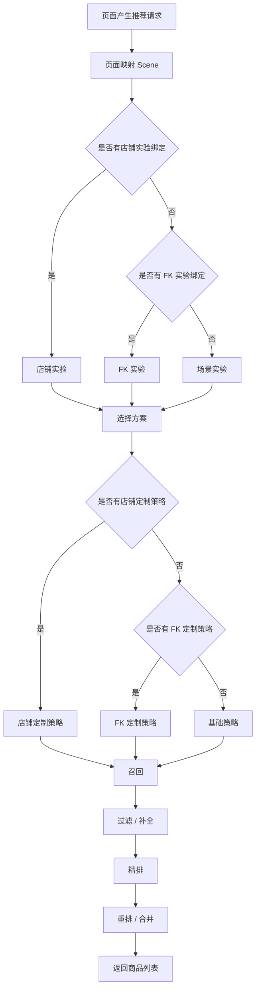
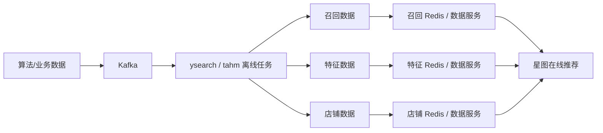
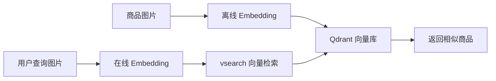

# 推荐工程整体业务背景

## 1. 推荐业务背景

### 1.1 我们在做什么

SHOPLINE 是服务商家经营独立站的电商平台。用户进入某个商家的店铺后，会浏览商品详情、商品列表、搜索结果或购物车等页面。商家希望用户能更容易发现感兴趣、愿意购买的商品，因此会在这些页面展示**商品推荐位**。

例如，一位用户正在浏览某家服装店的一件衬衫：

- **商品详情页**：推荐风格相似的衬衫，帮助用户找到替代选择。
- **购物车页**：推荐可以搭配的裤子、鞋子，提高加购机会。
- **商家首页**：推荐热门商品或更符合当前访客兴趣的商品。
- **搜索页**：在对应的业务配置下，为用户提供相关商品推荐。

这些都是推荐业务场景。**推荐系统并不是替商家开店或管理订单，而是根据当前场景，从店铺可用商品中挑出适合展示的商品，返回给业务页面。**

SHOPLINE 推荐工程中的在线执行系统称为**星图**。它服务多个业务入口，由不同的推荐插件、页面或后端调用；算法决定候选商品和推荐效果，工程负责让这些能力可靠、可配置地运行。

### 1.2 为什么不能直接推荐热门商品

最简单的实现是按销量或热度推荐商品。但不同用户、不同页面的需求不一样：

- **用户不同**：经常浏览运动鞋的用户和喜欢连衣裙的用户，兴趣可能不同。
- **页面不同**：商品详情页适合推荐相似商品，购物车更可能需要搭配商品。
- **店铺不同**：独立站商品规模和访问量差异较大；新店铺、新商品可能缺少足够的行为数据。
- **目标不同**：既希望用户愿意点击，也希望商品有购买价值，还要兼顾商品多样性、新鲜度和页面体验。

这就要求推荐系统既能使用用户行为、商品信息和算法模型，也能让算法同学针对不同场景、店铺和实验快速调整配置。

### 1.3 推荐业务希望达到什么效果

推荐系统的目标可以从三个角度理解：

**对访客**：更快找到感兴趣的商品，减少重复或不相关的推荐。

**对商家**：提高推荐位带来的点击、转化、订单及推荐引导 GMV 等业务效果。

**对平台与算法团队**：让召回、排序、重排等能力可以复用、定制和实验验证，并确保在线接口稳定、响应及时。

这里有一个重要区别：**推荐效果好，不等于推荐接口只要返回成功就行。** 接口可用性、延迟是工程运行指标；点击率、转化率等是业务效果指标。两类指标需要分别观察。

### 1.4 整体业务是怎样运转的

下面先看业务主线，不需要马上理解图中每个技术名词；第 2 章会逐一解释。

~~~mermaid
flowchart TD
    A["用户进入某个商家店铺的页面"] --> B["页面发起推荐请求"]
    B --> C["识别店铺与页面场景"]
    C --> D["选择实验、方案和策略"]
    D --> E["召回候选商品"]
    E --> F["合并 / 过滤 / 补全 / 排序 / 重排"]
    F --> G["向页面返回商品列表"]
    G --> H["用户曝光、点击、加购和下单"]
    H --> I["采集并加工效果数据"]
    I --> J["效果分析、实验评估与策略优化"]
    J -. "后续迭代" .-> D
~~~

同时，系统还存在一条**数据准备链路**：离线和实时任务加工商品、用户行为、召回及特征数据，经数据同步写入在线存储，供推荐请求读取。因此推荐工程不是只有一套在线 API，而是**数据准备、在线执行、配置实验、效果反馈**共同组成的业务系统。

### 1.5 站点范围

当前业务资料将推荐站点区分为：

- **EC10**：港台推荐。
- **EC20**：大陆推荐。

两个站点的页面编号、数据、配置和指标统计范围分别管理。同名页面在不同站点可能对应不同编号，不能因为知道店铺 ID 就直接推断站点，也不能把不同站点的数据合并统计。

具体页面编号和分析口径放在第 11 章；团队之间算法与工程的责任边界放在第 18 章。本章先建立对整体业务的认识。

---

## 2. 推荐业务的核心概念

本章统一使用一个例子：**用户进入某家服装店，正在查看一件白色衬衫，页面需要展示 6 件推荐商品。** 我们从这个例子出发，理解推荐系统如何准备数据、找到候选、做出选择，以及怎样验证推荐是否有效。

### 2.1 店铺、页面和场景（Store / Page / Scene）

首先区分三个概念：

**店铺**是商家自己的经营空间。不同店铺的商品、用户行为和推荐配置不能随意混用。

**页面**是访客看到的入口，比如商品详情页、购物车页、商品清单页。

**场景（Scene）**是推荐系统用来识别业务入口并选择推荐配置的标识。通常可以通过请求上下文和页面映射得到场景；实际编号按站点独立管理。

例如，同一位访客在同一家店铺：

- 进入**商品详情页**，系统可能优先推荐相似商品。
- 进入**购物车页**，系统可能优先推荐搭配商品。

虽然用户、店铺没有变，但**场景变了，推荐需求和执行方案也可能改变**。

场景不是实验，也不是召回算法。它首先回答的是：**“这次推荐发生在哪里？”**

### 2.2 特征与特征工程（Feature / Feature Engineering）

推荐系统要判断哪些商品可能适合用户，必须先获得关于**用户、商品以及用户和商品之间关系**的信息。这些供算法使用的信息就叫**特征**。

原始数据并不一定能直接用于算法。比如系统记录：

> 用户在过去 7 天浏览过 12 件衬衫、3 件牛仔裤，最近 5 分钟点击了一件白色衬衫。

**特征工程**就是把这些原始行为加工成算法可以直接使用的字段，例如：

- 用户特征：最近 7 天浏览衬衫的比例、最近一次浏览的品类。
- 商品特征：商品品类、价格、品牌、是否可售。
- 交叉特征：用户是否曾浏览当前商品，用户对该品类的偏好程度。
- 实时特征：最近几分钟的点击、浏览序列。

~~~mermaid
flowchart LR
    A["原始数据：浏览、点击、商品属性"] --> B["特征工程：清洗、统计、转换"]
    B --> C["可使用的特征"]
    C --> D["召回：找候选"]
    C --> E["排序：模型打分"]
    C --> F["策略：按条件调整"]
~~~

同一个特征可以被不同的推荐环节使用。比如“用户最近喜欢衬衫”既能帮助召回衬衫，也能帮助排序模型给衬衫打分。

按照数据更新速度，还可以区分：

- **离线特征**：由周期任务加工，如过去 7 天的偏好统计。
- **实时特征**：由实时行为或实时计算更新，如当前会话刚刚浏览的商品。

实际更新频率由数据生产链路决定，不能认为所有用户特征都天然实时。星图配置里出现的 userHistory、userLikeCate、userRealtimeHistory 等就是相关特征的例子。

**注意：这里的 Feature（模型特征）和后面介绍的 FeatureKey（FK，定制匹配键）不是同一个概念。**

### 2.3 召回（Recall）：先找出可能推荐的商品

一个店铺可能有几千、几万件商品，但页面最终只需要 6 件。系统通常不会对所有商品都执行复杂模型计算。

**召回**的任务是从大量商品中快速找出一批**可能适合当前请求的候选商品**。

仍然以白色衬衫详情页为例，推荐系统可能同时开启多条召回通道：

- **相似商品召回**：找款式、品类接近的衬衫。
- **用户兴趣召回**：根据用户最近的浏览偏好找商品。
- **热门召回**：找店铺最近卖得好或点击多的商品。
- **搭配召回**：找适合与衬衫搭配的裤子、配饰等。

~~~mermaid
flowchart TD
    A["白色衬衫详情页：发起推荐"] --> B["多路召回"]
    B --> C["相似商品：100 件"]
    B --> D["用户兴趣：100 件"]
    B --> E["店铺热门：100 件"]
    B --> F["搭配商品：100 件"]
    C --> G["合并候选商品"]
    D --> G
    E --> G
    F --> G
    G --> H["进入后续筛选和排序"]
~~~

以上数量仅用于演示。**多路召回结果可能重复**，所以四条通道各返回 100 件，不意味着一定得到 400 件不同商品。

在星图的历史配置中，storeHotRecall、store24HourHotRecall、userHistoryItemRecall、userLikedItemCfRecall 等就是不同类型的召回组件。

**召回回答“从哪里找商品”，不是“最终 6 件商品按什么顺序展示”。**

### 2.4 合并、粗排、过滤和补全：整理候选集合

召回的商品往往来源不同、质量参差不齐，通常还需要做一些处理。

**合并（Merge / Fusion）**：把多个召回通道的结果汇总，识别重复商品，并按配置融合相关分数或权重。同一件商品可能同时命中“热门”和“用户兴趣”，不需要在结果里重复展示。

**粗排（Pre-rank）**：用相对低成本的方法，先从较大的候选集合里选出更有希望的一部分，减少后续复杂模型的计算量。

**过滤（Filter）**：删除当前不能或不应该推荐的商品，例如已经下架、不可售、需要避免重复曝光的商品。

**补全/兜底（Complement / Fallback）**：当候选太少或过滤后数量不足时，按照配置从其他商品来源补充候选，避免页面没有可展示的商品。

举例：召回合并后有 200 件商品，过滤掉其中不可售和重复曝光的商品，最后只剩 4 件；如果页面需要 6 件，就可能使用兜底来源补足剩余数量。

这些组件的**具体先后顺序由方案决定**。不能把上面的教学例子当成所有场景的固定执行顺序。

### 2.5 排序（Rank）：判断哪件商品更值得推荐

召回已经找到了候选商品，但它们对当前用户的吸引力未必相同。**排序**负责对候选商品打分、比较，并确定优先级。

例如经过处理后，有三件候选商品：

- 商品 A：风格很相似，用户也经常浏览这类商品。
- 商品 B：店铺非常热门，但用户平时不太关注。
- 商品 C：价格合适，且属于用户近期感兴趣的品类。

排序模型可以综合用户、商品、场景和交叉特征，分别给它们计算预测分数，再根据目标进行排序。

~~~mermaid
flowchart LR
    A["候选商品 + 用户/商品/场景特征"] --> B["排序模型"]
    B --> C["商品 A：0.82"]
    B --> D["商品 C：0.75"]
    B --> E["商品 B：0.53"]
~~~

这些分数是示意值。**模型分数不一定就是点击概率**；具体代表点击、转化还是综合目标，要看训练标签和模型输出定义。

星图资料中的模型包括：

- **LR**：逻辑回归，结构较简单，可以用作轻量基准模型。
- **DeepFM**：适合学习不同特征之间的组合关系。
- **ESMM**：面向点击与转化等行为进行联合建模的模型。

因此可记住：**召回负责“找哪些”，排序负责“谁更靠前”。**

### 2.6 重排（Rerank）：把模型顺序变成最终展示顺序

即使商品按预测分数从高到低排列，也不一定符合页面体验和业务要求。

比如模型排出：

> 白色衬衫 A → 白色衬衫 B → 白色衬衫 C → 牛仔裤 D → 腰带 E

前三件商品太相似，页面看起来比较单一。**重排**可以根据业务规则、多样性或探索机制进一步调整顺序，例如：

> 白色衬衫 A → 牛仔裤 D → 白色衬衫 B → 腰带 E → 白色衬衫 C

星图资料里提到的重排形式包括**优先级重排、热度与兜底重排、汤普森采样、卡片重排**等。

其中汤普森采样（Thompson Sampling）主要体现“**探索与利用**”的平衡：既利用当前已经表现好的商品，也给尚不确定但可能有潜力的商品一定展示机会。

**排序是模型评分，重排是根据最终展示目标再次组织结果。**

### 2.7 策略和方案（Strategy / Solution）：决定调用哪些能力

到这里就有了召回、过滤、排序和重排等能力。但不同页面未必需要完全相同的组合。

**策略**描述一次推荐中具体使用哪些组件、如何组合和设置参数；**方案**是更上层的执行配置，可以把不同阶段的组件与实验配置组织起来。

例如一个“店铺热销商品推荐”策略可以简化理解为：

~~~yaml
storeHotSale:
  recallList:
    - name: storeHotSaleRecall
      size: 100
      weight: 100
  rankServiceName: lrCTRModelService
  rerankList:
    - compAndHotRerank
~~~

这个历史配置片段表示：

- 召回阶段使用 storeHotSaleRecall。
- 排序阶段调用 lrCTRModelService。
- 重排阶段调用 compAndHotRerank。

其中 size、weight 是对应组件的配置参数，不能直接当成最终得分。

在工程配置语境中，“策略”有时泛指整条执行流程，有时专指某个阶段的业务规则，需要根据所在层次理解。**策略本身不等于实验**：同一套策略可以作为实验中的一个方案，多个实验也可能复用它。

### 2.8 实验与 A/B 测试（Experiment / A/B Test）

如果算法同学想把“热门召回”换成“用户兴趣召回”，怎样知道新方案是否真的有效？

不能只凭主观感觉判断。**实验**就是让不同流量使用不同的方案，收集效果数据进行比较。

例如，假设实验计划把符合条件的访客分成两组：

~~~mermaid
flowchart TD
    A["符合条件的推荐请求"] --> B["实验分流"]
    B --> C["A 组：原有召回与排序配置"]
    B --> D["B 组：新召回与排序配置"]
    C --> E["收集曝光、点击、转化等指标"]
    D --> E
    E --> F["按相同口径比较实验效果"]
~~~

这里的 A/B 分组只是例子；实际分流比例、分组单位和命中条件由实验配置决定。

还要分清三件事：

- **场景实验**：对整个场景的推荐方案做实验。
- **功能实验**：对排序、重排等单个能力或参数做实验。
- **店铺/FK/场景绑定**：决定一个请求使用哪个实验配置，属于实验的命中或分流机制。

在分层绑定的方案中，店铺还能分别绑定 recall、rank、rerank 层级的实验。相关优先级和兼容逻辑放在第 12 章。

所以：**召回、排序和策略是在做推荐；实验是在验证不同推荐方法的效果。**

### 2.9 FeatureKey（FK）：比店铺更细的定制匹配条件

前面介绍的普通 Feature 是模型使用的数据，例如用户品类偏好；而星图定制架构中的 **FeatureKey（FK）是用来匹配定制配置的业务键**。

例如某个店铺希望对一类被特定业务规则圈选的请求单独使用实验或策略，可以把该条件组织为对应 FK，让在线推荐在命中 FK 时读取定制配置。

~~~mermaid
flowchart TD
    A["一次店铺推荐请求"] --> B{"是否命中店铺定制?"}
    B -- 是 --> C["店铺定制配置"]
    B -- 否 --> D{"是否命中 FK 定制?"}
    D -- 是 --> E["FK 定制配置"]
    D -- 否 --> F["基础配置"]
~~~

这张图只解释**定制配置的选择优先级**，具体实验绑定还需考虑第 12 章的分层逻辑。

FK 的具体取值、生成方式由业务定义。**不能把 userLikeCate 等模型特征直接当成 FK，也不能未经配置就从某个商品属性推断 FK 值。**

### 2.10 数据仓库、数据同步和 BI：推荐数据从哪里来

推荐不仅要在请求时做算法计算，还依赖数据准备与结果分析。这几个词要区分：

**数据仓库（Data Warehouse）**：集中保存并加工业务数据，便于进行统计、离线计算和模型训练。例如 Hive 中保存商品、浏览、点击等历史数据。

**数据同步**：把算法已经加工好的召回或特征数据送到在线系统，让星图能快速查到。项目中会涉及 Kafka、TiDB/CDC、Tahm、Redis、ES 等组件。

**BI（Business Intelligence，商业智能）**：把加工后的业务指标展示给产品、运营和算法同学，用于观察趋势、分场景分析和评估实验，而不是直接决定本次推荐哪件商品。

~~~mermaid
flowchart TD
    A["原始业务数据与事件"] --> B["数据仓库 / 数据加工"]
    B --> C["算法生成召回与特征"]
    C --> D["Kafka / 数据同步"]
    D --> E["Redis / ES 等在线数据"]
    E --> F["星图在线推荐"]
    F --> G["曝光、点击、转化等事件"]
    G --> B
    B --> H["效果指标 / BI 报表"]
    H --> I["算法与业务分析、优化"]
~~~

这张图表示典型逻辑关系，并非所有数据都必须先进入同一个仓库：实时行为也可能从实时计算链路直接产出特征。第 6 章介绍具体离线链路，第 19 章介绍 TiDB/CDC 同步及一致性规范。

可以这样区分：**数据仓库准备和沉淀数据，特征工程加工模型输入，数据同步把结果送到线上，BI 帮助人分析推荐效果。**

### 2.11 推荐效果指标：怎么判断有没有用

用户看到了推荐商品，叫作**曝光**；点击推荐商品，产生**点击**；后续按业务定义产生购买等行为，可以计入**推荐转化**。这些事件经过埋点和数据处理，形成效果指标。

最常见的三个比例是：

- **CTR（点击率）＝ 推荐点击量 ÷ 推荐曝光量**：展示出来的商品有多少被点击。
- **CVR（转化率）＝ 推荐转化量 ÷ 推荐点击量**：发生点击后，有多少带来了转化。
- **CTCVR ＝ 推荐转化量 ÷ 推荐曝光量**：从曝光到转化的整体比例。

此外还有订单和 **rec_gmv（推荐引导 GMV）** 等指标。具体分子分母、去重方式和归因规则以对应数据表及指标定义为准。

例如某一天，一个推荐场景有 1,000 次曝光、100 次点击、5 次转化，则：

- CTR = 100 ÷ 1,000 = **10%**
- CVR = 5 ÷ 100 = **5%**
- CTCVR = 5 ÷ 1,000 = **0.5%**

这些数只是教学示例。总体 CTR 不能直接平均各店铺或各实验组的 CTR，必须先汇总同口径的点击量与曝光量。

当前推荐成效数据以**按日 T+1** 为主，不等于在线实时 QPS、耗时或成功率。站点和页面的详细统计规则见第 11 章。

### 2.12 把这些概念串起来

回到开头的“用户正在看白色衬衫，页面需要 6 件商品”：

~~~mermaid
flowchart TD
    A["① 店铺 + 商品详情页：确定 Scene"] --> B["② 命中实验，选择方案和策略"]
    B --> C["③ 使用用户、商品等特征"]
    C --> D["④ 多路召回：兴趣 / 相似 / 热门 / 搭配"]
    D --> E["⑤ 合并、过滤，必要时补全"]
    E --> F["⑥ 排序模型打分"]
    F --> G["⑦ 重排后返回 6 件商品"]
    G --> H["⑧ 采集曝光、点击、转化"]
    H --> I["⑨ BI 分析效果，评估实验和策略"]
~~~

记住这条主线就够了：

**特征工程提供信息，召回找候选，排序判断优先级，重排组织展示；策略和方案决定用哪些组件，实验验证哪套配置更好；数据仓库和 BI 支撑效果分析。**

---


## 3. 整体架构


整体可以分成四部分：

- **配置控制面**：RAP 管理场景、实验、店铺/FK 绑定和定制策略，配置同步到 Nacos 和 Redis。
- **在线推荐面**：星图在线服务根据 Scene、实验和策略执行召回、过滤、补全、精排、重排和合并。
- **离线数据面**：算法和离线任务通过 Kafka、ysearch、tahm 等链路生成并同步召回数据和特征数据，供在线服务读取。
- **效果与稳定性**：离线产出每日推荐成效，工程侧按店铺和场景监控效果，同时通过限流、缓存、降级和扩缩容保证在线稳定性。


### 3.1 星图的分层技术架构（依据架构截图整理）

此前按“控制面、在线面、离线面、监控面”是**业务视角**的划分；从技术实现看，星图还能分成以下层次：

| 层次 | 主要组件 | 承担的事情 |
| --- | --- | --- |
| 应用层 | 商品推荐插件、智能落地页插件、组合商品推荐、应用市场、商家店铺首页 | 产生不同业务场景的推荐请求 |
| Web 层 | HTTP / Nginx、Dubbo RPC | 承接不同协议形式的服务访问 |
| 接入层 | 统一接入、负载均衡、限流降级、系统保护 | 控制流量入口、可用性和降级 |
| 管控层 | 场景、团队、方案、权限、实验、生命周期管理；在线服务容器；稳定性能力 | 管理配置和实验，将推荐执行方案组织到容器内 |
| 引擎层 | 搜索引擎、KV 引擎、向量引擎、排序引擎（特征、模型） | 提供候选查询、特征数据读取与模型推理 |
| 数据处理层 | Tahm、Transfer、Writer、UDF、HBase；模型训练 | 加工、转换、同步数据，支撑离线或实时数据准备 |
| 消息中间层 | Kafka、Pulsar、DRC-CDC | 消息传输、数据变更捕获 |
| 数据源 | TiDB、MySQL、Hive | 生产数据、关系数据和数仓数据来源 |

~~~mermaid
flowchart TB
    APP["应用层：推荐插件 / 智能落地页 / 组合商品 / 商家首页"]
    WEB["Web层：HTTP / Nginx / Dubbo RPC"]
    GW["接入层：统一接入 / 负载均衡 / 限流降级"]
    RUN["星图在线容器：场景 → 实验 → 方案 → 策略执行"]
    CTRL["管理控制面：场景 / 方案 / 实验 / 权限 / 生命周期"]
    STAB["稳定性：效果监控 / 服务指标 / 限流降级"]
    ENGINE["引擎层：搜索 / KV / 向量 / 排序（特征与模型）"]
    DATA["数据处理：Tahm（Transfer / Writer / UDF）与 HBase"]
    MQ["消息中间层：Kafka / Pulsar / DRC-CDC"]
    SOURCE["数据源：TiDB / MySQL / Hive"]
    TRAIN["模型训练与模型交付"]

    APP --> WEB --> GW --> RUN
    CTRL -. 配置 / 实验发布 .-> RUN
    STAB -. 运行保障 .-> RUN
    RUN --> ENGINE
    SOURCE --> MQ --> DATA --> ENGINE
    SOURCE --> TRAIN
    TRAIN --> ENGINE
~~~

这张图表示**组件分层与依赖关系**，不是要求每次请求逐一经过所有节点。尤其管控层的管理功能不是推荐请求的必经计算步骤；Tahm/消息中间件主要负责准备在线数据。

### 3.2 在线容器中的场景、实验、方案

截图中的容器呈现了清晰的层级关系：

~~~mermaid
flowchart TD
    S["集群 / Server"]
    S --> SC["场景 Scene"]
    SC --> E1["实验 A"]
    SC --> E2["实验 B"]
    E1 --> P1["方案 A 与实验配置"]
    E2 --> P2["方案 B 与实验配置"]
    P1 --> C1["召回 → 合并 → 过滤 → 排序 → 重排"]
    P2 --> C2["召回 → 合并 → 过滤 → 排序 → 重排"]
    S --> FAAS["FAAS 容器：运行方案"]
    FAAS -. 执行 .-> C1
    FAAS -. 执行 .-> C2
~~~

- **场景（Scene）**：决定当前页面或业务入口需要什么推荐能力。
- **实验（Experiment）**：让不同流量命中不同配置，用于验证效果。
- **方案（Solution）**：封装此次实验/场景要执行的推荐流程。
- **策略/组件（Strategy / Component）**：落实召回、合并、过滤、排序、重排等具体步骤。
- **FAAS 容器**：截图里的方案运行容器概念，不能仅凭名称推断所有节点都独立无状态或分别弹性部署。

### 3.3 星图支撑的业务场景

截图展示的星图业务入口包括：**商品推荐、商家首页卡片推荐、会员方案推荐、应用推荐、营销组合商品/加购品、风控图搜、AIGC、AI 导购机器人（Demo）**。

这些入口说明星图面向多个业务产品复用推荐/检索能力，**不是说所有业务入口都执行相同的召回、排序、重排链路**。其中 AI 导购明确标注 Demo，不能直接作为正式上线的证据。

---

## 4. 在线推荐流程

一次推荐请求的核心决策分成三层：**先确定场景，再确定实验/方案，最后确定策略并执行推荐链路。**



当前优先级可以概括为：

```text
实验选择：店铺实验 > FK 实验 > 场景实验
策略选择：店铺定制策略 > FK 定制策略 > 基础策略
```

这套设计让平台保留统一基础策略，同时支持特定店铺或 FeatureKey 做局部定制。


### 4.1 星图在线能力与各环节的关系

从提供的“星图在线能力”图看，完整能力包含**分层限流降级、A/B 实验、多通道召回、融合粗排、过滤、补全兜底、模型精排、重排、Summary 和配置**。其中限流、实验和配置属于横向的控制能力，不应该全部当成顺序执行的算法步骤。

| 能力 | 解决的问题 | 典型操作 |
| --- | --- | --- |
| 分层限流降级 | 服务压力过大时如何保障可用性 | 根据流量等级跳过成本较高的步骤或启用降级 |
| A/B 实验 | 哪组方案/参数真正带来效果提升 | 不同用户/流量命中不同实验版本 |
| 多通道召回 | 去哪里找足够多且相关的商品 | 同时取热门、协同、相似商品、个性化候选 |
| 融合/粗排 | 多通道结果怎样合并并提前筛选 | 去重、融合得分、筛掉明显不相关候选 |
| 过滤 | 哪些商品不允许进入结果 | 库存/可售、已曝光、业务规则过滤 |
| 补全兜底 | 候选数太少或无结果怎么办 | 补足商品、使用店铺热门商品等兜底结果 |
| 模型精排 | 哪些候选更可能点击/转化 | LR、DeepFM、ESMM 等模型预测并打分 |
| 重排 | 如何形成最终的展示序列 | 优先级、热度/兜底、Thompson 采样、卡片重排 |
| Summary | 怎样整理最终结果 | 汇总/包装商品信息与输出结构；具体逻辑以实现为准 |
| 配置 | 怎样便捷替换每个步骤 | 按场景/实验/方案配置召回、过滤、排序与重排服务 |

具体执行先后由方案和策略配置控制，**不代表每次请求所有环节都实际运行**。

### 4.2 召回的四类业务视角

截图按**场景、用户、热度、冷启动**解释召回。它们是便于理解的切入角度，并非四个完全互斥的算法类型：

| 召回视角 | 典型含义 | 示例 |
| --- | --- | --- |
| 场景召回 | 根据当前推荐入口和上下文找商品 | 商品详情页相关商品、购物车搭配商品 |
| 用户召回 | 利用用户偏好与行为找商品 | 历史浏览、兴趣品类、协同过滤 |
| 热度召回 | 利用全局或店铺局部热门信号找商品 | 店铺热门、近 24 小时热门、实时点击热门 |
| 冷启动召回 | 用户或商品行为少时保证候选 | 新用户地域相关、店铺热门、新品探索 |

**冷启动是待解决的业务问题，不只是一个固定召回组件**；它可能同时使用热度、地域、场景等通道。

### 4.3 排序模型与重排方式

原资料中的模型精排示例：

- **LR**：逻辑回归，常作轻量级点击率基准模型（benchmark）。
- **DeepFM**：组合低阶特征与高阶非线性特征交互的深度模型。
- **ESMM**：针对点击与转化行为建模的多任务模型；是否用于哪一类业务目标，仍要看实际训练标签与模型服务配置。

**精排预测商品得分，重排根据多样性/业务规则等调整最终展示顺序**。重排能力示例：

| 重排形式 | 一般作用 |
| --- | --- |
| 优先级重排 | 将需要优先展示的类别或商品前移 |
| 热度与兜底重排 | 结合热门商品与兜底商品调整展示 |
| Thompson Sampling（汤普森采样） | 在探索与利用之间进行概率性选择 |
| 卡片重排 | 针对商家首页等卡片形式重新编排展示位置 |

这些是平台支持或讨论的能力类型，不代表所有场景全部启用，也不能仅凭名称推断具体的打分公式。

---

## 5. 配置与实验体系

推荐配置主要由 RAP、Nacos 和 Redis 三部分组成。

### RAP

RAP 是业务配置入口，主要管理：

- 场景及实验配置
- 店铺与场景实验绑定
- FeatureKey 实验绑定
- 店铺定制策略
- FeatureKey 定制策略

### Nacos

Nacos 保存在线推荐运行需要的配置，核心包括：

| 配置 | 作用 |
| --- | --- |
| scene-configs | 场景及场景配置 |
| ab-configs | 实验、应用和策略配置 |
| solution-plugin-configs | 推荐方案配置 |
| flow-controls | 页面与 Scene 的映射 |
| data-sources / data-services-go | 数据源和数据服务 |
| recall-services | 召回能力配置 |
| filter-services | 过滤配置 |
| complement-services | 补全配置 |
| rank-services-go | 精排配置 |
| rerank-services | 重排配置 |
| recommend-strategies | 基础推荐策略 |
| base-strategies | 基础策略定义 |
| store-strategy-configs | 店铺定制策略 |
| cache-configs | 推荐缓存配置 |
| sentinel.rule | 限流和降级配置 |

### Redis

定制策略的具体内容会同步到 Redis，供在线推荐服务快速读取；Nacos 同时保留是否存在定制策略等控制信息。


### 5.1 配置分层：场景、策略、组件

从星图的配置体系看，“配置能力强”不是单指 Nacos 保存参数，而是**推荐执行链路的每一步都可以按场景和实验选用不同组件**：

| 配置类型 | 核心问题 | 相关配置或组件 |
| --- | --- | --- |
| 场景配置 | 当前页面应选择哪套方案 | scene-configs、flow-controls、场景/实验绑定 |
| 策略配置 | 一套方案如何组合召回、合并、过滤、补全、排序与重排 | recommend-strategies、base-strategies、店铺/FK 定制策略 |
| 召回配置 | 候选商品来自哪一路、各取多少、以什么方式融合 | recall-services、data-sources、recallList（含 size、weight） |
| 精排配置 | 选哪个模型、需要哪些特征、请求如何构造、执行等级和超时 | rank-services-go、rankServices、needFeatures |
| 重排配置 | 按什么规则调整模型排序后的展示顺序 | rerank-services、rerankList |
| 通用运行配置 | 限流、兜底、缓存、实验和发布 | sentinel.rule、cache-configs、ab-configs 等 |

配置之间的关系可以概括成：**场景命中实验 → 选择方案/策略 → 装配召回和排序等组件 → 执行**。其中“策略”既可以指完整推荐流程的编排，也可能在具体模块里指一条局部规则，理解时要结合对应配置层级。

### 5.2 精排服务模型配置（测试环境示例）

提供的星图测试配置包含四个精排服务：

| rankServices 名称 | modelId | 服务用途（按名称理解） | version | timeout | needLevel | needFeatures |
| --- | --- | --- | ---: | ---: | ---: | --- |
| lrCTRModelService | lr | LR 点击率模型 | 1 | 300 | 2 | userRealtimeHistory、ipAddress |
| deepFmModelService | deepfm | DeepFM 深度模型 | 1 | 300 | 未显式配置 | userRealtimeHistory、ipAddress |
| hotScoreRankService | ams3 | 热度/得分相关模型服务 | 1 | 300 | 未显式配置 | userRealtimeHistory、ipAddress |
| cardRankService | card | 卡片排序服务 | 1 | 300 | 3 | 原片段未显式配置 |

模型请求会根据模板组装输入，调用对应模型服务，再解析为统一的 RankResult。测试样例的路由分别是：

- lrCTRModelService：ai-star-atlas-djl-test.inshopline.com/api
- deepFmModelService：ai-star-atlas-djl-test.inshopline.com/deepfm/api
- hotScoreRankService：ai-star-atlas-djl-test.inshopline.com/hot/api
- cardRankService：api-ads-fs-test.inshopline.com/card-rank/rank

**这些是历史测试环境地址，不是生产调用地址或建议硬编码的接口。** 示例中的 timeout 均为 300，单位要按服务实现确认，不能仅凭 YAML 猜测。未填写 needLevel 的模型不能凭空补一个固定等级。

### 5.3 精排请求的字段与数据流

请求模板的主要结构可以概括为：

~~~json
{
  "data": {
    "contexts": {
      "userId": "用户标识",
      "storeId": "店铺标识",
      "appId": "应用标识",
      "pageType": "页面类型",
      "productsId": ["相关商品ID"],
      "traceId": "链路追踪ID",
      "ip": "可选地域/IP信息",
      "isMobile": "可选设备信息",
      "ipAddress": "可选IP特征",
      "userRealtimeHistory": [
        {"id": "历史商品ID", "score": 0.8}
      ]
    },
    "items": [
      {
        "id": "候选商品ID",
        "score": 0.1,
        "maxScore": 0.4,
        "recallIds": [1, 2]
      }
    ]
  }
}
~~~

上述 JSON **仅用于解释字段结构**，数值和 ID 为示意值，并非真实线上请求，也不是可以原样发送的完整模板。实际配置中的 request 是带条件判断、字段拼接与集合循环的模板字符串：

| 字段 | 来自哪里 / 用来做什么 |
| --- | --- |
| contexts.userId、storeId、appId、pageType | 请求上下文，标识用户、店铺、应用与页面 |
| contexts.productsId | 当前关联的商品或请求商品集合 |
| contexts.traceId | 串起星图和模型服务的一次请求 |
| contexts.ip、isMobile、ipAddress | 可选的地域、设备和 IP 特征 |
| contexts.userRealtimeHistory | 由用户实时历史特征构造的 item/score 列表 |
| items[].id | 召回/预处理阶段得到的候选商品 |
| items[].score、maxScore | 上游候选的相关分数 |
| items[].recallIds | 候选命中的召回通道标识，可用于模型和效果分析 |

卡片排序请求的候选 ID 有单独的 cardId 格式处理，且原例没有要求与商品排序模型完全相同的特征列表。统一的 response 类型为 com.joyy.shopline.star.atlas.commons.entity.result.RankResult。

### 5.4 needFeatures、needLevel 和降级的区别

- **needFeatures**：声明调用该排序组件前需要准备的特征键（如 userRealtimeHistory、ipAddress）；这与第 14 章召回/场景所需特征是同一个配置理念，实际会通过特征服务读取。
- **needLevel**：控制该排序服务在什么流量等级下可运行，属于在线分层执行和降级管理的一部分；**不是模型质量等级**。
- **timeout**：控制模型服务请求超时，属于服务调用的运行时约束，不能用它衡量离线训练耗时。

例如截图中 LR 的 needLevel 为 2、卡片模型为 3；第 17.5 节的应急预案通过把指定排序服务 needLevel 从 3 改为 4，使正常 level3 流量跳过该服务。**这些配置来自不同阶段/环境，不应合并成一份当前线上配置。**

---

## 6. 离线数据链路

推荐在线服务依赖大量提前生成的数据，主要包括召回数据、商品/用户特征和店铺数据。



港台推荐 ToAll 后，召回和特征从 Beta 数据逐步切换为全量数据，并通过独立 Kafka Topic 和 Redis 集群支撑线上推荐。

---

## 7. 推荐效果数据

推荐工程不仅负责“返回什么商品”，还需要持续判断推荐是否有效。

核心效果指标包括：

| 指标 | 含义 |
| --- | --- |
| 曝光 | 推荐商品被展示的次数 |
| 点击 | 推荐商品被点击的次数 |
| 转化 | 推荐带来的转化次数 |
| CTR | 点击 / 曝光 |
| CVR | 转化 / 点击 |
| CTCVR | 转化 / 曝光 |
| 推荐引导 GMV | 推荐链路产生的 GMV |

效果数据按日离线产出，当前分析口径以 T+1 为主。港台已经支持把推荐成效展示给商家，工程侧进一步按店铺和场景维护效果曲线，并监控明显突变，用于发现工程异常或辅助算法调整策略。

---

## 8. 在线稳定性

推荐服务支持四类主要干预方式：

- **限流降级**：通过 Sentinel 按页面或店铺限制流量等级。
- **缓存降级**：按 Scene 或店铺开启自动/手动缓存，降低后端压力。
- **排序降级**：模型或特征服务出现瓶颈时，可通过 rank 配置跳过精排。
- **扩缩容**：在线容器或 Redis 出现容量瓶颈时进行人工扩容。

稳定性控制的粒度与业务对象一致，主要围绕**页面、Scene、店铺和推荐执行阶段**展开。

---

## 9. 扩展能力

### FeatureKey 定制推荐

FeatureKey 用来表达更细的业务或商品特征条件。基础配置可以声明某个召回需要的 FeatureKey，RAP 再基于 FK 圈选实验和定制策略，实现比店铺粒度更细的推荐控制。

### 图搜 / 向量检索

港台图搜是推荐工程中的独立检索能力：



离线侧把商品图片向量写入 Qdrant；在线侧生成查询图片向量，通过 vsearch 检索相似商品。

---

## 10. 业务链路总结

推荐工程可以归纳成一条主链路：

```text
页面
→ Scene
→ 实验/方案
→ 策略
→ 召回
→ 过滤/补全
→ 精排
→ 重排/合并
→ 推荐结果
→ 曝光/点击/转化
→ 效果监控与策略调整
```

其中 RAP/Nacos/Redis 负责控制“**怎么推荐**”，Kafka/ysearch/tahm/数据服务负责准备“**拿什么数据推荐**”，星图在线服务负责执行“**本次请求具体推荐什么**”，效果数据和监控负责判断“**推荐得怎么样**”。


---

## 11. 业务分析口径与 Agent 公共背景

本节记录业务分析 Agent 的共同约束。**业务事实、指标定义、分析规则和权限边界应明确区分**：其中敏感指标限制属于 Agent 查询与输出约束，不代表数据仓库中不存在对应字段。

### 11.1 站点与页面映射

- **EC10**：港台推荐站点。
- **EC20**：大陆推荐站点。
- 两站的数据、页面映射和业务维度独立。店铺 ID 本身不能确定站点；缺少站点依据时不能默认选择，也不能跨站点混合分析。

| 页面名称 | EC10 场景编号 | EC20 场景编号 |
| --- | ---: | ---: |
| 全部 | 0 | 0 |
| 商品详情页 | 1 | 1 |
| 商品清单页 | 2 | 2 |
| 搜索页 | 3 | 4 |
| 所有商品页 | 4 | — |
| 购物车页 | 5 | 5 |
| mini购物车页 | 6 | 3 |
| blog页 | 7 | — |
| 订单完成页 | — | 7 |
| 404页 | — | 8 |
| 推荐落地 | — | 10 |

**规则**：仅允许在站点内部映射页面名称；未登记编号不可推断；mini购物车页和购物车页不能混为一谈；也不能仅凭页面名称反推站点。

### 11.2 效果指标与统计规则

| 指标 | 口径 |
| --- | --- |
| 推荐曝光量 | 推荐商品的曝光事件数 |
| 推荐点击量 | 推荐商品的点击事件数 |
| 推荐转化量 | 按对应推荐转化事件口径统计 |
| 推荐订单 | 推荐引导的订单相关指标，具体以查询字段定义为准 |
| CTR | 推荐点击量 ÷ 推荐曝光量 |
| CVR | 推荐转化量 ÷ 推荐点击量 |
| CTCVR | 推荐转化量 ÷ 推荐曝光量 |
| rec_gmv | 推荐引导 GMV；未限定的“GMV”按此含义理解 |

**禁止向分析 Agent 公开的指标**：store_gmv、store_gmv_per_user、rec_gmv_ratio。命中其中任一项时，整轮停止；不得生成查询、比较、排序、归因、计算或展示任务，也不得利用公开指标反推或偷偷改用替代指标。

统计与解释还需遵守：

1. **过滤、分组、比较是不同动作**。出现某维度不代表自动按它分组或对比。页面、店铺、推荐模式、策略、召回、实验分组各有不同业务角色。
2. **整体不能与子范围重复计算**。汇总比例必须按同口径汇总分子、分母后计算，而非直接平均各组比例；control/treatment 由本次请求明确赋予，不能猜测。
3. **数据状态不能混淆**。“无数据 / 覆盖不足 / 不可计算 / 能力不支持 / 查询失败 / 0”分别表达；null 依据返回状态解释，未返回的指标不能声称已返回。
4. **效果数据按日 T+1 产出**。未特别说明包含今天的最近 N 天，以昨天作为最新完整日；明确请求今天则保留今天；不能因无数据擅自扩大时间范围。这一口径不适用于实时运行流量。
5. **诊断数据不等于完整生产流量**。推荐请求量/PV、系统 QPS/耗时/错误率、店铺局部 Top 候选诊断捕获不能混算。未捕获不代表正常，capture_rate 不是真实故障率。
6. **结论与证据匹配**。异常、时间重合、变化贡献或数据结构变化，都不能单独证明原因；未查询、查询失败、无数据、证据不足、已排除是不同状态。

### 11.3 关键业务概念辨析

| 概念 | 回答的问题 | 例子 |
| --- | --- | --- |
| Scene / 页面场景 | 在什么推荐入口执行 | 商品详情页、搜索页 |
| 召回 Recall | 从哪里找候选商品 | 热门召回、协同过滤召回 |
| 排序 Rank | 如何给候选商品打分并排序 | ESMM 模型 |
| 重排 Rerank | 如何调整排序后结果 | 打散、约束、重新组织 |
| 策略 Strategy | 一次请求组合、执行哪些能力 | 哪些召回、过滤、排序、重排 |
| 实验 Experiment | 不同流量使用哪一套配置 | 场景实验、店铺圈选实验 |
| FK / FeatureKey | 用于定制配置匹配和分流的业务维度键 | 某个 FK 绑定对应实验或策略 |
| 特征 Feature | 模型和策略判断使用的数据 | 用户行为历史、商品属性 |

**特别注意**：实验不等于策略或召回；“按策略对比”和“按召回对比”也不自动等于 A/B 实验。FK 不是通常意义上的一个模型特征字段，而是这套推荐定制架构中的业务匹配键，具体语义由对应 FK 定义决定。

---

## 12. 推荐实验分流与分层绑定

### 12.1 原有实验选择

原有场景下，店铺可绑定圈选实验；否则按 FK 实验或场景实验进入分流。没有明确分组角色时，不应假设实验编号与 control / treatment 一一对应。

~~~mermaid
flowchart TD
    A[星图请求开始] --> B{存在店铺绑定实验?}
    B -- 否 --> C[使用场景实验分流]
    B -- 是 --> D{店铺绑定为层级绑定?}
    D -- 否 --> E[兼容旧绑定逻辑分流]
    D -- 是 --> F[读取该店铺已绑定的层级实验]
    F --> G[缺失层级由对应场景实验补齐]
    C --> H[生成本次实验方案]
    E --> H
    G --> H
    H --> I[执行推荐方案]
~~~

这里的旧逻辑兼容、场景兜底和层级拼装，是提供的《RAP 店铺绑定支持层级方案》的目标设计；**不代表已验证线上全部完成部署**。

### 12.2 为什么需要分层

**旧问题**：一个店铺只能参加一个圈选店铺实验组；如要调整召回、排序、重排，往往要在一个实验中同时组织三部分。

**新目标**：圈选店铺实验按三个层级拆分，一个店铺可以同时参加三个不同层级的实验，分别定制：

| 层级 | 枚举值 | 修改内容 |
| --- | --- | --- |
| 召回层 | recall | 候选商品怎么找 |
| 排序层 | rank | 候选商品怎么打分和排序 |
| 重排层 | rerank | 排序结果如何组织 |
| 兼容旧配置 | 空值 | 按旧绑定分流逻辑解释 |

同一个店铺在**同一场景、同一层级**最多参与一个圈选实验绑定；一个绑定只对应一个层级。不同层级的绑定最终组合成完整的推荐方案，缺失层级使用相应的场景实验补齐。

### 12.3 数据协议和改造范围

| 位置 | 改造内容 |
| --- | --- |
| MySQL：bind_scenes | 新增 bind_layer 字段，默认空 |
| Nacos：store-scene-configs | 绑定配置增加 bind_layer 字段，默认空 |
| RAP API / server / service | 绑定场景协议透传 bind_layer，支持分层 CRUD 和发布 |
| RAP 页面与校验 | 可选 recall / rank / rerank；同店铺同场景同层级最多配置一次 |
| 星图后端 | 读取 bind_layer；兼容空值；拼接多层店铺实验和场景缺省实验 |

发布顺序：**先升级星图后端兼容新旧协议 → 再发布 RAP → 算法同学将场景绑定配置逐步切到指定层级**。避免在新字段生效前让老服务读取无法理解的配置。


### 12.4 场景实验与功能实验的区别

平台文档还将 A/B 实验区分为两类，这个分类与前面的 **店铺/FK/场景绑定优先级** 不属于同一维度：

| 类型 | 实验范围 | 典型例子 |
| --- | --- | --- |
| **场景实验** | 对某个场景的整体推荐方案进行流量分组；可定制完整的方案、策略配置 | A 组使用旧推荐方案，B 组替换召回 + 排序的整体组合 |
| **功能实验** | 针对某个具体能力、配置参数做实验 | 只调整重排规则、精排参数，或单个功能的权重 |

因此：
- **场景实验 vs 功能实验**：区分实验要验证的对象和范围。
- **店铺绑定 vs FK 绑定 vs 场景默认**：区分一个请求怎样找到实验配置。
- **recall / rank / rerank 的分层店铺实验**：区分可替换的推荐执行层级。

这三套概念可以叠加使用，不能把功能实验直接等同于 bind_layer，也不能把召回策略配置当作已经执行过的 A/B 实验。

---

## 13. 推荐定制化架构演进

### 13.1 改造前

原推荐系统由星图统一承接请求，按四个主要在线服务能力执行推荐；定制能力和离线计算较多直接位于原架构中。

~~~mermaid
flowchart TB
    X[星图在线推荐] --> A[特征服务]
    X --> B[召回引擎]
    X --> C[配置管理]
    X --> D[排序服务]
    E[算法离线计算: 店铺策略 / 店铺实验 / 特征数据] --> F[Kafka]
    G[定制策略与实验库] --> F
    F --> H[tahm 数据同步]
    H --> A
    H --> B
    H --> C
    I[通用算法模型] --> J[模型同步]
    J --> D
~~~

- 特征服务：service、特征 Redis。
- 召回引擎：召回 ES、召回 Redis。
- 配置管理：动态配置、策略 Redis。
- 排序服务：Rank service、特征 Redis、模型。
- 数据同步：Kafka → tahm；模型走单独的模型同步链路。

### 13.2 改造后：算法运营平台与推荐执行解耦

~~~mermaid
flowchart LR
    subgraph FK[算法运营平台]
        UI[FK 管理页面] <--> S[FK service]
        S <--> DB[(FK 库)]
        S <--> CA[(Cache)]
        A[(业务 FK 库)] --> T[tahm]
        B[(智能 FK 库)] --> T
        T --> DB
    end
    S -- API --> C[星图在线服务/引擎层]
    S -- FK 流 / SDK --> O[算法离线计算层]
    O --> K[Kafka]
    K --> T2[tahm 同步]
    T2 --> C
    M[店铺定制模型] --> MS[模型同步]
    MS --> C
~~~

改造方向是：**把 FK 的管理和业务/智能 FK 数据来源集中到算法运营平台**；星图仍负责在线执行，离线计算仍负责店铺策略、实验、召回、特征、模型等结果准备。图中的 FK 管理页面、FK service、FK 库和 Cache 是控制面；不要将其误解成替代在线召回/排序的独立推荐引擎。

推荐定制能力覆盖：召回、排序、重排；离线侧可细分店铺定制策略、店铺定制实验、定制基础策略、店铺定制召回、店铺定制特征、店铺定制模型等。

### 13.3 FK 绑定与在线优先级

~~~mermaid
flowchart TD
    A[星图容器] --> B{是否有店铺实验绑定?}
    B -- 是 --> C[店铺绑定实验]
    B -- 否 --> D{是否有 FK 实验绑定?}
    D -- 是 --> E[FK 绑定实验]
    D -- 否 --> F[场景实验]
    C --> G[执行方案]
    E --> G
    F --> G
    G --> H{是否有店铺定制策略?}
    H -- 是 --> I[店铺定制策略]
    H -- 否 --> J{是否有 FK 定制策略?}
    J -- 是 --> K[FK 定制策略]
    J -- 否 --> L[基础策略]
    I --> M[执行策略]
    K --> M
    L --> M
~~~

这是提供的 FK 在线选择流程。**店铺绑定优先于 FK 绑定，FK 优先于场景默认；策略选择同样优先店铺定制，然后 FK，最后基础策略。**分层店铺实验是对第一步“店铺绑定实验”内部组装方式的扩展，不能直接把它理解成放弃原有优先级。

### 13.4 Roadmap（原方案规划，不视为当前完成状态）

| 阶段 | 规划 |
| --- | --- |
| Q1 | 对齐推荐 2.0 定制化能力 |
| Q2 | FeatureKey 定制能力开发（RAP、在线及算法运营平台）并灰度 |
| Q3 | 基于 FeatureKey 的定制解决方案 A/B 实验；离线计算定制化 |
| Q4 | 收集效果数据并检查目标达成情况 |

原始目标中“积累 X 个解决方案”和“单店铺成本从 $X 降到 $Y”属于**尚未给出数值的目标占位**，不能当作已实现结果。

---

## 14. 页面、召回与 Feature 配置实例

### 14.1 场景配置

原变更记录 **REC-819**：在 app-configs 中为商品清单页、搜索页、所有商品页新增场景及默认召回列表，在 flow-control 中配置场景编号。

| 场景配置 Key | 场景 ID | 主要召回 |
| --- | ---: | --- |
| collectionPage | 2 | 热门、近 24 小时热门、用户兴趣/历史、协同过滤、品类、搭配、列表相关 |
| searchPage | 3 | 热门、近 24 小时热门、用户兴趣/历史、协同过滤、品类、搭配 |
| allProducts | 4 | 热门、近 24 小时热门、用户兴趣/历史、协同过滤、品类、搭配 |

文档示例里的召回组件名：

~~~yaml
strategies:
  default:
    - storeHotRecall
    - store24HourHotRecall
    - userLikedItemRecall
    - userLikedItemCfRecall
    - userHistoryItemRecall
    - userHistoryItemCfRecall
    - userLikeCateRecall
    - userLongHistoryItemRecall
    - coAddonItemRecall
    - listRelatedRecall  # 原例仅 collectionPage 包含
~~~

其中 collectionPage 原始配置出现两次 userLikeCateRecall，整理时按不同召回组件去重展示；**不能由此判断实际运行时是否故意重复执行**。

原方案列出的特征需求：

~~~yaml
needFeatures:
  - userHistory
  - userLikeCate
  - userLikeTag
  - userRealtimeHistory
  - userLikeCateRealtime
  - userLikeTagRealtime
  - userLikeCateV3  # 原例在 collectionPage / allProducts 中列出
~~~

~~~yaml
flow-control:
  collectionPage:
    sceneId: 2
    percent: 1
    storeId: []
  searchPage:
    sceneId: 3
    percent: 1
    storeId: []
  allProducts:
    sceneId: 4
    percent: 1
    storeId: []
~~~

**注意**：这里的 sceneId 示例与 EC10 页面映射一致；配置里的 percent: 1、storeId: [] 应以当时配置协议解释，不要直接推断为生产流量百分比或店铺覆盖范围。

### 14.2 相关上线记录

| 任务 | 改动 | 涉及环节 |
| --- | --- | --- |
| REC-822 | 增加分类 / 列表相关召回 | 离线 ec15_rec_recall 发布 list_related_item_v1、Kafka/数据灌入检查；在线 data-services、recall-services；RAP 新增召回配置 |
| REC-821 | 库存可售判断改用 total_orderable_quantity | filter、complement、summary 的 filter |
| REC-820 | 增加每日推荐成效明细 | 离线 ysearch ec15_data_daily、灌入及校验；在线 ysearch ec15_rec_api |
| REC-819 | 新增三个页面推荐场景 | app-configs、flow-control、RAP 场景实验配置 |

任务编号只标识原文记录，**不能单凭记录推断已上线或当前使用的版本**。

---

## 15. 港台图搜与向量检索

图搜用于按图片相似度找商品，和基于业务场景配置的推荐链路相关，但并非同一条普通的召回-排序链路。

### 15.1 离线索引构建

~~~mermaid
flowchart LR
    P[商品图片表] --> K[Kafka]
    K --> E[离线 Embedding 生成]
    E --> K2[Kafka]
    I[商品基础信息] --> K2
    K2 --> T[tahm]
    T --> H[(HBase)]
    T --> Q[(Qdrant 向量引擎)]
~~~

- Embedding（向量）是将图片转换为可计算相似度的数值表示。
- 商品基础信息与图片向量一起参与入库与索引构建。
- HBase 与 Qdrant 在示意中分别承载相应数据；向量近邻查询由 Qdrant 完成。

### 15.2 在线查询

~~~mermaid
flowchart LR
    U[智能导购后端] --> V[vsearch 向量检索服务]
    V --> E[在线 Embedding 生成]
    V --> Q[(Qdrant 向量引擎)]
    E --> V
    Q --> V
    V --> R[返回相似商品候选]
~~~

调用入口是智能导购后端，vsearch 负责发起相似向量检索，在线生成查询图像 Embedding 后使用 Qdrant 找到近似商品。

---

## 16. 推荐算法能力开放

### 16.1 背景与现状

算法中心覆盖搜索、推荐、风控、NLP、图像等方向。以推荐为例，原资料称主站已有 **23 个推荐场景**，主要通过 product backend 包装成三种接入形态：

| 接入形式 | 使用方 | 当时的开放情况 |
| --- | --- | --- |
| 内部后端服务 | 推荐插件、营销插件及多数推荐场景 | 内部使用，未直接对外 |
| Ajax | 主题内推荐 | 可通过 Ajax 接入有限推荐能力 |
| Storefront GraphQL | 无头电商、第三方开发者 | 与 Ajax 能力相近 |

当时 Ajax 和 Storefront 主要开放**单商品相关商品推荐**，与大量内部场景能力不对等。以上属于方案调研时点的描述，并非对当前所有 API 能力的实时核验。

### 16.2 问题和设计方向

- **接口层级不合理**：推荐插件依赖内部 API，而插件对外能力应进入统一开放 API 体系。
- **交叉依赖**：营销插件等也依赖商品后端内部接口。
- **迭代成本高**：算法能力对外迭代需要多个业务方配合。

目标是将推荐开放能力统一管理，通过规范的对外接口提供能力，使算法能力演进与调用方相对解耦，减少跨服务交叉依赖。

原始方案提及推荐插件安装后可使用 Storefront API 及埋点接口，但资料同时标注**相关 Storefront 文档当时尚未公开**，不能视为已全面开放或保证权限可用。

### 16.3 相关链接

- [SHOPLINE Storefront 商品推荐接口](https://developer.shopline.com/zh-hans-cn/docs/storefront-api/products/queries/product-recommendations)
- [SHOPLINE Ajax 商品推荐接口](https://developer.shopline.com/zh-hans-cn/docs/ajax-api/product/product-recommendations)
- [Shopify Storefront 对照](https://shopify.dev/docs/api/storefront/latest/queries/productRecommendations)
- [Shopify Ajax 对照](https://shopify.dev/docs/api/ajax/reference/product-recommendations)
- [推荐能力开放需求：商品推荐开放 API](https://shopline.yuque.com/slpm/svh090/dfgr1si7g1wlg4yk?singleDoc#)
- [推荐埋点使用说明](https://docs.google.com/document/d/19ZDP_KfahYChX0FflDzMpqYuXjWZZVoxl_ymnKRlPX0/edit)
- [推荐能力相关产品文档](https://shopline.yuque.com/chkdwd/ocnnz4/xvpg6zqyyz9y169z?singleDoc#)

---

## 17. 推荐运行监控与操作预案

**区分两个层次**：下表是运行稳定性监控（在线接口、容器、Redis、Kafka），与按日 T+1 的推荐效果监控（曝光、CTR、CVR 等）不是同一统计口径。

### 17.1 星图在线服务告警（原文阈值）

| 告警项 | 原文判断条件 | 级别 | 电话 |
| --- | --- | --- | --- |
| 推荐平均时延 | 超过 500 ms | 紧急 | 是 |
| 推荐接口成功率 | 低于 99% | 紧急 | 是 |
| 大面积无结果 | 新加坡阈值 100、美国阈值 500 | 紧急 | 是 |
| Direct 内存使用 | 超过 500 M | 紧急 | 是 |
| CPU 使用 | 达到 70% | 紧急 | 是 |
| 内存使用 | 达到 85% | 紧急 | 是 |
| 磁盘使用 | 达到 85% | 紧急 | 是 |
| 兜底请求量 | 新加坡阈值 100、美国阈值 300 | 重要 | 否 |
| 小面积无结果 | 新加坡阈值 50、美国阈值 100 | 重要 | 否 |
| 请求量同比昨日 | 上升或下降 50% | 重要 | 否 |
| 大面积超时 | 新加坡超时数量 100、美国 200 | 紧急 | 是 |
| 小面积超时 | 新加坡超时数量 10、美国 20 | 重要 | 否 |
| 精排服务平均时延波动 | 时延增加 20% | 重要 | 否 |

“无结果 / 超时 / 兜底”的数量阈值在原截图中未列完整的统计窗口，**不要脱离现有监控规则臆造计数周期**。

### 17.2 Redis 与 Kafka 告警

| 组件 | 告警项 | 原文判断条件 | 级别 | 电话 |
| --- | --- | --- | --- | --- |
| Redis | 内存使用率 | 达到 85% | 紧急 | 是 |
| Redis | 慢日志出现 | 有慢日志 | 普通 | 否 |
| Redis | CPU 使用率 | 达到 80% | 紧急 | 是 |
| Kafka | 消费组积压 | 延迟 / 积压 10 万条 | 普通（原截图文字需核验） | 否 |

### 17.3 Sentinel 限流降级

配置入口：**Nacos 的 sentinel.rule**。

- **sentinelRuleFlowResource.bizPages.ec_product_rec.pages.productDetail.level3Qps**：商品详情页对应正常 level3 到降级 level2 的流控阈值；原示例将 50 调整为 20。
- **sentinelParamFlow.count**：店铺维度的限流阈值；原示例也可由 50 改为 20。

上述数字是操作预案里的人工干预示例，不是所有站点/页面的固定配置。

### 17.4 缓存降级

配置入口：**Nacos 的 cache-configs**。可按场景、店铺开启自动缓存，也可对突发流量的具体店铺强制开启缓存。

~~~yaml
open: true
cacheConfig:
  autoConfig:
    sceneList: ["1"]
    storeList: ["storeId1"]
  manualConfig:
    58e4736a9a76f0174c000278:
      sceneList: ["1"]
  ttl: 300
  allowList: []
cacheDataSource: storeRecallData
~~~

| 字段 | 作用 |
| --- | --- |
| open | 缓存总开关 |
| autoConfig.sceneList / storeList | 按场景或店铺自动使用缓存（配合流控） |
| manualConfig | 指定店铺与场景强制启用缓存 |
| ttl | 缓存有效时间，示例 300 秒 |
| allowList | 原文说明为“不使用缓存”的白名单 |
| cacheDataSource | 缓存数据来源，示例 storeRecallData |

### 17.5 精排（RS）降级

当特征 Redis 或 Rank Service 存在瓶颈时，操作预案通过配置 **rank-services-go** 控制精排能力是否可用，避免逐个修改每个定制策略。

~~~yaml
rankServices:
  hotScoreRankService:
    modelId: ec1_esmm_v0
    needLevel: 3
    timeout: 300
  directRankService:
    modelId: ec1_esmm_v0
    needLevel: 3
    timeout: 300
  esmmRankServiceV1:
    modelId: ec1_esmm_v1
    needLevel: 3
    timeout: 300
~~~

原文还给出各项的 version、模型服务 URL 以及 request 模板；其中请求上下文包含 userId、modelId、district、isMobile、storeId、appId、pageType、productsId、traceId，候选项包含 id、score、maxScore、recallIds。上例为了突出降级参数，只展示核心字段，**不是可直接覆盖部署的完整 YAML 配置**。

原预案指出，正常流量级别为 **level3**，将对应排序服务的 **needLevel 从 3 改为 4** 后，正常 level3 请求不再经过该精排服务。此为应急切换手段，恢复后需将阈值改回并观察排序调用率、时延、结果量与效果数据。

### 17.6 值班排查顺序

~~~text
推荐接口告警
→ 确认站点、场景、店铺及流量范围
→ 查看成功率 / 延迟 / 无结果 / 兜底
→ 检查 Redis、Kafka、精排服务及容器资源
→ 按预案选择限流、缓存或精排降级
→ 验证接口恢复，并记录操作与恢复时间
~~~

这属于**在线运行故障排查**；推荐 CTR、CVR、GMV 突变要结合 T+1 数据和实验/召回/策略配置另行分析，不能把技术告警阈值直接套用到业务成效指标。

---


---

## 18. 推荐业务团队角色与协作架构

本节是团队职责与需求协作规范，与推荐分析 Agent 的指标权限规则分开。

### 18.1 角色边界

| 角色 | 核心职责 | 协作边界 |
| --- | --- | --- |
| 产品/业务 | 提出业务目标、需求及验收期望 | 算法主导方案对接，工程辅助实施评估 |
| 算法 | 推荐效果；策略调整影响；业务方案评估与推进；离线召回、特征数据生产及写入 Kafka；算法模型 | 离线**数据量变化超过 5%**须知会工程评估评审；反馈需工程协助的问题时先判断问题有效性 |
| 工程 | 在线接口功能与架构评审；推荐稳定性、耗时/抖动排查和紧急故障；Kafka 到在线 Redis/ES 等引擎的同步；RAP 稳定性与效率 | 评估业务需求中的工程工作量、排期和实现；反馈需算法协助的问题时先确认有效性 |
| 运维/平台协作方 | TiDB/CDC 订阅、资源、报警等基础设施运行保障（按具体职责协作） | 与算法、工程共同排查数据链路故障 |

**核心交接点是 Kafka 和算法模型**：算法对上游离线/实时数据的生产与 Kafka 交付负责；工程对 Kafka 之后的同步、在线数据读取及服务稳定性负责。模型效果属于算法职责，模型在线调用的技术稳定性需要双方配合。TiDB/CDC 位于链路交界处，数据质量与订阅可用性需要协作保障。

“超过 5%”特指**离线数据量变化**触发知会和影响评审，并非 CTR、CVR 波动阈值。

### 18.2 角色协作与数据交接

~~~mermaid
flowchart TD
    P[产品业务目标] --> A[算法方案与效果评估]
    A <--> E[工程接口与实现评估]
    A --> U[算法离线/实时数据及模型]
    U --> T[Hive / TiDB / CDC]
    T --> K[Kafka 数据交付]
    K --> S[工程数据同步: tahm 等]
    S --> D[Redis / ES 在线存储]
    D --> X[星图在线推荐]
    U -. 模型交付 .-> X
    E --> C[RAP / 配置与在线服务]
    C --> X
    X --> F[监控 / 效果复盘]
    F --> A
    F --> E
~~~

### 18.3 五类需求流转

| 类型 | 评审决策 | 执行方式 | 复盘 |
| --- | --- | --- | --- |
| 产品业务需求 | 算法主导评估，工程辅助；不通过则拒绝 | 通过后由算法/工程建立 JIRA、排期、实现和上线 | 效果与影响评估、总结 |
| 需要工程参与的算法需求 | 算法、工程联合评审 | 工程 JIRA、排期、实施与部署 | 效果与影响回顾 |
| 不需工程参与的算法需求 | 算法内部评审 | 算法通过 RAP 或离线流程自主上线，并对质量及影响负责 | 效果与影响回顾 |
| 算法效率 / RAP 能力需求 | 算法、工程联合评审 | 工程 JIRA、排期、开发、沟通和培训 | 效率、效果与影响回顾 |
| 工程需算法配合的需求 | 双方联合评估 | 工程提 JIRA，算法排期实现并配合上线 | 效率、效果与影响回顾 |

~~~mermaid
flowchart TD
    A[提出需求] --> B{需求由谁实施}
    B -- 算法自主 --> C[算法内部评审]
    B -- 跨团队 / 工程需求 --> D[算法工程联合评审]
    C --> E{是否通过}
    D --> E
    E -- 否 --> F[拒绝需求]
    E -- 是 --> G[JIRA / 排期 / RAP或离线上线]
    G --> H[部署 / 发布]
    H --> I[效果、效率及影响回顾]
    I --> J[结束]
~~~

### 18.4 例会与发布窗口（原协作规范）

| 事项 | 规则 |
| --- | --- |
| 周会 | **每周三 16:00–17:00**，算法与工程沟通需求评审、排期、已上线效果及双方问题反馈 |
| 常规发布 | 工程/RAP 正常发布窗口为**每周二、周四**，需求按排期就近选择 |
| 紧急线上 Bug | 工程**力求 24 小时内解决** |
| 紧急稳定性问题需算法配合 | 双方协作，**力求 24 小时内解决** |

“力求 24 小时”是历史工作目标，不等于正式 SLA。以上排期规范不能直接断言当前仍然生效。


---

## 19. TiDB 与 CDC 订阅的稳定性规范

### 19.1 推荐数据链路

TiDB 在星图系统中作为**召回与特征数据的中间存储**。算法同学从 Hive 批量导入，或把实时计算结果写入 TiDB；CDC 订阅进程持续捕获变更并发往 Kafka，后续同步到在线 Redis/ES 等引擎，兼顾批量数据灌入和实时更新。

~~~mermaid
flowchart LR
    H[Hive 离线数据] --> T[(TiDB)]
    R[实时算法计算] --> T
    T --> CDC[CDC 订阅变更]
    CDC --> K[Kafka]
    K --> S[工程同步服务]
    S --> A[(Redis)]
    S --> B[(ES)]
    A --> X[星图在线召回/特征读取]
    B --> X
    T -. 对比 .-> D[小哨兵 / 数据 diff]
    A -. 校验 .-> D
    B -. 校验 .-> D
~~~

**读写关系**：算法的批量导入和实时结果更新属于 TiDB 写入；订阅进程读取 TiDB 的变更并投递 Kafka；全量更新、全量对比任务读取 TiDB；数据一致性校验应覆盖源表至 Redis/ES 的整条链路。“binlog”是原资料用语，实际按 TiDB CDC 变更日志机制理解，不能直接等同 MySQL 实现。

### 19.2 历史问题与规范

| 问题 | 风险 | 对应约束 |
| --- | --- | --- |
| 实时读写未利用索引 | TiDB 全表扫描、负载偏高 | 上线新 SQL 前先做 **EXPLAIN**，避免全表扫描，经工程评估；索引不足则协调新增 |
| 批量导入行数过多 | 单次变更日志过大，拖慢下游同步 | **单批导入最多 1000 行**（原规范） |
| 全量更新与比对 SQL 低效 | 全表扫描、不合理 UNION，增加负载 | 相关表建立 **update_time 索引**；全量更新和比对查询按 update_time 限定范围 |
| 订阅进程监控不充分 | 异常不能及时发现 | 完善 CDC 订阅进程告警，纳入开发同学通知 |
| 批量导入与 diff 同时运行 | 中间状态产生大量误报 | 原整改计划将 **数据 diff 调整到下午**，减少重叠 |
| 只监控 Kafka 同步而缺少全链路验证 | 无法确认在线数据最终一致 | 通过**小哨兵**监控 TiDB 源表到 Redis 和 ES 的一致性 |

update_time 范围限制不能替代正确的全量/增量同步协议；仍要保证应同步的数据完整、允许恢复与补偿。

### 19.3 原整改分工

| 负责侧 | 事项 | 原跟进人 |
| --- | --- | --- |
| 算法 | 巡检批量导入和实时更新任务，按规范改造 SQL / 批次 | 李露 |
| 工程 | 为相关表建立 update_time 索引、优化全量更新查询 | 李咏林 |
| 工程 | 调整数据 diff 时间，降低误报 | 李咏林 |
| 运维 | 订阅监控完善，告警通知加入李咏林、尹亮、常成龙 | 运维侧 |

资料提到“**五一节假日前完成**”，未给出年份或验收结果。本节仅记录原历史整改计划，**不代表目前仍待整改或已经完成**。


---

## 20. 历史推荐效果复盘、算法问题与优化方向

这一节来自历史会议纪要，**不是当前线上效果报告**。纪要没有给出完整的实验周期、显著性检验、站点和指标分母；其中的数字和阶段计划不可当作今天的基线。涉及 Agent 禁止公开的店铺敏感商业指标，不纳入对外业务分析结论。

### 20.1 新旧系统效果讨论

| 观察 | 历史讨论结论 |
| --- | --- |
| 整体 CTR | 新系统整体优于旧系统，但不同场景有好有坏 |
| 购物车 CTR / CVR | 购物车场景弱于旧系统 |
| 整体效果 | 会议上的总体定性结论是新系统更好，尚需分场景分析 |
| 召回 | 讨论认为召回层面的效果已对齐并超越旧系统 |
| 仍需改进 | 实时曝光过滤、推荐范围缩窄、探索能力、商品新鲜度与冷启动 |
| 流量切换 | 原纪要“下周切流 100%”是当时计划，不能理解成当前真实流量 |
| 前端链路 | 购物车涉及 SSR → CSR 的商品参数传递，需结合实际页面排查 |
| 重复曝光 | 当时怀疑重复曝光有影响，计划用曝光过滤验证 |

### 20.2 Redis 数据命中与模型性能（历史采样）

| Redis 数据类别 | 原笔记记录的命中比例 |
| --- | ---: |
| item_recall | 31% |
| item_feature | 48% |
| user_feature | 5% |
| user_recall（原笔记为 usser_recall） | 10% |
| store_recall | 47% |

该表没有说明分母、采样时间和站点，**不能当作推荐覆盖率、真实故障率或当前 Redis 命中率**。因此当时提出：工程侧细化上报；算法侧结合埋点分析；模型服务按特征是否命中、默认值/非默认值做更细粒度的监控。

| 模型链路环节或能力 | 当时的讨论内容 |
| --- | --- |
| 特征获取 | 约 10 ms 以上 |
| 特征转化/并发处理 | 约 10 ms |
| 模型推理 | 约 20–30 ms |
| 特征数量 | 当时约 70 个；计划 Q2 扩展到 150 个 |
| 模型体积 | LR 模型小于 10M；深度模型可能达到 100M+，考虑 GPU 成本和收益 |
| 特征管理 | 对齐训练和在线推理特征，减少不一致 |
| 特征预处理 | 字典映射、归一化、计算与转换等 |

当时性能判断是“现有优化基本满足目标，没有清晰的进一步优化目标”，**不表示目前没有性能瓶颈**。

### 20.3 优化方向与业务挑战

| 方向 | 问题 | 历史提议 |
| --- | --- | --- |
| 冷启动 | 新用户和新店铺缺少历史行为；访客回访少 | 新老用户/店铺使用不同策略；考虑地域召回和实时特征 |
| 召回多样性 | 召回源重复率高，推荐范围容易收窄 | 分析召回源区分度；增加探索；对多召回商品单独分析 |
| 商品去重 | 推荐栏里存在标题、大小写、图片等高度相似商品 | 相似商品识别与聚类，减少重复 |
| 新商品 | 商品缺少行为数据，难以被召回 | 商品属性实时 Embedding + ES/ANN 检索 |
| 模型 | 特征可用性和训练/推理不一致 | 深度模型、统一特征处理、详细的特征缺失监控 |
| 用户体验 | 纯指标优化未必改善推荐栏商品丰富度 | 实时曝光过滤、商品多样性、新鲜度、价格/营销信息 |
| 独立站限制 | 单店商品量小、样本稀疏、用户停留短 | 探索合规的跨样本训练、商品知识体系、实时信号 |
| 算法迭代效率 | 新方案依赖工程修改配置、排查困难 | RAP 动态配置、细化监控埋点和工具产品化 |

“跨卖家训练数据”“外部广告/社交画像”“ID 映射”等是**当时讨论的可能方向**，不是已上线能力，更不能据此放松店铺数据隔离或数据使用授权。纪要中“老用户占比 3%–5%”缺少统计口径，本节不作为明确业务事实使用。


---


### 20.4 历史行动项

| 事项 | 原跟进人 | 原日期 | 目标 |
| --- | --- | --- | --- |
| 实时曝光过滤 | 李咏林 | 4月21日 | 解决重复曝光 |
| 探索功能 | 钟媛媛、常成龙 | 未注明 | 提高多样性 |
| 深度模型 | 李露、陈轶 | 未注明 | 改善模型效果 |
| 星图召回/特征明细上报 | 尹亮、常成龙 | 4月28日 | 细化数据质量统计 |
| 模型服务特征命中上报 | 陈轶 | 未注明 | 区分默认值与非默认值 |
| 埋点分析召回/特征 | 李露 | 未注明 | 评估覆盖情况 |
| 实时特征延迟和生产 | 陈辉 | 未注明 | 校验时延并盘点实时特征 |
| 训练/推理特征一致性 | 李露、陈轶 | 未注明 | 保持线上线下一致 |
| 新老用户及店铺策略 | 丕帅、尹亮 | 未注明 | 改善冷启动 |
| 召回源区分度 | 冯一丁 | 未注明 | 降低召回重复率 |
| 新用户地域召回 | 陈辉、李咏林 | 5月15日 | 改善新用户冷启动 |
| 商品实时 Embedding / 向量检索 | 陈辉、常成龙 | 未注明 | 改善新商品召回 |
| 商品聚类 | 李露 | 未注明 | 减少高度相似商品 |
| 动态配置 | 尹亮 | 5月15日 | 提高迭代效率 |
| 效率工具调研 | 尹亮 | 未注明 | 辅助算法快速试错 |
| 商品样本扩充研究 | 未注明 | 未注明 | 探索数据稀疏问题 |
| 丰富用户特征 | 李露、常成龙 | 未注明 | 调研可授权的补充特征 |
| 价格及营销信息 | 李咏林 | 未注明 | 改善推荐吸引力 |
| 精品店铺效果分析 | 李露、常成龙 | 5月15日 | 对头部店铺进行体验和效果对照 |

**历史状态说明**：4月21日、4月28日、5月15日均未注明年份；原表为当时的行动计划，不等于当前任务、负责人或完成状态。


## 21. 推荐 4.0 技术方案（历史已评审方案）

### 21.1 背景与需求

方案目标是增加推荐应用场景和推荐策略，对齐 Shopify 等竞品的进阶功能，同时将 Recently Viewed 等组件纳入推荐插件能力。

| 需求 | 设计要点 |
| --- | --- |
| 新增页面 | context.pageType 增加 blankPage（404）和 thankYouPage（订单完成） |
| 规则化推荐 | 通过 context.rule.filter / context.rule.sort 传递 ES 的过滤及排序条件 |
| 商品选取 | context.rule.select 使用 spu_id |
| 智能推荐细分 | 通过 recommendStrategies 按需组合召回策略 |
| 方案类型 | AI 推荐、相似用户、相似商品、热销商品，以及自定义推荐 |

pageType 是请求参数，不等于整数场景 ID；站点内实际页面编号仍需遵循 EC10/EC20 映射。此为方案设计，不代表已部署上线。


### 21.2 召回与排序配置示例

热销商品推荐原配置如下：

~~~yaml
storeHotSale:
  recallList:
    - name: storeHotSaleRecall
      size: 100
      weight: 100
    - name: storeHotCtrRecall
      size: 100
      weight: 5
    - name: storeHotRecScoreRecall
      size: 100
      weight: 4
    - name: storeHotRtClickRecall
      size: 100
      weight: 1
    - name: storeHotRtCtrRecall
      size: 100
      weight: 2
  rankServiceName: lrCTRModelService
  rerankList:
    - compAndHotRerank
  secondaryRecalls:
~~~

含义：多路热销/点击召回获得候选，再由 lrCTRModelService 排序、compAndHotRerank 重排。size、weight 为配置参数，不能直接理解为最终分数。secondaryRecalls 原文未填写，不能断言二级召回实际是否生效。

自定义推荐示例：

~~~yaml
customer:
  recallList:
    - name: customerRecall
      size: 100
      weight: 1
  rankServiceName:
  filterName:
  complementName:
  summaryName: "summary"
~~~

原示例的 rankServiceName、filterName、complementName 留空，实际执行需看默认值与服务实现。补全逻辑当时按店铺商品的 update_time 排序，方案要求暂时保持原有逻辑。


### 21.3 测试重点

- 验证新增 404 页面和 Thank You 页的请求参数、场景识别与推荐返回。
- 验证 AI、相似用户、相似商品和热销四种策略的候选集合、排序及展示是否符合预期。
- 验证规则化推荐 filter / sort / select(spu_id) 的过滤、排序、商品选择行为。
- 验证自定义召回及空配置情况下的默认处理和补全兼容性。

参考资料：
- [推荐 4.0 需求清单（一）](https://shopline.yuque.com/docs/share/c485b673-846a-444f-ad91-6f8d9701ec86?#sj5ZT)
- [推荐 4.0 需求清单（二）](https://shopline.yuque.com/renziyi-x3mos/byozop/ox0hse)
- [新增页面类型资料](https://shopline.yuque.com/rbxwgy/dvqpxs/xemt6s)


## 22. 原始资料与术语索引

### 22.1 本次整理覆盖的资料

| 资料 | 核心内容 |
| --- | --- |
| 港台图搜技术方案及配图 | 商品图片离线向量、HBase / Qdrant、vsearch 在线检索 |
| RAP 店铺绑定支持层级方案 | 召回/排序/重排三层圈选实验、bind_layer 与发布顺序 |
| 推荐定制化 before / after 架构 | 星图四类服务、tahm、Kafka、FK 运营平台、店铺定制能力 |
| 推荐定制化 Roadmap | Q1—Q4 规划与目标 |
| 星图在线流程图 | 店铺实验 → FK 实验 → 场景实验；店铺策略 → FK 策略 → 基础策略 |
| 算法能力开放方案调研 | 内部推荐 API、Ajax、Storefront、插件及开放平台 |
| REC-819—822 | 场景、召回、可售库存及每日成效数据的变更记录 |
| 推荐操作预案及告警表 | Sentinel、缓存、精排降级与星图/Redis/Kafka 阈值 |
| 分析 Agent business_background | EC10/EC20 页面映射、指标和统计规则、安全限制 |
| 团队职责和协作 | 算法/工程边界、需求流程及发布机制 |
| TiDB 数据订阅 | CDC、Kafka交接、索引与一致性规范 |
| 历史效果复盘 | CTR/CVR、数据命中、模型性能及优化行动项 |
| 推荐 4.0 方案 | 新页面、规则化推荐与多召回配置 |
| 星图分层架构与应用截图 | 应用、接入、管控、引擎、数据处理及业务入口，见第3章 |
| 星图在线能力与概念图 | 召回、精排、重排、AB实验，见第4、12章 |

### 22.2 关联文档

- [RAP 店铺绑定支持层级方案（语雀）](https://shopline.yuque.com/rbxwgy/onb4p4/np6dg1gztyg5g7zn)

**资料边界**：各原方案、截图和预案来自不同时期，文中以“原文”、“方案”、“规划”、“示例”标注的内容，不直接断言为当前线上生效状态；生产配置、实验命中、阈值窗口应以运行服务和现行配置为准。
