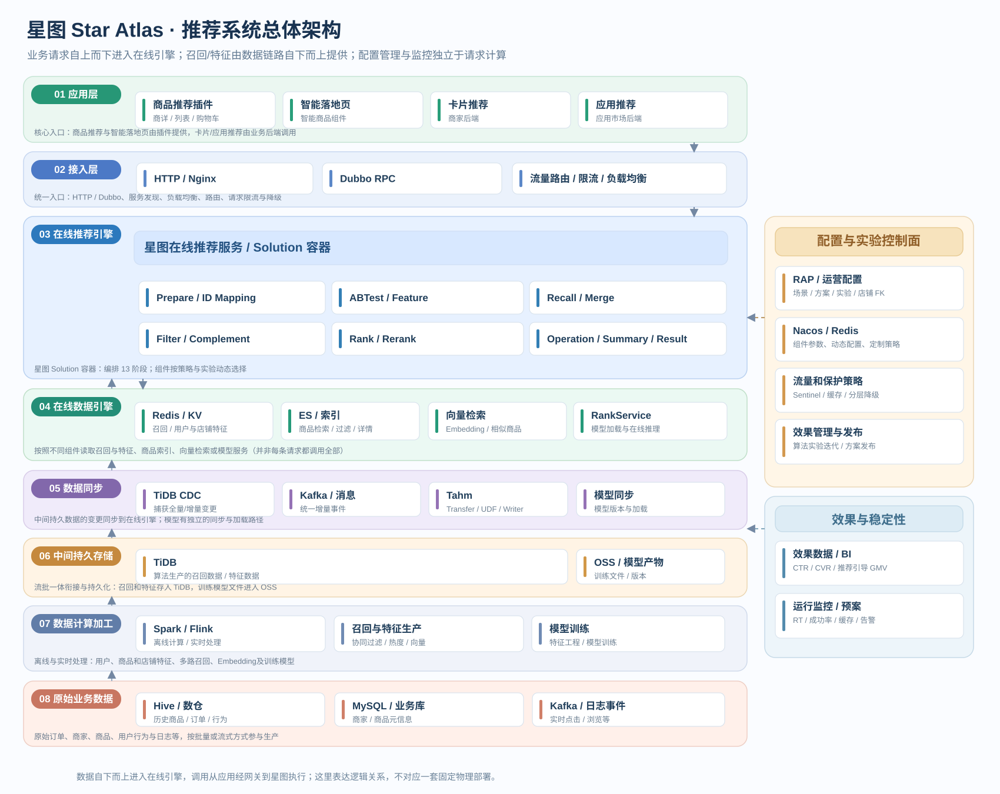
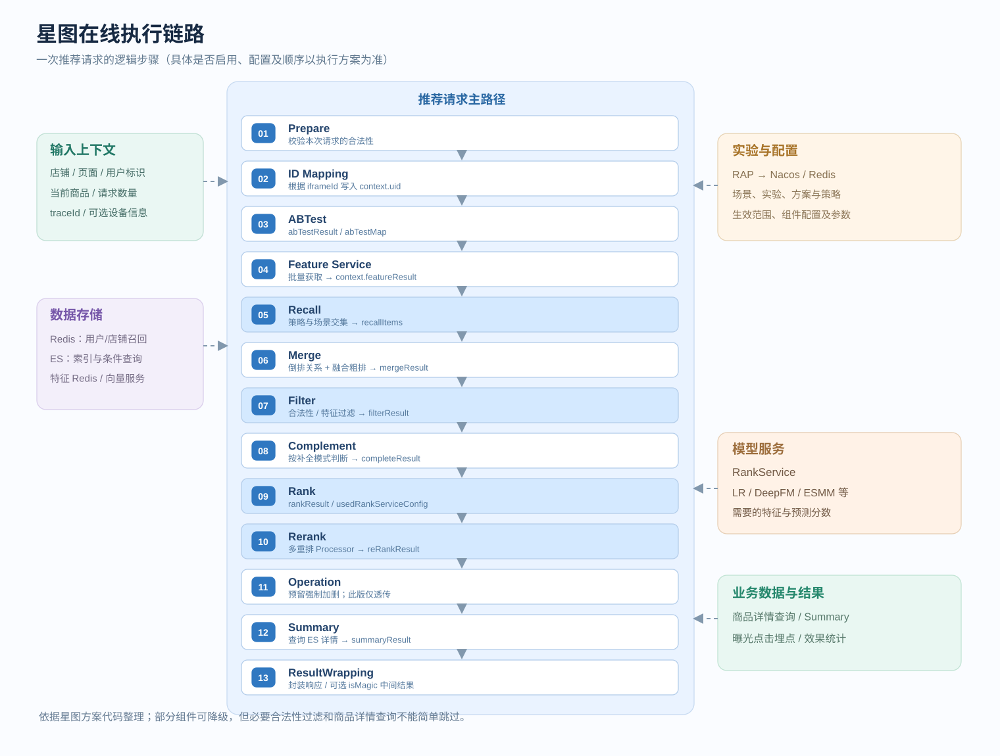
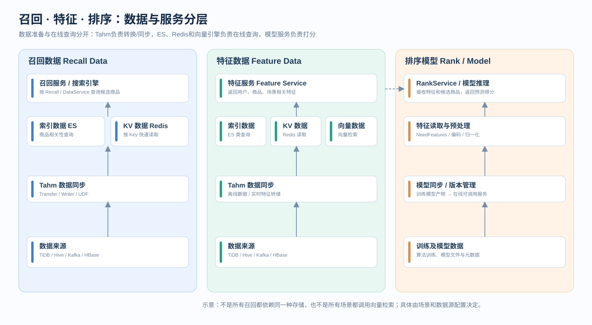
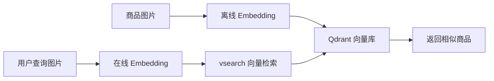
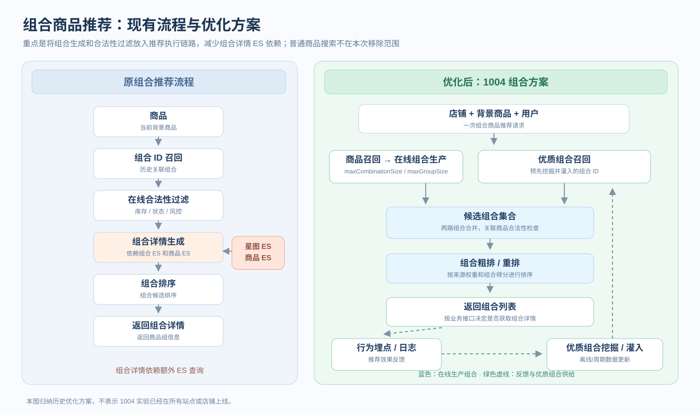

# 推荐工程整体业务背景

## 1. 推荐业务背景

### 1.1 我们在做什么

SHOPLINE 是服务商家经营独立站的电商平台。用户进入某个商家的店铺后，会浏览商品详情、商品列表、搜索结果或购物车等页面。商家希望用户能更容易发现感兴趣、愿意购买的商品，因此会在这些页面展示**商品推荐位**。

例如，一位用户正在浏览某家服装店的一件衬衫：

- **商品详情页**：推荐风格相似的衬衫，帮助用户找到替代选择。
- **购物车页**：推荐可以搭配的裤子、鞋子，提高加购机会。
- **商家首页**：推荐热门商品或更符合当前访客兴趣的商品。
- **搜索页**：在对应的业务配置下，为用户提供相关商品推荐。

这些都是推荐业务场景。**推荐系统并不是替商家开店或管理订单，而是根据当前场景，从店铺可用商品中挑出适合展示的商品，返回给业务页面。**

SHOPLINE 推荐工程中的在线执行系统称为**星图**。它服务多个业务入口，由不同的推荐插件、页面或后端调用；算法决定候选商品和推荐效果，工程负责让这些能力可靠、可配置地运行。

### 1.2 为什么不能直接推荐热门商品

最简单的实现是按销量或热度推荐商品。但不同用户、不同页面的需求不一样：

- **用户不同**：经常浏览运动鞋的用户和喜欢连衣裙的用户，兴趣可能不同。
- **页面不同**：商品详情页适合推荐相似商品，购物车更可能需要搭配商品。
- **店铺不同**：独立站商品规模和访问量差异较大；新店铺、新商品可能缺少足够的行为数据。
- **目标不同**：既希望用户愿意点击，也希望商品有购买价值，还要兼顾商品多样性、新鲜度和页面体验。

这就要求推荐系统既能使用用户行为、商品信息和算法模型，也能让算法同学针对不同场景、店铺和实验快速调整配置。

### 1.3 推荐业务希望达到什么效果

推荐系统的目标可以从三个角度理解：

**对访客**：更快找到感兴趣的商品，减少重复或不相关的推荐。

**对商家**：提高推荐位带来的点击、转化、订单及推荐引导 GMV 等业务效果。

**对平台与算法团队**：让召回、排序、重排等能力可以复用、定制和实验验证，并确保在线接口稳定、响应及时。

这里有一个重要区别：**推荐效果好，不等于推荐接口只要返回成功就行。** 接口可用性、延迟是工程运行指标；点击率、转化率等是业务效果指标。两类指标需要分别观察。

### 1.4 整体业务是怎样运转的

下面先看业务主线，不需要马上理解图中每个技术名词；第 2 章会逐一解释。

~~~mermaid
flowchart TD
    A["用户进入某个商家店铺的页面"] --> B["页面发起推荐请求"]
    B --> C["识别店铺与页面场景"]
    C --> D["选择实验、方案和策略"]
    D --> E["召回候选商品"]
    E --> F["合并 / 过滤 / 补全 / 排序 / 重排"]
    F --> G["向页面返回商品列表"]
    G --> H["商品曝光、用户点击、加购和下单"]
    H --> I["采集并加工效果数据"]
    I --> J["效果分析、实验评估与策略优化"]
    J -.->|后续迭代| D
~~~

同时，系统还存在一条**数据准备链路**：离线和实时任务加工商品、用户行为、召回及特征数据，经数据同步写入在线存储，供推荐请求读取。因此推荐工程不是只有一套在线 API，而是**数据准备、在线执行、配置实验、效果反馈**共同组成的业务系统。

### 1.5 站点范围

当前业务资料将推荐站点区分为：

- **EC10**：港台推荐。
- **EC20**：大陆推荐。

两个站点的页面编号、数据、配置和指标统计范围分别管理。同名页面在不同站点可能对应不同编号，不能因为知道店铺 ID 就直接推断站点，也不能把不同站点的数据合并统计。

具体页面编号和分析口径放在第 10 章；团队之间算法与工程的责任边界放在第 11 章。本章先建立对整体业务的认识。

---

## 2. 推荐业务的核心概念

本章统一使用一个例子：**用户进入某家服装店，正在查看一件白色衬衫，页面需要展示 6 件推荐商品。** 我们从这个例子出发，理解推荐系统如何准备数据、找到候选、做出选择，以及怎样验证推荐是否有效。

### 2.1 店铺、页面和场景（Store / Page / Scene）

首先区分三个概念：

**店铺**是商家自己的经营空间。不同店铺的商品、用户行为和推荐配置不能随意混用。

**页面**是访客看到的入口，比如商品详情页、购物车页、商品清单页。

**场景（Scene）**是推荐系统用来识别业务入口并选择推荐配置的标识。通常可以通过请求上下文和页面映射得到场景；实际编号按站点独立管理。

例如，同一位访客在同一家店铺：

- 进入**商品详情页**，系统可能优先推荐相似商品。
- 进入**购物车页**，系统可能优先推荐搭配商品。

虽然用户、店铺没有变，但**场景变了，推荐需求和执行方案也可能改变**。

场景不是实验，也不是召回算法。它首先回答的是：**“这次推荐发生在哪里？”**

### 2.2 特征与特征工程（Feature / Feature Engineering）

推荐系统要判断哪些商品可能适合用户，必须先获得关于**用户、商品以及用户和商品之间关系**的信息。这些供算法使用的信息就叫**特征**。

原始数据并不一定能直接用于算法。比如系统记录：

> 用户在过去 7 天浏览过 12 件衬衫、3 件牛仔裤，最近 5 分钟点击了一件白色衬衫。

**特征工程**就是把这些原始行为加工成算法可以直接使用的字段，例如：

- 用户特征：最近 7 天浏览衬衫的比例、最近一次浏览的品类。
- 商品特征：商品品类、价格、品牌、是否可售。
- 交叉特征：用户是否曾浏览当前商品，用户对该品类的偏好程度。
- 实时特征：最近几分钟的点击、浏览序列。

~~~mermaid
flowchart LR
    A["原始数据：浏览、点击、商品属性"] --> B["特征工程：清洗、统计、转换"]
    B --> C["可使用的特征"]
    C --> D["召回：找候选"]
    C --> E["排序：模型打分"]
    C --> F["策略：按条件调整"]
~~~

同一个特征可以被不同的推荐环节使用。比如“用户最近喜欢衬衫”既能帮助召回衬衫，也能帮助排序模型给衬衫打分。

按照数据更新速度，还可以区分：

- **离线特征**：由周期任务加工，如过去 7 天的偏好统计。
- **实时特征**：由实时行为或实时计算更新，如当前会话刚刚浏览的商品。

实际更新频率由数据生产链路决定，不能认为所有用户特征都天然实时。星图配置里出现的 userHistory、userLikeCate、userRealtimeHistory 等就是相关特征的例子。

**注意：这里的 Feature（模型特征）和后面介绍的 FeatureKey（FK，定制匹配键）不是同一个概念。**

### 2.3 召回（Recall）：先找出可能推荐的商品

一个店铺可能有几千、几万件商品，但页面最终只需要 6 件。系统通常不会对所有商品都执行复杂模型计算。

**召回**的任务是从大量商品中快速找出一批**可能适合当前请求的候选商品**。

仍然以白色衬衫详情页为例，推荐系统可能同时开启多条召回通道：

- **相似商品召回**：找款式、品类接近的衬衫。
- **用户兴趣召回**：根据用户最近的浏览偏好找商品。
- **热门召回**：找店铺最近卖得好或点击多的商品。
- **搭配召回**：找适合与衬衫搭配的裤子、配饰等。

~~~mermaid
flowchart TD
    A["白色衬衫详情页：发起推荐"] --> B["多路召回"]
    B --> C["相似商品：100 件"]
    B --> D["用户兴趣：100 件"]
    B --> E["店铺热门：100 件"]
    B --> F["搭配商品：100 件"]
    C --> G["合并候选商品"]
    D --> G
    E --> G
    F --> G
    G --> H["进入后续筛选和排序"]
~~~

以上数量仅用于演示。**多路召回结果可能重复**，所以四条通道各返回 100 件，不意味着一定得到 400 件不同商品。

在星图的历史配置中，storeHotRecall、store24HourHotRecall、userHistoryItemRecall、userLikedItemCfRecall 等就是不同类型的召回组件。

**召回回答“从哪里找商品”，不是“最终 6 件商品按什么顺序展示”。**

### 2.4 合并、粗排、过滤和补全：整理候选集合

召回的商品往往来源不同、质量参差不齐，通常还需要做一些处理。

**合并（Merge / Fusion）**：把多个召回通道的结果汇总，识别重复商品，并按配置融合相关分数或权重。同一件商品可能同时命中“热门”和“用户兴趣”，不需要在结果里重复展示。

**粗排（Pre-rank）**：用相对低成本的方法，先从较大的候选集合里选出更有希望的一部分，减少后续复杂模型的计算量。

**过滤（Filter）**：删除当前不能或不应该推荐的商品，例如已经下架、不可售、需要避免重复曝光的商品。

**补全/兜底（Complement / Fallback）**：当候选太少或过滤后数量不足时，按照配置从其他商品来源补充候选，避免页面没有可展示的商品。

举例：召回合并后有 200 件商品，过滤掉其中不可售和重复曝光的商品，最后只剩 4 件；如果页面需要 6 件，就可能使用兜底来源补足剩余数量。

这些组件的**具体先后顺序由方案决定**。不能把上面的教学例子当成所有场景的固定执行顺序。

### 2.5 排序（Rank）：判断哪件商品更值得推荐

召回已经找到了候选商品，但它们对当前用户的吸引力未必相同。**排序**负责对候选商品打分、比较，并确定优先级。

例如经过处理后，有三件候选商品：

- 商品 A：风格很相似，用户也经常浏览这类商品。
- 商品 B：店铺非常热门，但用户平时不太关注。
- 商品 C：价格合适，且属于用户近期感兴趣的品类。

排序模型可以综合用户、商品、场景和交叉特征，分别给它们计算预测分数，再根据目标进行排序。

~~~mermaid
flowchart LR
    A["候选商品 + 用户/商品/场景特征"] --> B["排序模型"]
    B --> C["商品 A：0.82"]
    B --> D["商品 C：0.75"]
    B --> E["商品 B：0.53"]
~~~

这些分数是示意值。**模型分数不一定就是点击概率**；具体代表点击、转化还是综合目标，要看训练标签和模型输出定义。

星图资料中的模型包括：

- **LR**：逻辑回归，结构较简单，可以用作轻量基准模型。
- **DeepFM**：适合学习不同特征之间的组合关系。
- **ESMM**：面向点击与转化等行为进行联合建模的模型。

因此可记住：**召回负责“找哪些”，排序负责“谁更靠前”。**

### 2.6 重排（Rerank）：把模型顺序变成最终展示顺序

即使商品按预测分数从高到低排列，也不一定符合页面体验和业务要求。

比如模型排出：

> 白色衬衫 A → 白色衬衫 B → 白色衬衫 C → 牛仔裤 D → 腰带 E

前三件商品太相似，页面看起来比较单一。**重排**可以根据业务规则、多样性或探索机制进一步调整顺序，例如：

> 白色衬衫 A → 牛仔裤 D → 白色衬衫 B → 腰带 E → 白色衬衫 C

星图资料里提到的重排形式包括**优先级重排、热度与兜底重排、汤普森采样、卡片重排**等。

其中汤普森采样（Thompson Sampling）主要体现“**探索与利用**”的平衡：既利用当前已经表现好的商品，也给尚不确定但可能有潜力的商品一定展示机会。

**排序是模型评分，重排是根据最终展示目标再次组织结果。**

### 2.7 策略和方案（Strategy / Solution）：决定调用哪些能力

到这里就有了召回、过滤、排序和重排等能力。但不同页面未必需要完全相同的组合。

**策略**描述一次推荐中具体使用哪些组件、如何组合和设置参数；**方案**是更上层的执行配置，可以把不同阶段的组件与实验配置组织起来。

例如一个“店铺热销商品推荐”策略可以简化理解为：

~~~yaml
storeHotSale:
  recallList:
    - name: storeHotSaleRecall
      size: 100
      weight: 100
  rankServiceName: lrCTRModelService
  rerankList:
    - compAndHotRerank
~~~

这个历史配置片段表示：

- 召回阶段使用 storeHotSaleRecall。
- 排序阶段调用 lrCTRModelService。
- 重排阶段调用 compAndHotRerank。

其中 size、weight 是对应组件的配置参数，不能直接当成最终得分。

在工程配置语境中，“策略”有时泛指整条执行流程，有时专指某个阶段的业务规则，需要根据所在层次理解。**策略本身不等于实验**：同一套策略可以作为实验中的一个方案，多个实验也可能复用它。

### 2.8 实验与 A/B 测试（Experiment / A/B Test）

如果算法同学想把“热门召回”换成“用户兴趣召回”，怎样知道新方案是否真的有效？

不能只凭主观感觉判断。**实验**就是让不同流量使用不同的方案，收集效果数据进行比较。

例如，假设实验计划把符合条件的访客分成两组：

~~~mermaid
flowchart TD
    A["符合条件的推荐请求"] --> B["实验分流"]
    B --> C["A 组：原有召回与排序配置"]
    B --> D["B 组：新召回与排序配置"]
    C --> E["收集曝光、点击、转化等指标"]
    D --> E
    E --> F["按相同口径比较实验效果"]
~~~

这里的 A/B 分组只是例子；实际分流比例、分组单位和命中条件由实验配置决定。

还要分清三件事：

- **场景实验**：对整个场景的推荐方案做实验。
- **功能实验**：对排序、重排等单个能力或参数做实验。
- **店铺/FK/场景绑定**：决定一个请求使用哪个实验配置，属于实验的命中或分流机制。

在分层绑定的方案中，店铺还能分别绑定 recall、rank、rerank 层级的实验。相关优先级和兼容逻辑放在第 6 章。

所以：**召回、排序和策略是在做推荐；实验是在验证不同推荐方法的效果。**

### 2.9 FeatureKey（FK）：比店铺更细的定制匹配条件

前面介绍的普通 Feature 是模型使用的数据，例如用户品类偏好；而星图定制架构中的 **FeatureKey（FK）是用来匹配定制配置的业务键**。

例如某个店铺希望对一类被特定业务规则圈选的请求单独使用实验或策略，可以把该条件组织为对应 FK，让在线推荐在命中 FK 时读取定制配置。

~~~mermaid
flowchart TD
    A["一次店铺推荐请求"] --> B{"是否命中店铺定制?"}
    B -- 是 --> C["店铺定制配置"]
    B -- 否 --> D{"是否命中 FK 定制?"}
    D -- 是 --> E["FK 定制配置"]
    D -- 否 --> F["基础配置"]
~~~

这张图只解释**定制配置的选择优先级**，具体实验绑定还需考虑第 6 章的分层逻辑。

FK 的具体取值、生成方式由业务定义。**不能把 userLikeCate 等模型特征直接当成 FK，也不能未经配置就从某个商品属性推断 FK 值。**

### 2.10 数据仓库、数据同步和 BI：推荐数据从哪里来

推荐不仅要在请求时做算法计算，还依赖数据准备与结果分析。这几个词要区分：

**数据仓库（Data Warehouse）**：集中保存并加工业务数据，便于进行统计、离线计算和模型训练。例如 Hive 中保存商品、浏览、点击等历史数据。

**数据同步**：把算法已经加工好的召回或特征数据送到在线系统，让星图能快速查到。项目中会涉及 Kafka、TiDB/CDC、Tahm、Redis、ES 等组件。

**BI（Business Intelligence，商业智能）**：把加工后的业务指标展示给产品、运营和算法同学，用于观察趋势、分场景分析和评估实验，而不是直接决定本次推荐哪件商品。

~~~mermaid
flowchart TD
    A["原始业务数据与事件"] --> B["数据仓库 / 数据加工"]
    B --> C["算法生成召回与特征"]
    C --> D["Kafka / 数据同步"]
    D --> E["Redis / ES 等在线数据"]
    E --> F["星图在线推荐"]
    F --> G["曝光、点击、转化等事件"]
    G --> B
    B --> H["效果指标 / BI 报表"]
    H --> I["算法与业务分析、优化"]
~~~

这张图表示典型逻辑关系，并非所有数据都必须先进入同一个仓库：实时行为也可能从实时计算链路直接产出特征。第 9 章介绍离线、实时数据链路及 TiDB/CDC 同步和一致性规范。

可以这样区分：**数据仓库准备和沉淀数据，特征工程加工模型输入，数据同步把结果送到线上，BI 帮助人分析推荐效果。**

### 2.11 推荐效果指标：怎么判断有没有用

用户看到了推荐商品，叫作**曝光**；点击推荐商品，产生**点击**；后续按业务定义产生购买等行为，可以计入**推荐转化**。这些事件经过埋点和数据处理，形成效果指标。

最常见的三个比例是：

- **CTR（点击率）＝ 推荐点击量 ÷ 推荐曝光量**：展示出来的商品有多少被点击。
- **CVR（转化率）＝ 推荐转化量 ÷ 推荐点击量**：发生点击后，有多少带来了转化。
- **CTCVR ＝ 推荐转化量 ÷ 推荐曝光量**：从曝光到转化的整体比例。

此外还有订单和 **rec_gmv（推荐引导 GMV）** 等指标。具体分子分母、去重方式和归因规则以对应数据表及指标定义为准。

例如某一天，一个推荐场景有 1,000 次曝光、100 次点击、5 次转化，则：

- CTR = 100 ÷ 1,000 = **10%**
- CVR = 5 ÷ 100 = **5%**
- CTCVR = 5 ÷ 1,000 = **0.5%**

这些数只是教学示例。总体 CTR 不能直接平均各店铺或各实验组的 CTR，必须先汇总同口径的点击量与曝光量。

当前推荐成效数据以**按日 T+1** 为主，不等于在线实时 QPS、耗时或成功率。站点和页面的详细统计规则见第 10 章。

### 2.12 把这些概念串起来

回到开头的“用户正在看白色衬衫，页面需要 6 件商品”：

~~~mermaid
flowchart TD
    A["① 店铺 + 商品详情页：确定 Scene"] --> B["② 命中实验，选择方案和策略"]
    B --> C["③ 使用用户、商品等特征"]
    C --> D["④ 多路召回：兴趣 / 相似 / 热门 / 搭配"]
    D --> E["⑤ 合并、过滤，必要时补全"]
    E --> F["⑥ 排序模型打分"]
    F --> G["⑦ 重排后返回 6 件商品"]
    G --> H["⑧ 采集曝光、点击、转化"]
    H --> I["⑨ BI 分析效果，评估实验和策略"]
~~~

记住这条主线就够了：

**特征工程提供信息，召回找候选，排序判断优先级，重排组织展示；策略和方案决定用哪些组件，实验验证哪套配置更好；数据仓库和 BI 支撑效果分析。**

---

## 3. 推荐系统总体架构

推荐系统不只是“召回 + 排序”两个算法步骤。它需要接入不同的商家业务、管理场景与实验、执行在线推荐、准备召回和特征数据，还要持续检查效果和服务稳定性。

下面这张图参考星图技术方案中的**分层架构**重新绘制。**这一章只回答有哪些模块、各模块之间是什么关系**；推荐请求怎么走、每个组件怎么实现，在后面章节分别说明。

### 3.1 模块与组件

| 模块 | 主要组件 | 在系统中的作用 |
| --- | --- | --- |
| **业务应用** | 商品推荐插件、智能落地页插件、卡片推荐、应用推荐；其他如图搜、智能导购 | 面向访客和商家提供推荐入口，向星图请求推荐结果 |
| **接入层** | HTTP/Nginx、Dubbo RPC、统一接入、负载均衡、限流降级 | 统一承接不同业务的请求，并进行流量控制和保护 |
| **星图在线服务** | 请求准备、场景识别、实验选择、方案/策略编排，以及召回、合并、过滤、补全、排序、重排、摘要 | 按当前场景执行一次推荐任务，返回最终商品或卡片 |
| **配置与管控** | RAP、Nacos、定制策略 Redis、店铺/FK 绑定、实验/方案管理 | 决定不同请求用哪套实验、策略和组件；支持算法快速调参和发布 |
| **在线依赖引擎** | ES、Redis/KV、特征服务、RankService/模型、向量引擎、商品业务服务 | 向星图提供候选商品、特征、商品信息以及模型评分 |
| **原始数据与加工** | Hive、MySQL、Kafka；Spark/Flink、离线和实时算法计算、模型训练 | 加工用户、店铺、商品特征以及多路召回和模型 |
| **中间持久存储** | TiDB（召回/特征）、OSS（训练模型） | 统一承接批量和增量产物，持久化保存并支持后续同步 |
| **数据同步** | TiDB CDC、Kafka、Tahm（Transfer / Writer / UDF） | 同步召回、特征到在线 Redis、ES；模型使用独立同步/推理服务 |
| **效果与稳定性** | 埋点、推荐成效、BI、接口/组件监控、限流和缓存降级 | 分别判断推荐效果，以及在线服务是否稳定 |

这里的“在线依赖引擎”不是每次请求都要同时调用的固定名单。**召回服务可以使用 ES、Redis；特征服务读取特征存储；精排调用模型服务；不同方案会选用不同组件**。

### 3.2 三条相互协作的链路

**在线执行链路**：业务页面/后端 → 接入层 → 星图根据场景和实验选择方案 → 调用召回、特征、模型等能力 → 返回商品。

**数据准备链路**：Hive/MySQL/Kafka 原始数据 → Spark/Flink 等离线/实时计算 → 召回与特征产出至 TiDB → CDC/Kafka → Tahm → Redis/ES；**训练后的模型产物单独存放 OSS，再由模型同步、RankService 加载使用**。因此模型不是普通召回数据，也不要求经过 Tahm。

总图因此分为**应用、接入、在线引擎、在线数据引擎、数据同步、中间持久存储、数据计算加工、原始业务数据**八层；右侧的 RAP/Nacos 配置控制与监控体系为横向支撑能力。

**配置与反馈链路**：算法通过 RAP 管理实验和策略，发布至 Nacos/Redis 等在线配置；曝光、点击、转化以及运行指标反馈给算法、产品和工程，用于后续优化。

三条链路的职责不一样：**在线服务处理本次请求；数据链路准备“拿什么推荐”；管控与反馈决定“怎样推荐、推荐得怎么样”。**

### 3.3 后续章节怎么阅读

- **业务入口与插件**：解释商品推荐、智能落地页、卡片和应用推荐的区别。
- **在线执行引擎**：按完整的 prepare → result 流程逐步拆解组件。
- **配置、实验与定制**：解释 RAP/Nacos、场景实验、功能实验及 FK 绑定。
- **召回、特征、排序、同步**：分别展开数据结构、组件配置和具体实现。
- **效果、稳定性与团队**：介绍如何观测效果、定位异常和处理需求。
- **经典业务场景**：以商品详情页、购物车、智能落地页和定制实验串起整套系统。

架构图基于现有资料中的组件关系整理，属于**逻辑架构**：不表示所有模块部署在同一进程，也不等于每次请求都会走完图中所有组件。历史方案和规划会在对应章节标注，避免与当前生效配置混淆。

---

## 4. 业务入口与推荐场景

星图不只服务商品详情页，而是一套由多个业务入口复用的推荐能力。资料中主要包括**商品推荐、智能落地页推荐、卡片推荐、应用推荐**四类；此外还包括风控图搜、AI 导购 Demo、组合商品和营销加购等扩展业务。

本章只解释**谁在调用推荐、商家能配置什么**。技术执行流程从第 5 章开始。

### 4.1 四类主要业务入口

| 业务 | 用户看到的功能 | 请求方 | 商家插件 |
| --- | --- | --- | --- |
| 商品推荐 | 店铺不同页面的推荐商品区块 | 商品推荐插件及相关业务接口 | 是 |
| 智能落地页推荐 | 落地页内的智能商品组件 | 智能落地页插件 | 是 |
| 卡片推荐 | 商家首页等位置的卡片推荐 | 商家业务后端 | 否 |
| 应用推荐 | 应用市场内的应用推荐 | 应用市场后端 | 否 |

卡片和应用推荐不是以独立推荐插件形态提供的，不能直接假设与商品推荐插件使用完全一样的召回组件。

### 4.2 商品推荐插件

商家安装[商品推荐插件](https://apps.shopline.com/detail/?appId=22927)后，可以按页面定制商品推荐。

插件页面截图中包含**商品详情、商品列表、搜索、购物车、Mini 购物车、支付结果（Thank You）、404** 等七类页面，还提供**全店商品推荐**与**单个商品自定义推荐**的配置入口。界面排列顺序不是 Scene ID；编号以各站点业务映射为准。

商品推荐分为两类：

#### 自定义推荐

商家直接指定推荐内容或选择规则：

- **手动添加商品**：圈选具体商品，适合活动推广或重点展示。
- **指定推荐规则**：使用商品引擎的字段进行筛选。原材料指出支持 **7 类规则条件**，但目前没有完整的字段清单，不能补造七个条件。

商品详情页还有**单个商品的专属推荐配置**，是商品详情页的一个特例，不是新 Scene。

#### 智能推荐

根据场景和算法策略自动产生推荐结果，产品页面支持**AI 多维度推荐、相似用户推荐、相关商品推荐、热门趋势**四类。

**同一种智能策略在不同页面里，内部召回组件也不一定相同**。例如商品详情页偏向相关商品，购物车可能强调搭配或补充购买。具体配置参考[页面与策略的对应推荐逻辑](https://shopline.yuque.com/rbxwgy/dvqpxs/bmt7vn)。

业务示例（历史演示站点，当前页面能否访问以实际情况为准）：

- [商品详情页](https://iwine.myshopline.com/products/%E7%94%B7%E8%A3%85-2)
- [商品列表页](https://iwine.myshopline.com/collections/-copy-name-a-to-z)
- [搜索列表页](https://iwine.myshopline.com/products/search?keyword=%E5%B7%B4%E6%8B%89&type=user_search)
- [购物车页](https://iwine.myshopline.com/cart)
- [404 页](https://iwine.myshopline.com/404)
- [单商品定制推荐](https://iwine.myshopline.com/products/%E5%B7%B4%E6%8B%89%E5%B7%B4%E6%8B%89)

原单商品示例因库存仅显示一件商品。这说明**配置中指定商品，不等于最终一定展示所有指定商品**，商品合法性与库存仍可能影响结果。

### 4.3 智能落地页插件

安装[智能落地页插件](https://apps.shopline.com/detail/?appId=29336)后，商家可以在落地页增加**智能商品组件**。访客打开页面，组件就会向星图请求商品推荐：

~~~mermaid
flowchart LR
    A["商家配置落地页"] --> B["添加智能商品组件"]
    B --> C["访客进入页面"]
    C --> D["组件向星图发起请求"]
    D --> E["场景 / 实验 / 策略执行"]
    E --> F["返回商品供组件展示"]
~~~

智能落地页与商品推荐插件共享底层能力，但**是两个独立业务入口**，不能因为都叫智能推荐就认为页面场景、推荐配置完全相同。

- [智能落地页演示](https://iwine.myshopline.com/page/merrychristmas)

### 4.4 其他推荐入口

**卡片推荐**由商家后端请求星图，面向首页等位置的卡片推荐目标；其排序可能使用专用 cardRankService，商品 ID 与卡片 ID 的请求格式不完全一样。

关于**卡片池、店铺标签、卡片状态筛选以及偏好分 + CTR 排序实验**，第 16.2 节有完整场景案例。

**应用推荐**由应用市场发起调用，推荐对象是应用，而不是商品，因此不能直接套用商品库存过滤等规则。

其他扩展还有风控图片搜索、AI 导购机器人（资料标注为 Demo）、EC1.0 组合商品推荐、营销组合商品/加购品。它们是星图能力复用的不同场景，**不代表每条链路都完整经过商品召回、过滤和商品精排**。

组合商品推荐的**在线生成组合、优质组合召回及 1004 专用执行方案**在第 18 章以完整案例展开。

---

## 5. 星图在线引擎：组件及执行流程

**星图的方案（Solution）代码负责把一次推荐请求从参数校验执行到最终结果包装。** 这是配置驱动的流水线：每个阶段有固定的输入输出约定，再按策略选用不同处理器或服务。

本章依据《星图代码梳理》的 13 个 Service 和 `RecomContext` 字段说明执行逻辑。这里介绍的是**基础推荐方案**，不是所有场景、专用方案或降级流量都必须执行全部组件。

### 5.1 请求准备、ID 映射与实验分流

**① Prepare：`prepareService`**。校验请求参数合法性，包括店铺、当前场景、背景商品和 TopK 等是否符合本次业务要求。它解决“本次请求能不能执行”，不负责推荐得分。

**② ID Mapping：`IdMappingService`**。依据请求的 `iframeId` 完成用户标识映射，将本次执行所用的 UID 写入 `RecomContext.uid`。后续用户特征、个性化召回、实验分流都可能用这个标识。

**③ ABTest：`abTestService`**。整合三处实验配置：**AppConfig 中当前场景的实验、推荐策略上配置的实验、全局实验**，再向实验服务请求分流。结果写入：

- `context.abTestResult`：本次请求实际命中的实验结果。
- `context.abTestMap`：本次请求对应的实验配置信息。

历史调用示意：

~~~java
abTestClient.experiment(
    ExperimentRequest.build(it -> it
        .codes(allAbTestCodes)
        .param(sconfig.getAbtestParamName(), context.getUid())
        .param(sconfig.getAbtestTraceIdParamName(), context.getRequest().getTraceId())
    )
);
~~~

具体店铺、FK、场景实验如何匹配及其分层绑定，见第 6 章。

### 5.2 获取特征与多路召回

**④ Feature：`featureService`**。从 `app-configs` 读取当前场景声明的 `needFeatures`，通过 RPC **批量查询特征服务**，并写入 `context.featureResult`。例如用户浏览历史、实时行为、喜欢的品类，可用于之后的召回或过滤。

**⑤ Recall：`recallService`**。实际执行通道不是直接使用策略中的全部召回，而是：

1. 从 `recommend-strategies` 取当前策略的 `recallList`。
2. 从 `app-configs` 取当前业务、Widget、页面和策略允许的召回名称列表。
3. **两者取交集**，得到本次真正允许执行的通道。
4. 并发调用对应的 `RecallProcessor`，例如 `redisProcessor`、`esProcessor`。
5. 需要特征条件的通道，根据其 `featureNames` 从 `context.featureResult` 读取具体值，再查询 Redis 或 ES。

结果按召回通道存入 **`context.recallItems`**。此时同一商品可能出现在多个通道中，还没有完成合并。

举例：全局 `default` 策略声明 A、B、C 三条召回，但当前商品详情页只允许 A、B，最终**只执行 A 和 B**，不会因为 C 出现在策略配置里就自动执行 C。

### 5.3 候选合并、粗排与过滤

**⑥ Merge：`mergeService`**。以 `context.recallItems` 为输入，从策略的 `mergeList` 定位 `mergeConfigs` 中的处理器，然后完成：

- 对同一商品在不同召回通道中的数据建立倒排汇总，写入 **`context.invertedRecallItems`**。
- 聚合各通道的分数和权重，做初步粗排。
- 将粗排排序结果写入 **`context.mergeResult`**。

这个阶段既包含**合并**，也包含**粗排分数计算**。商品 A 命中两条通道，会记录两份召回来源但只形成一个商品候选；具体计算实例见第 7 章。

**⑦ Filter：`filterService`**。读取 `context.mergeResult`，从策略 `filterNames` 中选择过滤器，再依据 `filter-services` 中的 `processor` 执行：

- 特征过滤：例如过滤已曝光商品 ID。
- 商品合法性与标签过滤：库存、状态、风控、算法标签等。

过滤结果写入 **`context.filterResult`**。

**合法性过滤是保障可展示商品有效性的关键阶段，不能简单因降级而省略。** 原历史设计还要求：安全过滤失败时，相关候选应置空，而非直接透出未经验证的商品。

### 5.4 补全、精排与重排

**⑧ Complement：`complementService`**。读取 `context.filterResult`，按照配置模式决定是否补全：

- **模式 2**：只有过滤结果**为空**时才触发补全。
- **模式 1 或未配置**：当过滤后数量 **小于请求的 TopK** 时触发。
- 其他情况不触发。

若需补全，则通过策略的 `complementName` 找到 `data-service` 查询配置，计算缺少数量，原实现从 **ES 商品索引**取回合法商品。结果写入 **`context.completeResult`**。

例如 TopK=6、过滤后 4 件，模式 1 会尝试补 2 件；模式 2 不会补。能否补够仍取决于店铺合法商品数量。

**⑨ Rank：`rankService`**。以 `context.completeResult` 为输入，从策略读取 `rankServiceName`，再从 `rank-services` 找到模型 URL、请求模板、返回类型、超时等配置。调用模型服务后：

- 模型结果写入 **`context.rankResult`**。
- 本次使用的排序服务配置写入 **`context.usedRankServiceConfig`**。

**⑩ Rerank：`reRankService`**。读取 `context.rankResult`，按策略 `rerankList` 查找 `rerank-services` 的处理器，顺序执行配置的重排操作，写入 **`context.reRankResult`**。重排是调整最终展示顺序，不是重新训练精排模型。

### 5.5 人工干预、商品详情与结果包装

**⑪ Operation：`operationService`**。设计上预留“强制添加/删除商品”的能力，但这份代码梳理写明**目前没有实际处理**；现有步骤只是将 `context.reRankResult` 传入 **`context.operationResult`**。不能把预留能力描述成已经生效的功能。

**⑫ Summary：`summaryService`**。读取 `context.operationResult`，从策略取 `summaryName`，再用 `data-service` 获取商品详情查询配置。原实现从 **ES** 查询最终商品的详情，保存到 **`context.summaryResult`**。

这里 Summary 不是生成一段文字摘要，而是把商品 ID 补成页面可展示的商品详情。历史稳定性设计明确指出，这个必要阶段不能直接跳过。

**⑬ ResultWrapping：`resultWrappingService`**。处理最终响应。若请求设置了 `isMagic`，按照协议在响应中附带部分中间结果，便于排查和调试；普通请求主要返回最终商品数据。

### 5.6 用 RecomContext 把 13 个阶段串起来

~~~mermaid
flowchart TD
    A["Prepare：请求校验"] --> B["ID Mapping → uid"]
    B --> C["ABTest → abTestResult / abTestMap"]
    C --> D["Feature → featureResult"]
    D --> E["Recall → recallItems"]
    E --> F["Merge → invertedRecallItems / mergeResult"]
    F --> G["Filter → filterResult"]
    G --> H["Complement → completeResult"]
    H --> I["Rank → rankResult / usedRankServiceConfig"]
    I --> J["Rerank → reRankResult"]
    J --> K["Operation → operationResult"]
    K --> L["Summary → summaryResult"]
    L --> M["ResultWrapping → 返回结果"]
~~~

**`RecomContext` 就是一次推荐请求内部的工作台**：各 Service 从上一步的字段取数据，按本阶段配置处理后写入下一字段。因此整条链路可以通过方案编排，而每个处理器相对独立。

这里列出的 `Service` 名称和上下文字段来自所提供的星图 Java 版本方案；是否与后续 Go 重构完全相同，应以具体版本代码为准。分层降级或专用方案可能改变实际执行路径，第 11 章单独介绍。

---

## 6. 场景、策略、实验与 RAP 配置

**配置面决定本次请求选择哪套执行流程**：业务首先命中店铺与场景，实验在相应范围内完成分流，方案/策略进一步装配召回、排序和重排等组件。RAP 是重要配置管理入口，Nacos 和 Redis 供在线读取。

### 6.1 RAP、Nacos、Redis 和组件配置

推荐配置主要由 RAP、Nacos 和 Redis 三部分组成。

#### RAP

RAP 是业务配置入口，主要管理：

- 场景及实验配置
- 店铺与场景实验绑定
- FeatureKey 实验绑定
- 店铺定制策略
- FeatureKey 定制策略

#### Nacos

Nacos 保存在线推荐运行需要的配置，核心包括：

| 配置 | 作用 |
| --- | --- |
| app-configs | 按业务 ID / Widget / 页面 / 策略配置可用召回、场景特征和实验 |
| scene-configs | 场景及场景配置 |
| ab-configs | 实验、应用和策略配置 |
| solution-plugin-configs | 推荐方案配置 |
| flow-controls | 页面与 Scene 的映射 |
| data-sources / data-services-go | 数据源和数据服务 |
| recall-services | 召回能力配置 |
| filter-services | 过滤配置 |
| complement-services | 补全配置 |
| rank-services-go | 精排配置 |
| rerank-services | 重排配置 |
| recommend-strategies | 基础推荐策略 |
| base-strategies | 基础策略定义 |
| store-strategy-configs | 店铺定制策略 |
| cache-configs | 推荐缓存配置 |
| sentinel.rule | 限流和降级配置 |

#### Redis

定制策略的具体内容会同步到 Redis，供在线推荐服务快速读取；Nacos 同时保留是否存在定制策略等控制信息。

#### 配置分层：场景、策略、组件

从星图的配置体系看，“配置能力强”不是单指 Nacos 保存参数，而是**推荐执行链路的每一步都可以按场景和实验选用不同组件**：

| 配置类型 | 核心问题 | 相关配置或组件 |
| --- | --- | --- |
| 场景配置 | 当前页面应选择哪套方案 | scene-configs、flow-controls、场景/实验绑定 |
| 策略配置 | 一套方案如何组合召回、合并、过滤、补全、排序与重排 | recommend-strategies、base-strategies、店铺/FK 定制策略 |
| 召回配置 | 候选商品来自哪一路、各取多少、以什么方式融合 | recall-services、data-sources、recallList（含 size、weight） |
| 精排配置 | 选哪个模型、需要哪些特征、请求如何构造、执行等级和超时 | rank-services-go、rankServices、needFeatures |
| 重排配置 | 按什么规则调整模型排序后的展示顺序 | rerank-services、rerankList |
| 通用运行配置 | 限流、兜底、缓存、实验和发布 | sentinel.rule、cache-configs、ab-configs 等 |

配置之间的关系可以概括成：**场景命中实验 → 选择方案/策略 → 装配召回和排序等组件 → 执行**。其中“策略”既可以指完整推荐流程的编排，也可能在具体模块里指一条局部规则，理解时要结合对应配置层级。

### 6.2 场景、策略、组件与数据源的配置关系

在星图中，**AppConfig 决定当前场景能使用什么；RecommendStrategy 决定策略要组合什么；组件配置决定怎么处理；DataService/DataSource 决定去哪里读取。**

以商品推荐插件的商品详情页为例。

**第一层：`app-configs` 指定场景允许哪些召回、需要哪些特征**

~~~yaml
appConfigs:
  product_rec:
    widgets:
      aiRecommend:
        pages:
          productDetail:
            strategies:
              default:
                - storeHotCtrRecall
                - storeHotSaleRecall
            needFeatures:
              - similarUser
              - userRealtimeHistory
              - userLikeCate
            abTests:
              - priorityRecallRerankExp
~~~

`product_rec` 是业务 ID；`aiRecommend` 是 Widget；`productDetail` 是页面；`default` 是策略。场景可同时声明特征和实验。

**第二层：`recommend-strategies` 定义推荐流水线要调用哪些组件**

~~~yaml
recommendStrategies:
  default:
    recallList:
      - name: storeHotCtrRecall
        size: 100
        weight: 2
      - name: storeHotSaleRecall
        size: 100
        weight: 5
      - name: storeHotRecScoreRecall
        size: 100
        weight: 5
    rankServiceName: lrCTRModelService
    filterNames: ["badEffectSpu", "filter"]
    complementName: "complement"
    summaryName: "summary"
    rerankList: ["priorityRecallRerank", "compAndHotRerank"]
    mergeList: ["sameLocHotSaleRecallMerge"]
~~~

除了这些字段，策略还可声明 `secondaryRecalls`（重排使用的二级召回）、`priorityRecalls`（优先级召回）和 `abTests`。

注意：**最终执行召回列表，是 AppConfig 当前场景允许的召回，与策略 `recallList` 的交集**：

~~~mermaid
flowchart TD
    A["AppConfig：页面 default 允许 A、B"] --> C["求交集：A、B"]
    B["RecommendStrategy：配置 A、B、C"] --> C
    C --> D["recall-services：找到 A、B 对应 Processor"]
    D --> E["data-services：查询 Key 或 ES 条件"]
    E --> F["data-sources：连接 Redis / ES"]
~~~

例如全局策略配置了 C，但场景没有允许 C，本次请求就不会执行 C。策略上的 `size`、`weight` 等参数只对实际选中的召回生效。

**第三层：组件配置决定执行细节**。例如 `recall-services` 通过 `processor` 选 Redis/ES 处理器；`merge-config`、`filter-services`、`rerank-services` 都可分别选择处理器；`rank-services` 指向某个模型服务。

**第四层：数据配置负责定位底层存储**。`data-services` 负责 Redis Key 模板、ES 索引、过滤条件、字段、排序及返回类型；`data-sources` 负责 Redis/ES 类型与连接节点。具体 Key 与粗排数据结构在第 7 章展开。

这就是**业务 → Widget → 页面 → 实验/策略 → 组件 → 数据服务 → 数据源**的层级结构，并不是每个业务都要重新部署一套代码。

### 6.3 配置发布与生效流程

~~~mermaid
flowchart LR
    A["算法 / RAP 管理页面"] --> B["业务校验与实验配置"]
    B --> C["配置库及发布"]
    C --> D["Nacos：场景 / 方案 / 服务配置"]
    C --> E["Redis：定制策略 / 配置数据"]
    D --> F["星图容器加载对应配置"]
    E --> F
    F --> G["根据请求场景装配策略"]
~~~

RAP 主要解决**人如何管理和发布策略**，Nacos/Redis 主要解决**在线服务如何读取生效配置**。下层的 recallServices、rankServices、filterServices 等定义组件能力；上层的方案和策略负责组合它们。

举例：商品详情页实验 B 使用 storeHotSaleRecall 与 lrCTRModelService，并额外启用 compAndHotRerank。RAP 改变的通常是**选中哪些已有组件与参数**，不代表每次调整实验都必须重新部署整套在线服务。

### 6.4 实验分流、分层绑定与兼容

#### 原有实验选择

原有场景下，店铺可绑定圈选实验；否则按 FK 实验或场景实验进入分流。没有明确分组角色时，不应假设实验编号与 control / treatment 一一对应。

~~~mermaid
flowchart TD
    A["一次店铺场景请求"] --> B{"有店铺绑定实验?"}
    B -- 是 --> C{"是否是分层绑定?"}
    B -- 否 --> D{"有 FK 绑定实验?"}
    D -- 是 --> E["使用 FK 实验分流"]
    D -- 否 --> F["使用场景实验分流"]
    C -- 否 --> G["按旧店铺绑定逻辑分流"]
    C -- 是 --> H["按 recall / rank / rerank 分别查找店铺实验"]
    H --> I["缺失层级使用相应场景实验补齐"]
    G --> J["生成本次执行方案"]
    I --> J
    E --> J
    F --> J
    J --> K["执行推荐策略"]
~~~

这里的旧逻辑兼容、场景兜底和层级拼装，是提供的《RAP 店铺绑定支持层级方案》的目标设计；**不代表已验证线上全部完成部署**。

#### 为什么需要分层

**旧问题**：一个店铺只能参加一个圈选店铺实验组；如要调整召回、排序、重排，往往要在一个实验中同时组织三部分。

**新目标**：圈选店铺实验按三个层级拆分，一个店铺可以同时参加三个不同层级的实验，分别定制：

| 层级 | 枚举值 | 修改内容 |
| --- | --- | --- |
| 召回层 | recall | 候选商品怎么找 |
| 排序层 | rank | 候选商品怎么打分和排序 |
| 重排层 | rerank | 排序结果如何组织 |
| 兼容旧配置 | 空值 | 按旧绑定分流逻辑解释 |

同一个店铺在**同一场景、同一层级**最多参与一个圈选实验绑定；一个绑定只对应一个层级。不同层级的绑定最终组合成完整的推荐方案，缺失层级使用相应的场景实验补齐。

#### 数据协议和改造范围

| 位置 | 改造内容 |
| --- | --- |
| MySQL：bind_scenes | 新增 bind_layer 字段，默认空 |
| Nacos：store-scene-configs | 绑定配置增加 bind_layer 字段，默认空 |
| RAP API / server / service | 绑定场景协议透传 bind_layer，支持分层 CRUD 和发布 |
| RAP 页面与校验 | 可选 recall / rank / rerank；同店铺同场景同层级最多配置一次 |
| 星图后端 | 读取 bind_layer；兼容空值；拼接多层店铺实验和场景缺省实验 |

发布顺序：**先升级星图后端兼容新旧协议 → 再发布 RAP → 算法同学将场景绑定配置逐步切到指定层级**。避免在新字段生效前让老服务读取无法理解的配置。

#### 场景实验与功能实验的区别

平台文档还将 A/B 实验区分为两类，这个分类与前面的 **店铺/FK/场景绑定优先级** 不属于同一维度：

| 类型 | 实验范围 | 典型例子 |
| --- | --- | --- |
| **场景实验** | 对某个场景的整体推荐方案进行流量分组；可定制完整的方案、策略配置 | A 组使用旧推荐方案，B 组替换召回 + 排序的整体组合 |
| **功能实验** | 针对某个具体能力、配置参数做实验 | 只调整重排规则、精排参数，或单个功能的权重 |

因此：
- **场景实验 vs 功能实验**：区分实验要验证的对象和范围。
- **店铺绑定 vs FK 绑定 vs 场景默认**：区分一个请求怎样找到实验配置。
- **recall / rank / rerank 的分层店铺实验**：区分可替换的推荐执行层级。

这三套概念可以叠加使用，不能把功能实验直接等同于 bind_layer，也不能把召回策略配置当作已经执行过的 A/B 实验。

## 7. 召回引擎、特征服务与数据检索

召回负责找候选商品，特征服务负责向推荐组件提供用户、商品等可用数据。两类服务都依赖**数据源配置 + 在线引擎**，但查询结果和下游用途不同。

### 7.1 召回服务、数据服务与数据源的关系

在星图配置里，**召回服务（Recall Service）不直接等于一张 Redis 表**。它通常指定调用哪个数据服务、使用哪个数据版本、候选如何处理；数据服务再描述真实的数据源、业务 Data ID、Key 规则和返回类型。

以提供的店铺热销商品召回为例：

~~~yaml
recallServices:
  storeHotSaleRecall:
    processor: redisProcessor
    personalization: false
    recallId: h1
    dataService:
      name: hotSale
      version: 1
    needLevel: 2

dataServices:
  hotSale:
    dataSource: storeRecallData
    dataId: hot_sale
    version: 1
    key: "{<context.appId>_<context.storeId>}_<dataId>_<version>"
    value: java.util.ArrayList
~~~

其中：

- **storeHotSaleRecall**：本次策略引用的召回组件名称。
- **processor: redisProcessor**：使用 Redis 查询处理器；并不意味着所有召回都基于 Redis。
- **personalization: false**：这个召回示例不按用户个性化查询。
- **recallId: h1**：召回来源标识，后续合并、排序和效果分析可以用它标记候选来源。
- **hotSale**：数据服务名称；通过 dataSource 找到对应在线数据存储。
- **dataId: hot_sale、version: 1**：决定具体的业务数据及版本。
- **key**：由应用、店铺、数据 ID 和版本拼成实际存储键。
- **needLevel: 2**：该召回组件的运行等级要求，与分层限流/降级配置相关，不是“召回质量分数”。

例如原文给出的查询 Key 为：

~~~text
{SL201_1655692394963}_hot_sale_1
~~~

这一串由应用、店铺、数据名、版本构成，Redis 里的值是该店铺热销召回候选列表。实际 Key 的命名空间、Hash Slot 与部署分片由存储配置决定，不能仅凭示例推断所有 Redis 集群规则。

### 7.2 多路召回如何批量查询

同一请求可能选中十几个召回组件。如果每个组件都独立串行访问 Redis，会造成额外网络开销。提供的星图查询方案采用**按 DataSource 分组、组内按 Slot 分组、再用 Jedis Pipeline 批量发送**的方式：

~~~mermaid
flowchart TD
    A["本次策略中的多路 Recall"] --> B["按 DataSource 分组"]
    B --> C["同一数据源内部按 Key / Redis Slot 分组"]
    C --> D["Jedis Pool / Pipeline 批量发送命令"]
    D --> E["取回各召回结果"]
    E --> F["合并、去重及权重计算"]
    F --> G["过滤、补全和排序"]
~~~

**Pipeline 解决的是减少同一数据源内多条读取命令的往返成本**，并不是把不同召回算法都变成同一条 Redis 命令。ES 召回、向量召回等要走各自的查询实现。

对于出现在多个召回通道里的同一商品，星图还需要保留召回来源信息、按合并规则加权，才能交给后续过滤与排序组件。

### 7.3 多路召回融合粗排：从两个通道合并到一个商品

粗排不只是“先用简单模型预测”。在这份星图方案中，**融合粗排主要根据多个召回通道的原始分数与权重，生成一个初步的商品排序**。必要时可以截断候选集合，再调用精排模型。

假设有两个召回通道 `h1`、`h2`：

~~~json
{
  "h1": [{"id": "idA", "score": 1}],
  "h2": [
    {"id": "idA", "score": 1},
    {"id": "idB", "score": 3}
  ]
}
~~~

**先按商品 ID 建立倒排关系**。同一个商品 `idA` 同时被两路召回命中，不能当成两件商品展示，而是保存两份来源和得分：

~~~json
[
  {
    "id": "idA",
    "recalls": [
      {"recallId": "h1", "score": 1},
      {"recallId": "h2", "score": 1}
    ]
  },
  {
    "id": "idB",
    "recalls": [
      {"recallId": "h2", "score": 3}
    ]
  }
]
~~~

这对应 `context.invertedRecallItems` 的主要作用：**商品 → 对应的各个召回来源**。

随后依据召回源权重计算总分：

\[
\operatorname{score}(i)=\sum_{r\in R(i)}w_r\,s_r(i)
\]

假设 `h1` 的权重为 5，`h2` 的权重为 1，那么：

- `idA`：\(1\times5+1\times1=6\)。
- `idB`：\(3\times1=3\)。

最后按粗排分数得到 **idA → idB**，存入 `context.mergeResult`。

**粗排与精排的区别**：粗排是以召回来源分数和权重做低成本融合，精排则使用特征和训练好的模型重新评分。降级跳过 RankService 时，可以使用已有粗排顺序，但仍需必要的过滤及商品详情查询。

此外，`mergeList` 还可以选择 `mergeConfigs` 中的处理器（如 `PriorityMergeProcessor`），对配置的召回源执行优先级合并。它是可配置的合并操作，不等于直接拼接列表。

### 7.4 召回数据与特征数据的区别

- **Recall Data**：面向“找候选”，例如“这个店铺最近热销的前 100 个商品 ID”。
- **Feature Data**：面向“描述用户/商品”，例如用户最近浏览记录、品类偏好或商品属性。

图中两类数据都可能通过 Tahm 同步，底层可采用索引型数据、KV 数据或向量数据。索引型通常通过 ES 类服务检索，KV 型通常通过 Redis 按 Key 读取；**向量数据只在相关业务配置需要时使用，不是所有召回或排序的必经步骤**。

特征服务提供查询接口，并可被 Recall、Filter、Rank 复用；RankService 会额外根据模型声明的 needFeatures 获取排序所需特征。

### 7.5 召回结果与质量问题

工程侧主要检查**数据能否读取、接口延迟、返回量和同步延迟**；算法侧主要检查**数据覆盖率、不同召回源的重合度、候选质量和策略效果**。

历史记录里提到的“多个召回源高度重复”属于召回多样性问题；“Redis 查不到 Key”则可能是上游未生产、同步异常、版本/Key 配置错误或过期等问题。**两类问题表现都可能是候选不足，但排查方向不同。**

### 7.6 场景召回和特征配置实例

#### 场景配置

原变更记录 **REC-819**：在 app-configs 中为商品清单页、搜索页、所有商品页新增场景及默认召回列表，在 flow-control 中配置场景编号。

| 场景配置 Key | 场景 ID | 主要召回 |
| --- | ---: | --- |
| collectionPage | 2 | 热门、近 24 小时热门、用户兴趣/历史、协同过滤、品类、搭配、列表相关 |
| searchPage | 3 | 热门、近 24 小时热门、用户兴趣/历史、协同过滤、品类、搭配 |
| allProducts | 4 | 热门、近 24 小时热门、用户兴趣/历史、协同过滤、品类、搭配 |

文档示例里的召回组件名：

~~~yaml
strategies:
  default:
    - storeHotRecall
    - store24HourHotRecall
    - userLikedItemRecall
    - userLikedItemCfRecall
    - userHistoryItemRecall
    - userHistoryItemCfRecall
    - userLikeCateRecall
    - userLongHistoryItemRecall
    - coAddonItemRecall
    - listRelatedRecall  # 原例仅 collectionPage 包含
~~~

其中 collectionPage 原始配置出现两次 userLikeCateRecall，整理时按不同召回组件去重展示；**不能由此判断实际运行时是否故意重复执行**。

原方案列出的特征需求：

~~~yaml
needFeatures:
  - userHistory
  - userLikeCate
  - userLikeTag
  - userRealtimeHistory
  - userLikeCateRealtime
  - userLikeTagRealtime
  - userLikeCateV3  # 原例在 collectionPage / allProducts 中列出
~~~

~~~yaml
flow-control:
  collectionPage:
    sceneId: 2
    percent: 1
    storeId: []
  searchPage:
    sceneId: 3
    percent: 1
    storeId: []
  allProducts:
    sceneId: 4
    percent: 1
    storeId: []
~~~

**注意**：这里的 sceneId 示例与 EC10 页面映射一致；配置里的 percent: 1、storeId: [] 应以当时配置协议解释，不要直接推断为生产流量百分比或店铺覆盖范围。

#### 相关上线记录

| 任务 | 改动 | 涉及环节 |
| --- | --- | --- |
| REC-822 | 增加分类 / 列表相关召回 | 离线 ec15_rec_recall 发布 list_related_item_v1、Kafka/数据灌入检查；在线 data-services、recall-services；RAP 新增召回配置 |
| REC-821 | 库存可售判断改用 total_orderable_quantity | filter、complement、summary 的 filter |
| REC-820 | 增加每日推荐成效明细 | 离线 ysearch ec15_data_daily、灌入及校验；在线 ysearch ec15_rec_api |
| REC-819 | 新增三个页面推荐场景 | app-configs、flow-control、RAP 场景实验配置 |

任务编号只标识原文记录，**不能单凭记录推断已上线或当前使用的版本**。

## 8. 模型精排与重排服务

排序模型对候选商品进行预测打分；重排按最终展示约束调整顺序。它们在架构上属于不同阶段：排序服务依赖模型和特征，重排通常使用排序结果、召回信息及业务规则。

### 8.1 RankService 模型与接口配置

#### 精排服务模型配置（测试环境示例）

提供的星图测试配置包含四个精排服务：

| rankServices 名称 | modelId | 服务用途（按名称理解） | version | timeout | needLevel | needFeatures |
| --- | --- | --- | ---: | ---: | ---: | --- |
| lrCTRModelService | lr | LR 点击率模型 | 1 | 300 | 2 | userRealtimeHistory、ipAddress |
| deepFmModelService | deepfm | DeepFM 深度模型 | 1 | 300 | 未显式配置 | userRealtimeHistory、ipAddress |
| hotScoreRankService | ams3 | 热度/得分相关模型服务 | 1 | 300 | 未显式配置 | userRealtimeHistory、ipAddress |
| cardRankService | card | 卡片排序服务 | 1 | 300 | 3 | 原片段未显式配置 |

模型请求会根据模板组装输入，调用对应模型服务，再解析为统一的 RankResult。测试样例的路由分别是：

- lrCTRModelService：ai-star-atlas-djl-test.inshopline.com/api
- deepFmModelService：ai-star-atlas-djl-test.inshopline.com/deepfm/api
- hotScoreRankService：ai-star-atlas-djl-test.inshopline.com/hot/api
- cardRankService：api-ads-fs-test.inshopline.com/card-rank/rank

**这些是历史测试环境地址，不是生产调用地址或建议硬编码的接口。** 示例中的 timeout 均为 300，单位要按服务实现确认，不能仅凭 YAML 猜测。未填写 needLevel 的模型不能凭空补一个固定等级。

#### 精排请求的字段与数据流

请求模板的主要结构可以概括为：

~~~json
{
  "data": {
    "contexts": {
      "userId": "用户标识",
      "storeId": "店铺标识",
      "appId": "应用标识",
      "pageType": "页面类型",
      "productsId": ["相关商品ID"],
      "traceId": "链路追踪ID",
      "ip": "可选地域/IP信息",
      "isMobile": "可选设备信息",
      "ipAddress": "可选IP特征",
      "userRealtimeHistory": [
        {"id": "历史商品ID", "score": 0.8}
      ]
    },
    "items": [
      {
        "id": "候选商品ID",
        "score": 0.1,
        "maxScore": 0.4,
        "recallIds": [1, 2]
      }
    ]
  }
}
~~~

上述 JSON **仅用于解释字段结构**，数值和 ID 为示意值，并非真实线上请求，也不是可以原样发送的完整模板。实际配置中的 request 是带条件判断、字段拼接与集合循环的模板字符串：

| 字段 | 来自哪里 / 用来做什么 |
| --- | --- |
| contexts.userId、storeId、appId、pageType | 请求上下文，标识用户、店铺、应用与页面 |
| contexts.productsId | 当前关联的商品或请求商品集合 |
| contexts.traceId | 串起星图和模型服务的一次请求 |
| contexts.ip、isMobile、ipAddress | 可选的地域、设备和 IP 特征 |
| contexts.userRealtimeHistory | 由用户实时历史特征构造的 item/score 列表 |
| items[].id | 召回/预处理阶段得到的候选商品 |
| items[].score、maxScore | 上游候选的相关分数 |
| items[].recallIds | 候选命中的召回通道标识，可用于模型和效果分析 |

卡片排序请求的候选 ID 有单独的 cardId 格式处理，且原例没有要求与商品排序模型完全相同的特征列表。统一的 response 类型为 com.joyy.shopline.star.atlas.commons.entity.result.RankResult。

#### needFeatures、needLevel 和降级的区别

- **needFeatures**：声明调用该排序组件前需要准备的特征键（如 userRealtimeHistory、ipAddress）；这与第 7 章召回/场景所需特征是同一个配置理念，实际会通过特征服务读取。
- **needLevel**：控制该排序服务在什么流量等级下可运行，属于在线分层执行和降级管理的一部分；**不是模型质量等级**。
- **timeout**：控制模型服务请求超时，属于服务调用的运行时约束，不能用它衡量离线训练耗时。

例如截图中 LR 的 needLevel 为 2、卡片模型为 3；第 11 章的精排应急预案通过把指定排序服务 needLevel 从 3 改为 4，使正常 level3 流量跳过该服务。**这些配置来自不同阶段/环境，不应合并成一份当前线上配置。**

### 8.2 特征管理与模型推理链路

参考的精排架构资料中，排序服务不只是一个“调用模型的 HTTP 接口”，还包含多个职责：

~~~mermaid
flowchart TD
    A["星图传入候选商品 + Request Context"] --> B["Feature Manager / Feature Registry"]
    B --> C["特征查询与预处理"]
    C --> D["Predict / RankService"]
    E["Model Manager：模型加载、版本切换、回收"] --> D
    D --> F["模型推理：LR / DeepFM / ESMM等"]
    F --> G["候选得分或排序结果"]
    G --> H["星图后续 Rerank / Summary"]
~~~

- **Feature Manager**：把特征来源和读取/解析细节封装起来，调用方主要声明所需的特征名称。
- **Feature Registry**：与外部特征目录/元数据交互，注册特征来源。
- **Model Manager**：负责模型加载、版本切换和资源回收；模型版本与本次调用选择的模型 ID 对应。
- **Predict Script**：封装推理调用与前后处理逻辑；训练、模型注册和在线推理需要保持特征口径一致。

这是额外提供的算法工程参考架构，用于理解排序服务的内部职责，**不能直接认定星图 RankService 当前采用相同的框架或类名**。

### 8.3 重排组件与算法目标

重排使用模型评分和召回信息重新调整展示顺序；常见组件包括：

- **召回优先级重排**：让某些来源或商品组优先展示。
- **热度与兜底重排**：结合热门候选和兜底结果，调整最终位置。
- **汤普森采样（Thompson Sampling）**：在已知有效商品和需要探索的新候选之间进行概率性选择。
- **卡片重排**：面向卡片推荐场景按卡片目标重新排序。

**排序模型选择与重排规则相互独立，但会共同影响最终列表**。这也是为什么分层 A/B 实验会区分 rank 和 rerank 两个维度。

卡片排序是一个单独的业务例子：第 16.2 节展示了如何把**店铺卡片匹配偏好分与历史 CTR**结合，而不是沿用商品推荐的库存、SPU 和购买转化特征。

### 8.4 精排模型服务的输入、输出与稳定性

一次典型精排调用包含三个部分：

1. **输入**：用户、商品、店铺、页面等上下文，候选 ID/召回来源，以及 needFeatures 声明的模型特征。
2. **推理**：按照 modelId/version 和 request 模板调用模型服务，预测商品的相关得分。
3. **输出**：解析成星图认可的 RankResult，供后续重排。

调用超时、模型服务异常或特征缺失都会影响排序效果和稳定性。线上应关注特征是否返回默认值、模型推理时延、RankService 成功率与调用量；相关阈值及精排降级在第 11 章说明。

---

## 9. 离线数据生产、Tahm 与在线同步

离线计算、实时计算、Kafka/TiDB/CDC 和 Tahm 共同构成推荐的数据准备链路。在线请求通常读已经同步好的 Redis、ES 或其他数据存储，不应每次请求都重新跑 Hive 批处理。

### 9.1 数据来源、同步与在线存储

推荐需要两种不同形态的数据：

**召回数据**：预先计算好的候选集合，例如店铺热销商品列表、用户相似商品列表，供 RecallService 读取。

在这份功能架构设计中，**召回数据和特征数据主要写入 TiDB 作为中间持久化数据，训练好的模型文件写入 OSS**。数据同步层以 TiDB CDC + Kafka + Tahm 将召回/特征同步到 Redis、ES 等在线引擎；模型走独立的部署和加载路径。

**特征数据**：用户历史、商品属性、实时行为等，供 FeatureService、Filter 和 RankService 使用。

算法侧可以从 Hive 等数仓计算后批量写入 TiDB，也可以把实时计算结果写入 TiDB。随后通过 CDC 发送 Kafka，再由 Tahm 等同步组件写入在线 Redis/ES。对于其他离线接入任务，也可能按数据源配置走不同的入口，**并非所有来源必须经过 TiDB**。

~~~mermaid
flowchart TB
    A["Hive / 业务商品数据"] --> B["算法离线生产"]
    C["实时行为 / 实时计算"] --> D["算法实时生产"]
    B --> E["TiDB 中间表 / 其他来源"]
    D --> E
    E --> F["CDC / Kafka 等传输"]
    F --> G["Tahm：Transfer / UDF / Writer"]
    G --> H["Redis：KV 召回/特征"]
    G --> I["ES：索引与检索"]
    H --> J["在线召回 / 特征服务"]
    I --> J
    K["模型训练与模型同步"] --> L["RankService"]
    J --> M["星图在线推荐"]
    L --> M
~~~

### 9.2 Tahm 在数据链路里具体做什么

从你提供的星图系统图看，Tahm 数据同步框架将数据处理拆成几个职责：

- **Transfer**：从上游读取、传输或转换数据。
- **UDF**：对数据做特定业务的计算和格式转换。
- **Writer**：把处理后的数据写到目标在线存储。

例如，店铺热销召回离线计算输出店铺 ID 与候选商品集合，经过同步处理后写入 Redis：

~~~text
算法产出：店铺ID + 热销商品ID列表
   ↓
TiDB / CDC / Kafka
   ↓
Tahm 转换与写入
   ↓
Redis Key → 商品ID列表
   ↓
storeHotSaleRecall 读取候选
~~~

原始资料还指出：同步到 Redis 时，可由 **TiDB 表中部分字段拼接 Key，其他字段构成 Value**。具体字段组合、数据编码、版本号依赖相应表和 dataService 协议，并不是 Tahm 自动生成所有业务 Key。

对于 ES，Writer 则可能写入供条件过滤或索引召回使用的文档，而不是 Redis 的 Key/Value 结构。

#### 搜索侧数据同步案例：Transfer、HBase、Writer 和 ES

这张“搜索离线数据指标”流程图补充了 **Tahm 类数据同步组件内部为什么要拆 Transfer 和 Writer**。这里是**搜索侧的具体链路案例**，不表示星图所有推荐召回数据都必须经过 HBase；推荐侧仍按实际 DataService 和数据源配置选择 Redis/ES。

~~~mermaid
flowchart LR
    K1["Kafka：上游 binlog / 变更事件"] --> T["Transfer：解析变更并生成最新状态"]
    T --> H[("HBase：完整文档 / 最终状态")]
    T --> K2["Kafka：变更数据的主键"]
    K2 --> W["Writer：按主键读取"]
    H --> W
    W --> ES[("Elasticsearch：可检索索引")]
~~~

**按实际时序理解：**

1. 上游 DTS 等同步组件将数据库变更事件写入 Kafka，事件包含变更类型、字段值等。
2. **Transfer** 消费变更日志，将数据更新后的完整状态写入 HBase，同时把**发生变更的主键**写入另一条 Kafka 消息流。
3. **Writer** 消费主键，从 HBase 查询对应的**完整文档**，再写入 Elasticsearch。

这个设计的关键是把**变更事件**和**ES 所需的最终完整文档**分开：传给 Writer 的消息不一定携带整条文档，它可以拿主键到 HBase 读取最新状态。这样便于处理同一数据连续多次更新的情况，但最终一致性仍取决于消费顺序、写入与失败恢复机制。

对比推荐侧前述 **TiDB → CDC/Kafka → Tahm → Redis/ES** 链路，两者共同的思想是**将数据生产与在线索引更新解耦**；中间是否使用 HBase、写 Redis 还是 ES、事件携带主键还是完整数据，都由具体业务管道决定。

### 9.3 离线、实时与模型的不同交付路径

- **离线批量数据**：数据仓库/离线任务生成召回或特征，按调度写入中间存储并批量同步。
- **实时更新数据**：行为实时计算后写入 TiDB 或相应实时数据源，通过订阅持续更新在线数据。
- **模型产物**：算法负责训练和模型交付，模型同步/服务加载后由 RankService 在线调用；**不等于把模型文件也作为普通 Redis 值通过 Tahm 写入**。

在历史职责规范里，算法与工程的主要数据交接边界是 **Kafka 和模型交付**。工程侧对下游在线同步及稳定性负责，算法侧对上游数据生产和内容负责。

历史资料提到推荐 ToAll 时曾从 Beta 召回/特征数据切换至全量数据、独立 Kafka Topic 与 Redis 集群。这是版本迁移背景，不能直接理解为当前环境仍在切换。

### 9.4 TiDB、CDC 订阅和全链路一致性

#### 推荐数据链路

TiDB 在星图系统中作为**召回与特征数据的中间存储**。算法同学从 Hive 批量导入，或把实时计算结果写入 TiDB；CDC 订阅进程持续捕获变更并发往 Kafka，后续同步到在线 Redis/ES 等引擎，兼顾批量数据灌入和实时更新。

~~~mermaid
flowchart LR
    H[Hive 离线数据] --> T[(TiDB)]
    R[实时算法计算] --> T
    T --> CDC[CDC 订阅变更]
    CDC --> K[Kafka]
    K --> S[工程同步服务]
    S --> A[(Redis)]
    S --> B[(ES)]
    A --> X[星图在线召回/特征读取]
    B --> X
    T -. 对比 .-> D[小哨兵 / 数据 diff]
    A -. 校验 .-> D
    B -. 校验 .-> D
~~~

**读写关系**：算法的批量导入和实时结果更新属于 TiDB 写入；订阅进程读取 TiDB 的变更并投递 Kafka；全量更新、全量对比任务读取 TiDB；数据一致性校验应覆盖源表至 Redis/ES 的整条链路。“binlog”是原资料用语，实际按 TiDB CDC 变更日志机制理解，不能直接等同 MySQL 实现。

#### 历史问题与规范

| 问题 | 风险 | 对应约束 |
| --- | --- | --- |
| 实时读写未利用索引 | TiDB 全表扫描、负载偏高 | 上线新 SQL 前先做 **EXPLAIN**，避免全表扫描，经工程评估；索引不足则协调新增 |
| 批量导入行数过多 | 单次变更日志过大，拖慢下游同步 | **单批导入最多 1000 行**（原规范） |
| 全量更新与比对 SQL 低效 | 全表扫描、不合理 UNION，增加负载 | 相关表建立 **update_time 索引**；全量更新和比对查询按 update_time 限定范围 |
| 订阅进程监控不充分 | 异常不能及时发现 | 完善 CDC 订阅进程告警，纳入开发同学通知 |
| 批量导入与 diff 同时运行 | 中间状态产生大量误报 | 原整改计划将 **数据 diff 调整到下午**，减少重叠 |
| 只监控 Kafka 同步而缺少全链路验证 | 无法确认在线数据最终一致 | 通过**小哨兵**监控 TiDB 源表到 Redis 和 ES 的一致性 |

update_time 范围限制不能替代正确的全量/增量同步协议；仍要保证应同步的数据完整、允许恢复与补偿。

#### 原整改分工

| 负责侧 | 事项 | 原跟进人 |
| --- | --- | --- |
| 算法 | 巡检批量导入和实时更新任务，按规范改造 SQL / 批次 | 李露 |
| 工程 | 为相关表建立 update_time 索引、优化全量更新查询 | 李咏林 |
| 工程 | 调整数据 diff 时间，降低误报 | 李咏林 |
| 运维 | 订阅监控完善，告警通知加入李咏林、尹亮、常成龙 | 运维侧 |

资料提到“**五一节假日前完成**”，未给出年份或验收结果。本节仅记录原历史整改计划，**不代表目前仍待整改或已经完成**。

## 10. 推荐效果、BI 与分析口径

推荐成效与工程服务指标要分开观察。效果类主要看曝光、点击、转化、推荐引导 GMV；系统类关注调用量、耗时、成功率、缓存或依赖服务状态。

### 10.1 推荐效果的基础指标

推荐工程不仅负责“返回什么商品”，还需要持续判断推荐是否有效。

核心效果指标包括：

| 指标 | 含义 |
| --- | --- |
| 曝光 | 推荐商品被展示的次数 |
| 点击 | 推荐商品被点击的次数 |
| 转化 | 推荐带来的转化次数 |
| CTR | 点击 / 曝光 |
| CVR | 转化 / 点击 |
| CTCVR | 转化 / 曝光 |
| 推荐引导 GMV | 推荐链路产生的 GMV |

效果数据按日离线产出，当前分析口径以 T+1 为主。港台已经支持把推荐成效展示给商家，工程侧进一步按店铺和场景维护效果曲线，并监控明显突变，用于发现工程异常或辅助算法调整策略。

### 10.2 站点、页面和指标口径约束

本节记录业务分析 Agent 的共同约束。**业务事实、指标定义、分析规则和权限边界应明确区分**：其中敏感指标限制属于 Agent 查询与输出约束，不代表数据仓库中不存在对应字段。

#### 站点与页面映射

- **EC10**：港台推荐站点。
- **EC20**：大陆推荐站点。
- 两站的数据、页面映射和业务维度独立。店铺 ID 本身不能确定站点；缺少站点依据时不能默认选择，也不能跨站点混合分析。

| 页面名称 | EC10 场景编号 | EC20 场景编号 |
| --- | ---: | ---: |
| 全部 | 0 | 0 |
| 商品详情页 | 1 | 1 |
| 商品清单页 | 2 | 2 |
| 搜索页 | 3 | 4 |
| 所有商品页 | 4 | — |
| 购物车页 | 5 | 5 |
| mini购物车页 | 6 | 3 |
| blog页 | 7 | — |
| 订单完成页 | — | 7 |
| 404页 | — | 8 |
| 推荐落地 | — | 10 |

**规则**：仅允许在站点内部映射页面名称；未登记编号不可推断；mini购物车页和购物车页不能混为一谈；也不能仅凭页面名称反推站点。

#### 效果指标与统计规则

| 指标 | 口径 |
| --- | --- |
| 推荐曝光量 | 推荐商品的曝光事件数 |
| 推荐点击量 | 推荐商品的点击事件数 |
| 推荐转化量 | 按对应推荐转化事件口径统计 |
| 推荐订单 | 推荐引导的订单相关指标，具体以查询字段定义为准 |
| CTR | 推荐点击量 ÷ 推荐曝光量 |
| CVR | 推荐转化量 ÷ 推荐点击量 |
| CTCVR | 推荐转化量 ÷ 推荐曝光量 |
| rec_gmv | 推荐引导 GMV；未限定的“GMV”按此含义理解 |

**禁止向分析 Agent 公开的指标**：store_gmv、store_gmv_per_user、rec_gmv_ratio。命中其中任一项时，整轮停止；不得生成查询、比较、排序、归因、计算或展示任务，也不得利用公开指标反推或偷偷改用替代指标。

统计与解释还需遵守：

1. **过滤、分组、比较是不同动作**。出现某维度不代表自动按它分组或对比。页面、店铺、推荐模式、策略、召回、实验分组各有不同业务角色。
2. **整体不能与子范围重复计算**。汇总比例必须按同口径汇总分子、分母后计算，而非直接平均各组比例；control/treatment 由本次请求明确赋予，不能猜测。
3. **数据状态不能混淆**。“无数据 / 覆盖不足 / 不可计算 / 能力不支持 / 查询失败 / 0”分别表达；null 依据返回状态解释，未返回的指标不能声称已返回。
4. **效果数据按日 T+1 产出**。未特别说明包含今天的最近 N 天，以昨天作为最新完整日；明确请求今天则保留今天；不能因无数据擅自扩大时间范围。这一口径不适用于实时运行流量。
5. **诊断数据不等于完整生产流量**。推荐请求量/PV、系统 QPS/耗时/错误率、店铺局部 Top 候选诊断捕获不能混算。未捕获不代表正常，capture_rate 不是真实故障率。
6. **结论与证据匹配**。异常、时间重合、变化贡献或数据结构变化，都不能单独证明原因；未查询、查询失败、无数据、证据不足、已排除是不同状态。

#### 关键业务概念辨析

| 概念 | 回答的问题 | 例子 |
| --- | --- | --- |
| Scene / 页面场景 | 在什么推荐入口执行 | 商品详情页、搜索页 |
| 召回 Recall | 从哪里找候选商品 | 热门召回、协同过滤召回 |
| 排序 Rank | 如何给候选商品打分并排序 | ESMM 模型 |
| 重排 Rerank | 如何调整排序后结果 | 打散、约束、重新组织 |
| 策略 Strategy | 一次请求组合、执行哪些能力 | 哪些召回、过滤、排序、重排 |
| 实验 Experiment | 不同流量使用哪一套配置 | 场景实验、店铺圈选实验 |
| FK / FeatureKey | 用于定制配置匹配和分流的业务维度键 | 某个 FK 绑定对应实验或策略 |
| 特征 Feature | 模型和策略判断使用的数据 | 用户行为历史、商品属性 |

**特别注意**：实验不等于策略或召回；“按策略对比”和“按召回对比”也不自动等于 A/B 实验。FK 不是通常意义上的一个模型特征字段，而是这套推荐定制架构中的业务匹配键，具体语义由对应 FK 定义决定。

## 11. 服务稳定性、故障预案与团队协作

监控和降级用于保证服务可用；算法与工程之间通过 Kafka 和模型的交付界面明确责任，并共同评审业务需求和线上问题。

双十一容量准备中的**压测目标、升压轮次、结果采集与紧急降级验证**放在第 19 章，本章重点解释可用的稳定性机制与操作预案。

### 11.1 稳定性机制概览

推荐服务支持四类主要干预方式：

- **限流降级**：通过 Sentinel 按页面或店铺限制流量等级。
- **缓存降级**：按 Scene 或店铺开启自动/手动缓存，降低后端压力。
- **排序降级**：模型或特征服务出现瓶颈时，可通过 rank 配置跳过精排。
- **扩缩容**：在线容器或 Redis 出现容量瓶颈时进行人工扩容。

稳定性控制的粒度与业务对象一致，主要围绕**页面、Scene、店铺和推荐执行阶段**展开。

#### 分层限流降级：哪些可以省、哪些不能省

星图服务于大量独立店铺，可能遇到某一家店铺突然涌入流量的情况。降级的目标不是把所有推荐组件关闭，而是**逐层减少高成本计算，同时守住商品合法性与结果完整性**。

在这份星图历史方案中，常见流量按 **Level 3** 运行，压力升高时可以调整为 **Level 2、Level 1**。组件使用 `needLevel` 声明最低运行等级，**当前请求 Level 低于组件要求时，不执行相应的可降级组件**。例如某召回需要 Level 2，当前请求降低到 Level 1，就不会再执行这条召回。

~~~mermaid
flowchart TD
    A["请求进入：正常 Level 3"] --> B{"当前店铺命中热点限流?"}
    B -- 是 --> C["降低本店铺 Level，按配置调整页面限流"]
    B -- 否 --> D["按普通页面限流规则处理"]
    C --> D
    D --> E{"请求是否被页面限流?"}
    E -- 是 --> F["按规则继续降级或拒绝请求"]
    E -- 否 --> G["保留当前请求 Level"]
    F --> H["按每个组件的 needLevel 决定是否执行"]
    G --> H
    H --> I["减小召回成本；视等级降低或跳过精排"]
    I --> J["保留必要的商品合法性 Filter"]
    J --> K["Summary 获取商品详情"]
    K --> L["结果包装、记录日志"]
~~~

上图是**主要控制关系的简化图**，不是源码中全部条件分支。关于**热点店铺逐级限流、页面 RT 熔断、数据源查询改写及验证结果**，见下面的第 11.2～11.4 节。

从功能看，降级影响的不是同一种数据：

- **Feature**：降级后部分特征可能无法获取，依赖这些特征的召回与相关过滤也可能受影响。
- **Recall**：按重要性和 `needLevel` 减少昂贵的通道，低等级依赖必要的兜底召回及补全。
- **Rank**：正常 Level 3 可用模型精排；低等级在对应配置下可能使用简单模型或不调用 RankService，退回已有的融合粗排结果。
- **Filter**：**不能因降级绕过商品合法性过滤**。原设计要求相关安全过滤失败时将本次候选置空，避免返回库存、状态或风控不合法的商品。
- **Complement**：原设计通过 ES 查询兜底商品，查询方法可适应存储引擎的降级，但补出的商品也要保证合法。
- **Summary**：此版方案强调**不能直接跳过**。它负责查询商品详情，跳过可能导致页面没有可用的展示结果。

要注意：历史资料还存在“4 个降级等级”的总体设计表述，并有按不同版本调整召回/精排能力的方案。这些不能与本节的 **Level 3 → Level 2 → Level 1 实现细节**未经核对就合并为同一套当前生产规则。

#### 数据源异常：熔断与重试不是直接忽略错误

原代码流程还对 Recall、Filter 的数据源查询设置异常处理分支。遇到熔断类异常，可能简化查询分片；遇到限流类异常，可能按限流重试策略重新查询。这些是**错误处理机制**，不是把查询失败结果一概解释为“无候选商品”。

具体重试次数、超时、切换方式，应以当前服务实现和配置为准。无论如何，**异常处理不能破坏合法性过滤的约束**。

### 11.2 Sentinel 的资源、规则与降级级别

推荐服务为什么既要限流又要熔断？**限流主要应对请求量超过承载能力；熔断还要应对“请求量不高，但下游已经变慢或发生异常”**。如果只有 QPS 阈值，遇到低流量下的 ES 慢查询，依然可能把在线推荐的 RT 拉得很高。

本节整理的是星图历史稳定性方案与改造设计；Nacos 中的字段和值均为当时的示例，不能直接认为是当前线上配置。

#### 11.2.1 一次请求的三个控制粒度

- **热点店铺**：以 `storeId` 作为 Sentinel 热点参数，对异常流量集中的单个店铺进行保护，尽量避免影响其他店铺。
- **业务 / 页面**：例如 `product_rec / productDetail`，按不同执行 Level 设定 QPS 阈值；压力增大时允许本次请求使用更轻量的方案。
- **数据源**：例如 `itemDetail`（ES）、`storeRecallData`（Redis），对其调用设置限流和慢调用熔断，必要时简化查询。

~~~mermaid
flowchart TD
    A["请求进入星图"] --> B["热点店铺限流：storeId"]
    B --> C["业务/页面限流与慢调用熔断"]
    C --> D["确定本次请求 Level"]
    D --> E["按 needLevel 选择召回/精排等组件"]
    E --> F["查询 ES / Redis 等数据源"]
    F --> G{"数据源限流或熔断?"}
    G -- 否 --> H["正常完成查询"]
    G -- 是 --> I["按异常类型处理：限流或简化查询"]
    H --> J["合法性检查、详情查询与结果返回"]
    I --> J
~~~

同一条推荐请求的流控目标是保护**应用整体、单个店铺以及被调用的数据源**。单店铺流控阈值和 ES 引擎流控阈值不是一个指标，触发的处置也不相同。

#### 11.2.2 Sentinel 有哪些规则

| 规则 | 作用 | 星图中的例子 |
| --- | --- | --- |
| `FlowRule` 流量规则 | 按 QPS 或线程数保护一个资源 | 商品详情页不同 Level 的 QPS |
| `ParamFlowRule` 热点参数 | 对同一资源中特定参数值分别限流 | `storeId` 热点店铺 |
| `DegradeRule` 熔断规则 | 按慢调用比例、异常比例/数量等决定暂时熔断 | ES / Redis 慢查询、页面 RT 升高 |
| `SystemRule` 系统保护 | 从应用整体 CPU、Load、RT、QPS、并发量保护入口 | 整体资源水位过高 |
| `AuthorityRule` 来源访问控制 | 根据调用方 origin 进行黑白名单控制 | 限制某些访问来源 |

`resource` 是被 Sentinel 统计和控制的**资源名称**；同一资源可以分别配置 FlowRule 与 DegradeRule。`grade=1` 在**FlowRule** 里表示 QPS 模式，在**DegradeRule** 里却代表熔断策略类型，二者含义不能混用。

常见配置字段：

- **`count`**：流控时代表 QPS/线程阈值；熔断时随熔断策略代表慢调用临界 RT 或异常阈值。
- **`controlBehavior`**：流控效果；原方案中使用 `0` 直接拒绝。
- **`limitApp`**：对哪些来源生效；`default` 表示不区分来源。
- **`minRequestAmount`、`statIntervalMs`、`slowRatioThreshold`、`timeWindow`**：熔断判断所需的最小请求量、统计时长、慢调用比例阈值及熔断持续时间。

[Sentinel 热点参数限流说明](https://sentinelguard.io/zh-cn/docs/parameter-flow-control.html)。

#### 11.2.3 三层与四层降级是两套历史口径

你提供的“整体降级级别”资料中，同时出现了三层和四层设计，必须分开理解：

| 口径 | 不降级 | 轻度降级 | 进一步降级 | 最小兜底 | 无结果 |
| --- | --- | --- | --- | --- | --- |
| **三层方案** | L3：完整能力 | L2：保留部分召回、不排序 | — | L1：补全、不排序 | L0 |
| **四层方案** | L4：完整能力 | L3：保留部分召回、不排序 | L2：兜底召回、不排序 | L1：补全、不排序 | L0 |

下文讨论的 `level3Qps / level2Qps / level1Qps`、`needLevel=3`，主要采用**三层方案**。四层方案只记录为历史设计口径，不能在同一套实例中把 L4 当作正常等级，同时又认为 L3 是正常等级。

**注意：级别越低，允许执行的组件越少，不等于“数据合法性要求越低”。** 例如无论怎么简化推荐，不能把不合法商品直接透出；对没有有效候选的请求，也应依具体协议返回空结果，而不是随意生成商品。

#### 11.2.4 组件如何响应 Level：`needLevel`

方案在 `recall-services`、`rank-services` 等配置中设置最小执行等级：

~~~yaml
recallServices:
  storeHotSaleRecall:
    processor: redisProcessor
    recallId: h1
    dataService:
      name: hotSale
      version: 1
    needLevel: 2

rankServices:
  hotScoreRankService:
    modelId: ec1_esmm_v0
    needLevel: 3
~~~

在该历史 Java 配置里，`needLevel` 未明确设置时默认 **3**。当请求 Level 低于组件所需值，就跳过该**可降级组件**。比如 L2 继续运行 `h1` 热销召回，却不再执行要求 L3 的精排模型。

原召回梳理中，L2 需要保留的典型通道包括 **`h1`、`h2`、`s6`、`s15`、`s16`**；另一份待办还列出 **`s4`**（清单页热门商品）。它们依页面与推荐策略选用，不应误写成“所有页面一律同时执行六路”。

| 召回 ID | 历史描述 | 适用理解 |
| --- | --- | --- |
| `h1` / `h2` | 高订单量 / 高点击率 | 店铺热度召回，低等级也可提供候选 |
| `s6` | 标签相似商品 | 商品详情等场景的相关召回 |
| `s15` | 优质相关商品 | 相似商品等场景的有效候选 |
| `s16` | 清单优质相关商品 | 清单/列表相关召回 |
| `s4` | 清单页热门商品 | 智能落地页清单场景等 |

原召回明细还包含应用推荐的 `popularRecall`、`newestRecall`，以及卡片推荐的 `cardRecall`。这些非普通商品场景有单独的基础召回，不应该直接套用商品推荐的 L2 通道名单。

### 11.3 降级触发优化：从单纯 QPS 到逐级流控与 RT 熔断

#### 11.3.1 热点店铺：原方案一次跳 L1，优化为逐级退化

原热点店铺限流只有一个 Sentinel 资源：

~~~yaml
sentinelParamFlow:
  resource: recom_store_param_flow
  paramIdx: 0
  grade: 1
  controlBehavior: 0
  clusterMode: false
  count: 2000
  durationInSec: 1
  paramFlowItemList: []
~~~

请求中传入店铺 ID 作为 `paramIdx=0` 的参数。原逻辑在热点店铺触发限流时，**直接把 Level 设置为 1**。这对整体资源保护有效，但跳级较大，可能过早损失推荐效果。

优化方案是在热点店铺场景分别增加三个 Sentinel 资源：

~~~text
recom_store_param_flow_level3
recom_store_param_flow_level2
recom_store_param_flow_level1
~~~

每个资源有对应的限流 QPS，**触发当前资源的限流后把 Level 降一级**，再按下一等级执行，而不是首次超阈值就直接降到 L1。这里列出的新增资源是方案目标，不代表已确认全部投入使用。

~~~mermaid
flowchart TD
    A["热点店铺请求：正常 L3"] --> B{"L3 的热点参数流控是否触发?"}
    B -- 否 --> R3["L3：原推荐策略"]
    B -- 是 --> C["降低到 L2"]
    C --> D{"L2 的热点参数流控是否触发?"}
    D -- 否 --> R2["L2：保留关键召回，不跑精排"]
    D -- 是 --> E["降低到 L1"]
    E --> F{"L1 是否仍超出保护阈值?"}
    F -- 否 --> R1["L1：使用最低成本兜底"]
    F -- 是 --> G["按最低等级处理 / 必要时拒绝"]
~~~

改动不只是“多写两个 count”：需要在热点参数流控逻辑中**根据当前 Level 选择对应资源，并在触发后调整 Level**。对于实际实现，等级应有下界，避免无限递归/重复请求。

#### 11.3.2 页面：将 QPS 与慢调用一起作为降级依据

原页面配置按场景为不同等级分配限流阈值：

~~~yaml
sentinelRuleFlowResource:
  bizPages:
    product_rec:
      pages:
        productDetail:
          level1Qps: 90
          level2Qps: 60
          level3Qps: 30
~~~

在这组三层配置里，**正常 L3 的计算较重，所以可承受的 QPS 阈值更低**；转到 L2/L1 后减掉部分召回和精排成本，允许承接更大的请求量。这三个值来自历史示例，并非全站统一的当前阈值。

优化方向是在每个页面等级流控资源旁，增加**同名熔断资源**与独立的慢调用 RT 阈值。这样即使页面请求还没达到 QPS 限流阈值，只要调用明显变慢，也有机会触发降级。

~~~mermaid
flowchart LR
    P["某店铺请求 productDetail"] --> R["当前等级页面资源"]
    R --> F{"FlowRule：QPS 过高?"}
    R --> D{"DegradeRule：慢调用条件满足?"}
    F -- 是 --> L["降低 Level"]
    D -- 是 --> L
    F -- 否 --> N["正常执行本等级"]
    D -- 否 --> N
    L --> T["重新按新等级选择组件"]
~~~

原方案用 `SphU.entry(resource, EntryType.OUT, 1, storeId)` 纳入 Sentinel 统计，并按异常类型区分：

- `DegradeException`：意味着触发熔断，尝试把当前 Level 降一级，再由预处理/推荐执行逻辑按低等级处理。
- 其他 `BlockException`：意味着命中一般限流，原代码示例记录日志，不在同一个捕获分支直接等同为“RT 熔断降级”。
- `Entry.exit(1, storeId)`：`entry` 时传入了热点参数，就要以相同参数退出，否则会影响统计正确性。

历史草案还提出在 `RecommendController.recommend` 中进行相应的降级重入处理；那是**具体改造点**，不是说明现有所有版本已经采用递归重入。

#### 11.3.3 数据源：低流量高 RT 为什么仍需要熔断

历史故障案例中，新加坡推荐服务因 ES 查询变慢出现过**聚合平均 RT 约 5159 ms** 的告警，而当时告警阈值为 450 ms、参考请求 89 次。排查记录指出单节点每分钟约 92 次请求、两个节点分摊后每台约 0.5 QPS；**流量远没有达到限流阈值，也未达到当时熔断的请求量门槛**，因此慢查询没有及时触发保护。

这正是“只看 QPS”不够的原因：即使请求少，也可能因为一个下游组件过慢，导致大量请求超时。

对 `itemDetail` 等数据源，历史 Nacos 规则示例如下：

~~~yaml
sentinelRuleFlowResource:
  dataSources:
    itemRecall:
      type: es
      limitQps: 300
      limitLatency: 500
    itemDetail:
      type: es
      limitQps: 200
      limitLatency: 1000
    storeRecallData:
      type: redis
      limitQps: 500
      limitLatency: 300

sentinelDegrade:
  grade: 0
  count: 500
  timeWindow: 1
  minRequestAmount: 5
  statIntervalMs: 3000
  slowRatioThreshold: 0.8
~~~

这里展示的是“数据源可有独立 `limitQps` / `limitLatency`，通用熔断参数再提供默认值”的配置结构。原文说明：例如**统计窗口 3 秒、请求数至少 5 次、慢调用比例达到 80%，且请求 RT 超过临界值**时，短时间熔断；不同数据源可以配置单独的慢调用阈值。不能仅凭 `count=500` 就断言 `itemDetail` 的阈值也固定是 500 ms，具体还要看数据源覆盖配置。

#### 11.3.4 数据源查询如何区分限流与熔断

优化思路是：**一次资源进入时同时应用该数据源的 FlowRule 与 DegradeRule，捕获异常后再决定处理方式**，而不是一次拦截后再进入另外一个“`_degrade`”资源做串联判断。

- **熔断（`DegradeException`）**：针对 ES 历史方案使用 `SentinelClient.queryRewrite`，把原查询改成简化的索引分片查询，再执行降级后的请求。
- **普通限流（`BlockException`）**：原历史草案给出“允许本次查询按正常查询执行”的特殊处理方向；它是该方案中的限流语义选择，**不是 Sentinel 默认会放行，也不应当成所有数据源通用的限流策略**。
- **其他异常**：如超时、连接异常、请求中断，记录错误并按相应组件的容错策略处理；原样例在没有响应时构造空 `SearchResponse`。

~~~mermaid
flowchart TD
    A["请求 ES 数据源 itemDetail"] --> B["SphU.entry：检查同名 Flow/Degrade 规则"]
    B --> C{"进入资源后发生什么?"}
    C -- 正常 --> D["正常查询 ES"]
    C -- 熔断 DegradeException --> E["queryRewrite：简化查询分片"]
    E --> F["使用降级查询"]
    C -- 其他 BlockException --> G["按当时限流处理方案处置"]
    C -- 其他执行异常 --> H["记录异常 / 按阶段容错"]
    D --> I["返回响应或异常状态"]
    F --> I
    G --> I
    H --> I
~~~

**实现细节要注意两个地方：**

1. `DegradeException` 也是 Sentinel 拦截异常体系中的一种，代码应在一般 `BlockException` 前识别，或者在统一捕获后使用互斥分支，避免既执行降级查询又进入普通限流处理。
2. 原伪代码中的 `queryRewrite` 只展示查询改写意图，完整实现必须明确**改写后由谁真正重试查询、执行次数与超时边界**，不能把“改写请求对象”本身当成“已经返回查询结果”。

过滤与 Summary 不能因为该查询失败而直接绕过商品合法性校验；在无有效结果时应当按协议处理，不应把依赖异常伪装成一次正常推荐成功。

### 11.4 Sentinel 稳定性验证与历史压测效果

这里与第 19 章的**双十一容量规划/全链路压测**不同，重点是验证 Sentinel 配置生效、降级触发机制和性能收益。

#### 11.4.1 功能验证

原测试文档用 JMeter、线上请求日志和接近线上配置的测试环境验证：

1. **页面流控**：配置 `productDetail` 三个等级的 `level1Qps / level2Qps / level3Qps`，通过调整规则阈值验证实时生效，观察流量是否进入相应降级等级。
2. **热点店铺**：以 `storeId` 为参数，调低 `sentinelParamFlow.count`，检查只针对目标热点店铺触发，并观察正常店铺是否受影响。
3. **数据源**：使用 `itemDetail` 等依赖验证 QPS 限流与 RT 熔断是否分别按条件触发；检查简化查询、异常路径和返回数据的合法性。
4. **配置动态更新**：Sentinel 规则支持内存中动态更新；实际还要验证 Nacos 配置变化到进程规则生效的过程。
5. **回放对比**：未触发限流的情况下核对新旧结果，再在触发情况下检查候选数量、耗时、成功率与空结果行为。

原文列出的观察指标包括 `pass_qps`、`block_qps`、`block_request`，以及自定义的 `pass_r`、`block_r`。它们主要描述**放行/阻断的流量情况**，不是推荐 CTR 或 CVR。

#### 11.4.2 历史压测结果

原记录使用**30 线程持续施压**，初始星图吞吐量约 **90 QPS**、CPU 水位 **100%**。通过强制流量进入不同降级级别，记录到如下吞吐变化：

| 测试方式 | 历史观察吞吐 | 相对基线变化 |
| --- | ---: | ---: |
| 原配置 | 90 QPS | 基线 |
| 商品详情页 L3 阈值压低，流量转 L2 | 123 QPS | 约 +37% |
| 进一步压低 L2 阈值，流量转 L1 | 133 QPS | 约 +47% |
| 热点店铺阈值由 100 调为 1，流量由 L3 直接转 L1 | 158 QPS | 约 +76% |

这组历史试验表明**跳过高成本计算后，同样施压条件下吞吐可以提高**，但它衡量的是性能，不代表推荐效果同时提升。由于页面降级和热点店铺降级的规则与路径不同，也不能仅凭表格认定“热点限流算法一定比页面限流高 76%”。

历史发布配置还曾区分 `itemRecall`、`itemDetail`、`storeRecallData`、`userRecallData` 等数据源的 `limitQps`，考虑推荐请求与下游 ES 查询次数可能不是 1:1，并注明 `summary` 阶段不参与该次限流计数。容量评估应统计**单次请求实际产生的下游访问次数**，不能把入口 100 QPS 直接当成 ES 100 QPS。

#### 11.4.3 验收时需要一起看的指标

- **保护是否生效**：各 Level 请求比例、`pass_qps / block_qps`、熔断次数、流控资源名与店铺维度。
- **性能是否改善**：吞吐量、平均及尾部 RT、CPU/内存、ES/Redis 下游请求量。
- **结果是否可用**：有结果率、兜底率、合法商品过滤是否仍执行、Summary 是否正常、降级解除后是否恢复正常调用。
- **质量与效果**：短期看接口可用和异常恢复，长期再对照实验或 T+1 成效评估业务影响。

这部分数据都是**历史测试与历史上线方案**，记录了设计目标与当时观察；并不证明 Sentinel 改造、每一项监控或具体阈值在当前架构中仍全部生效。

### 11.5 监控告警与应急操作

**区分两个层次**：下表是运行稳定性监控（在线接口、容器、Redis、Kafka），与按日 T+1 的推荐效果监控（曝光、CTR、CVR 等）不是同一统计口径。

#### 星图在线服务告警（原文阈值）

| 告警项 | 原文判断条件 | 级别 | 电话 |
| --- | --- | --- | --- |
| 推荐平均时延 | 超过 500 ms | 紧急 | 是 |
| 推荐接口成功率 | 低于 99% | 紧急 | 是 |
| 大面积无结果 | 新加坡阈值 100、美国阈值 500 | 紧急 | 是 |
| Direct 内存使用 | 超过 500 M | 紧急 | 是 |
| CPU 使用 | 达到 70% | 紧急 | 是 |
| 内存使用 | 达到 85% | 紧急 | 是 |
| 磁盘使用 | 达到 85% | 紧急 | 是 |
| 兜底请求量 | 新加坡阈值 100、美国阈值 300 | 重要 | 否 |
| 小面积无结果 | 新加坡阈值 50、美国阈值 100 | 重要 | 否 |
| 请求量同比昨日 | 上升或下降 50% | 重要 | 否 |
| 大面积超时 | 新加坡超时数量 100、美国 200 | 紧急 | 是 |
| 小面积超时 | 新加坡超时数量 10、美国 20 | 重要 | 否 |
| 精排服务平均时延波动 | 时延增加 20% | 重要 | 否 |

“无结果 / 超时 / 兜底”的数量阈值在原截图中未列完整的统计窗口，**不要脱离现有监控规则臆造计数周期**。

#### Redis 与 Kafka 告警

| 组件 | 告警项 | 原文判断条件 | 级别 | 电话 |
| --- | --- | --- | --- | --- |
| Redis | 内存使用率 | 达到 85% | 紧急 | 是 |
| Redis | 慢日志出现 | 有慢日志 | 普通 | 否 |
| Redis | CPU 使用率 | 达到 80% | 紧急 | 是 |
| Kafka | 消费组积压 | 延迟 / 积压 10 万条 | 普通（原截图文字需核验） | 否 |

#### Sentinel 限流降级（操作预案）

详细原理、资源与触发规则见第 11.2～11.3 节。实际操作配置入口：**Nacos 的 sentinel.rule**。

- **sentinelRuleFlowResource.bizPages.ec_product_rec.pages.productDetail.level3Qps**：商品详情页对应正常 level3 到降级 level2 的流控阈值；原示例将 50 调整为 20。
- **sentinelParamFlow.count**：店铺维度的限流阈值；原示例也可由 50 改为 20。

上述数字是操作预案里的人工干预示例，不是所有站点/页面的固定配置。

#### 缓存降级

配置入口：**Nacos 的 cache-configs**。可按场景、店铺开启自动缓存，也可对突发流量的具体店铺强制开启缓存。

~~~yaml
open: true
cacheConfig:
  autoConfig:
    sceneList: ["1"]
    storeList: ["storeId1"]
  manualConfig:
    58e4736a9a76f0174c000278:
      sceneList: ["1"]
  ttl: 300
  allowList: []
cacheDataSource: storeRecallData
~~~

| 字段 | 作用 |
| --- | --- |
| open | 缓存总开关 |
| autoConfig.sceneList / storeList | 按场景或店铺自动使用缓存（配合流控） |
| manualConfig | 指定店铺与场景强制启用缓存 |
| ttl | 缓存有效时间，示例 300 秒 |
| allowList | 原文说明为“不使用缓存”的白名单 |
| cacheDataSource | 缓存数据来源，示例 storeRecallData |

#### 精排（RS）降级

当特征 Redis 或 Rank Service 存在瓶颈时，操作预案通过配置 **rank-services-go** 控制精排能力是否可用，避免逐个修改每个定制策略。

~~~yaml
rankServices:
  hotScoreRankService:
    modelId: ec1_esmm_v0
    needLevel: 3
    timeout: 300
  directRankService:
    modelId: ec1_esmm_v0
    needLevel: 3
    timeout: 300
  esmmRankServiceV1:
    modelId: ec1_esmm_v1
    needLevel: 3
    timeout: 300
~~~

原文还给出各项的 version、模型服务 URL 以及 request 模板；其中请求上下文包含 userId、modelId、district、isMobile、storeId、appId、pageType、productsId、traceId，候选项包含 id、score、maxScore、recallIds。上例为了突出降级参数，只展示核心字段，**不是可直接覆盖部署的完整 YAML 配置**。

原预案指出，正常流量级别为 **level3**，将对应排序服务的 **needLevel 从 3 改为 4** 后，正常 level3 请求不再经过该精排服务。此为应急切换手段，恢复后需将阈值改回并观察排序调用率、时延、结果量与效果数据。

#### 值班排查顺序

~~~text
推荐接口告警
→ 确认站点、场景、店铺及流量范围
→ 查看成功率 / 延迟 / 无结果 / 兜底
→ 检查 Redis、Kafka、精排服务及容器资源
→ 按预案选择限流、缓存或精排降级
→ 验证接口恢复，并记录操作与恢复时间
~~~

这属于**在线运行故障排查**；推荐 CTR、CVR、GMV 突变要结合 T+1 数据和实验/召回/策略配置另行分析，不能把技术告警阈值直接套用到业务成效指标。

---

### 11.6 团队角色与业务需求流程

本节是团队职责与需求协作规范，与推荐分析 Agent 的指标权限规则分开。

#### 角色边界

| 角色 | 核心职责 | 协作边界 |
| --- | --- | --- |
| 产品/业务 | 提出业务目标、需求及验收期望 | 算法主导方案对接，工程辅助实施评估 |
| 算法 | 推荐效果；策略调整影响；业务方案评估与推进；离线召回、特征数据生产及写入 Kafka；算法模型 | 离线**数据量变化超过 5%**须知会工程评估评审；反馈需工程协助的问题时先判断问题有效性 |
| 工程 | 在线接口功能与架构评审；推荐稳定性、耗时/抖动排查和紧急故障；Kafka 到在线 Redis/ES 等引擎的同步；RAP 稳定性与效率 | 评估业务需求中的工程工作量、排期和实现；反馈需算法协助的问题时先确认有效性 |
| 运维/平台协作方 | TiDB/CDC 订阅、资源、报警等基础设施运行保障（按具体职责协作） | 与算法、工程共同排查数据链路故障 |

**核心交接点是 Kafka 和算法模型**：算法对上游离线/实时数据的生产与 Kafka 交付负责；工程对 Kafka 之后的同步、在线数据读取及服务稳定性负责。模型效果属于算法职责，模型在线调用的技术稳定性需要双方配合。TiDB/CDC 位于链路交界处，数据质量与订阅可用性需要协作保障。

“超过 5%”特指**离线数据量变化**触发知会和影响评审，并非 CTR、CVR 波动阈值。

#### 角色协作与数据交接

~~~mermaid
flowchart TD
    P[产品业务目标] --> A[算法方案与效果评估]
    A <--> E[工程接口与实现评估]
    A --> U[算法离线/实时数据及模型]
    U --> T[Hive / TiDB / CDC]
    T --> K[Kafka 数据交付]
    K --> S[工程数据同步: tahm 等]
    S --> D[Redis / ES 在线存储]
    D --> X[星图在线推荐]
    U -. 模型交付 .-> X
    E --> C[RAP / 配置与在线服务]
    C --> X
    X --> F[监控 / 效果复盘]
    F --> A
    F --> E
~~~

#### 五类需求流转

| 类型 | 评审决策 | 执行方式 | 复盘 |
| --- | --- | --- | --- |
| 产品业务需求 | 算法主导评估，工程辅助；不通过则拒绝 | 通过后由算法/工程建立 JIRA、排期、实现和上线 | 效果与影响评估、总结 |
| 需要工程参与的算法需求 | 算法、工程联合评审 | 工程 JIRA、排期、实施与部署 | 效果与影响回顾 |
| 不需工程参与的算法需求 | 算法内部评审 | 算法通过 RAP 或离线流程自主上线，并对质量及影响负责 | 效果与影响回顾 |
| 算法效率 / RAP 能力需求 | 算法、工程联合评审 | 工程 JIRA、排期、开发、沟通和培训 | 效率、效果与影响回顾 |
| 工程需算法配合的需求 | 双方联合评估 | 工程提 JIRA，算法排期实现并配合上线 | 效率、效果与影响回顾 |

~~~mermaid
flowchart TD
    A[提出需求] --> B{需求由谁实施}
    B -- 算法自主 --> C[算法内部评审]
    B -- 跨团队 / 工程需求 --> D[算法工程联合评审]
    C --> E{是否通过}
    D --> E
    E -- 否 --> F[拒绝需求]
    E -- 是 --> G[JIRA / 排期 / RAP或离线上线]
    G --> H[部署 / 发布]
    H --> I[效果、效率及影响回顾]
    I --> J[结束]
~~~

#### 例会与发布窗口（原协作规范）

| 事项 | 规则 |
| --- | --- |
| 周会 | **每周三 16:00–17:00**，算法与工程沟通需求评审、排期、已上线效果及双方问题反馈 |
| 常规发布 | 工程/RAP 正常发布窗口为**每周二、周四**，需求按排期就近选择 |
| 紧急线上 Bug | 工程**力求 24 小时内解决** |
| 紧急稳定性问题需算法配合 | 双方协作，**力求 24 小时内解决** |

“力求 24 小时”是历史工作目标，不等于正式 SLA。以上排期规范不能直接断言当前仍然生效。

## 12. 其他推荐能力与对外开放

这一章归纳主链路之外的定制推荐、图片检索和开放 API 能力；它们可以复用在线召回/排序基础设施，但不应默认套用商品详情页推荐的所有步骤。

### 12.1 FeatureKey 定制与图片检索概览

#### FeatureKey 定制推荐

FeatureKey 用来表达更细的业务或商品特征条件。基础配置可以声明某个召回需要的 FeatureKey，RAP 再基于 FK 圈选实验和定制策略，实现比店铺粒度更细的推荐控制。

#### 图搜 / 向量检索

港台图搜是推荐工程中的独立检索能力：

离线侧把商品图片向量写入 Qdrant；在线侧生成查询图片向量，通过 vsearch 检索相似商品。

### 12.2 港台图搜向量检索链路

图搜用于按图片相似度找商品，和基于业务场景配置的推荐链路相关，但并非同一条普通的召回-排序链路。

#### 离线索引构建

~~~mermaid
flowchart LR
    P[商品图片表] --> K[Kafka]
    K --> E[离线 Embedding 生成]
    E --> K2[Kafka]
    I[商品基础信息] --> K2
    K2 --> T[tahm]
    T --> H[(HBase)]
    T --> Q[(Qdrant 向量引擎)]
~~~

- Embedding（向量）是将图片转换为可计算相似度的数值表示。
- 商品基础信息与图片向量一起参与入库与索引构建。
- HBase 与 Qdrant 在示意中分别承载相应数据；向量近邻查询由 Qdrant 完成。

#### 在线查询

~~~mermaid
flowchart LR
    U[智能导购后端] --> V[vsearch 向量检索服务]
    V --> E[在线 Embedding 生成]
    V --> Q[(Qdrant 向量引擎)]
    E --> V
    Q --> V
    V --> R[返回相似商品候选]
~~~

调用入口是智能导购后端，vsearch 负责发起相似向量检索，在线生成查询图像 Embedding 后使用 Qdrant 找到近似商品。

### 12.3 推荐能力对外开放

#### 背景与现状

算法中心覆盖搜索、推荐、风控、NLP、图像等方向。以推荐为例，原资料称主站已有 **23 个推荐场景**，主要通过 product backend 包装成三种接入形态：

| 接入形式 | 使用方 | 当时的开放情况 |
| --- | --- | --- |
| 内部后端服务 | 推荐插件、营销插件及多数推荐场景 | 内部使用，未直接对外 |
| Ajax | 主题内推荐 | 可通过 Ajax 接入有限推荐能力 |
| Storefront GraphQL | 无头电商、第三方开发者 | 与 Ajax 能力相近 |

当时 Ajax 和 Storefront 主要开放**单商品相关商品推荐**，与大量内部场景能力不对等。以上属于方案调研时点的描述，并非对当前所有 API 能力的实时核验。

#### 问题和设计方向

- **接口层级不合理**：推荐插件依赖内部 API，而插件对外能力应进入统一开放 API 体系。
- **交叉依赖**：营销插件等也依赖商品后端内部接口。
- **迭代成本高**：算法能力对外迭代需要多个业务方配合。

目标是将推荐开放能力统一管理，通过规范的对外接口提供能力，使算法能力演进与调用方相对解耦，减少跨服务交叉依赖。

原始方案提及推荐插件安装后可使用 Storefront API 及埋点接口，但资料同时标注**相关 Storefront 文档当时尚未公开**，不能视为已全面开放或保证权限可用。

#### 相关链接

- [SHOPLINE Storefront 商品推荐接口](https://developer.shopline.com/zh-hans-cn/docs/storefront-api/products/queries/product-recommendations)
- [SHOPLINE Ajax 商品推荐接口](https://developer.shopline.com/zh-hans-cn/docs/ajax-api/product/product-recommendations)
- [Shopify Storefront 对照](https://shopify.dev/docs/api/storefront/latest/queries/productRecommendations)
- [Shopify Ajax 对照](https://shopify.dev/docs/api/ajax/reference/product-recommendations)
- [推荐能力开放需求：商品推荐开放 API](https://shopline.yuque.com/slpm/svh090/dfgr1si7g1wlg4yk?singleDoc#)
- [推荐埋点使用说明](https://docs.google.com/document/d/19ZDP_KfahYChX0FflDzMpqYuXjWZZVoxl_ymnKRlPX0/edit)
- [推荐能力相关产品文档](https://shopline.yuque.com/chkdwd/ocnnz4/xvpg6zqyyz9y169z?singleDoc#)

### 12.4 与搜索系统的联系：商品引擎从哪里提供数据

星图的召回、商品合法性过滤与 Summary 经常会依赖**商品检索和商品业务数据**。但“推荐引擎”与“搜索引擎”不是同一个东西：前者按场景和用户选择推荐商品，后者主要根据查询条件进行检索和排序。

相关搜索系统分享材料中有以下组件：

| 搜索模块 | 主要职责 |
| --- | --- |
| SP（Search Planner） | 制定搜索计划，组织召回与排序 |
| QP（Query Processor） | Query 分词、改写、类目预测等 |
| CP（Context Predict） | 场景流量识别 |
| BE（Basic Engine） | 图化的基础引擎和执行 DAG |
| Qrs / Searcher | 搜索代理节点与执行节点 |
| Ha3 | 搜索检索执行引擎 |
| Feature Center | 为搜索/排序提供特征 |
| RTP / RankService | 搜索领域的模型预测与打分 |

其中的店铺 × 商品检索索引，会综合店铺业务数据、算法数据及商品业务数据，经离线处理与 BuildService 构建可检索的店铺/商品索引。它与星图“ES 召回 + 商品合法性过滤”在概念上有交集，**不代表星图实际调用了图中每一个搜索组件**。

~~~mermaid
flowchart TD
    A["店铺业务 / 算法数据"] --> B["离线处理 / BuildService"]
    C["商品业务 / 算法数据"] --> D["离线处理 / BuildService"]
    B --> E["店铺索引：Searcher"]
    D --> F["商品索引：Searcher"]
    G["SP 查询规划"] --> H["店铺 QRS"]
    G --> I["商品 QRS"]
    H --> E
    I --> F
    E --> J["店铺或商品检索结果"]
    F --> J
~~~

营销优惠引擎的历史示例则展示另一种关系：搜索计划层请求营销人群及优惠信息，再向搜索引擎发起按营销价排序的查询。这说明**价格、库存和促销等商品信息可能影响候选合法性或排序**，但营销价排序的具体调用顺序不能未经证据直接套用到星图。

### 12.5 其他通用个性化推荐架构（技术参考）

另一张个性化推荐系统架构图使用 RR 接入层、Glaucus 容器、Match&Rank、RTP、DII/BE、共享插件、模型训练等组件，说明可配置推荐平台通常也会把：

- **接入与流量调度**：处理集群路由、场景路由、流控和隔离；
- **场景与实验容器**：将实验、方案和插件组装在运行环境；
- **召回与模型预测**：封装检索引擎、特征和模型；
- **离线训练及发布**：独立管理模型与算法数据；

拆成不同控制面和执行面。该图属于**其他系统的架构参考**，不是 SHOPLINE 星图实际部署结构。本文第 3 章仍以星图相关方案和组件为依据。

---

## 13. 历史版本演进与定制方案

本章保留已有的 FeatureKey 定制方案、推荐 4.0 方案、Roadmap 和数据协议，作为理解历史设计取舍的参考。**历史目标与当期配置不代表当前生产状态。**

### 13.1 FeatureKey 定制架构演进

#### 改造前

原推荐系统由星图统一承接请求，按四个主要在线服务能力执行推荐；定制能力和离线计算较多直接位于原架构中。

~~~mermaid
flowchart TB
    X[星图在线推荐] --> A[特征服务]
    X --> B[召回引擎]
    X --> C[配置管理]
    X --> D[排序服务]
    E[算法离线计算: 店铺策略 / 店铺实验 / 特征数据] --> F[Kafka]
    G[定制策略与实验库] --> F
    F --> H[tahm 数据同步]
    H --> A
    H --> B
    H --> C
    I[通用算法模型] --> J[模型同步]
    J --> D
~~~

- 特征服务：service、特征 Redis。
- 召回引擎：召回 ES、召回 Redis。
- 配置管理：动态配置、策略 Redis。
- 排序服务：Rank service、特征 Redis、模型。
- 数据同步：Kafka → tahm；模型走单独的模型同步链路。

#### 改造后：算法运营平台与推荐执行解耦

~~~mermaid
flowchart LR
    subgraph FK[算法运营平台]
        UI[FK 管理页面] <--> S[FK service]
        S <--> DB[(FK 库)]
        S <--> CA[(Cache)]
        A[(业务 FK 库)] --> T[tahm]
        B[(智能 FK 库)] --> T
        T --> DB
    end
    S -- API --> C[星图在线服务/引擎层]
    S -- FK 流 / SDK --> O[算法离线计算层]
    O --> K[Kafka]
    K --> T2[tahm 同步]
    T2 --> C
    M[店铺定制模型] --> MS[模型同步]
    MS --> C
~~~

改造方向是：**把 FK 的管理和业务/智能 FK 数据来源集中到算法运营平台**；星图仍负责在线执行，离线计算仍负责店铺策略、实验、召回、特征、模型等结果准备。图中的 FK 管理页面、FK service、FK 库和 Cache 是控制面；不要将其误解成替代在线召回/排序的独立推荐引擎。

推荐定制能力覆盖：召回、排序、重排；离线侧可细分店铺定制策略、店铺定制实验、定制基础策略、店铺定制召回、店铺定制特征、店铺定制模型等。

#### FK 绑定与在线优先级

~~~mermaid
flowchart TD
    A[星图容器] --> B{是否有店铺实验绑定?}
    B -- 是 --> C[店铺绑定实验]
    B -- 否 --> D{是否有 FK 实验绑定?}
    D -- 是 --> E[FK 绑定实验]
    D -- 否 --> F[场景实验]
    C --> G[执行方案]
    E --> G
    F --> G
    G --> H{是否有店铺定制策略?}
    H -- 是 --> I[店铺定制策略]
    H -- 否 --> J{是否有 FK 定制策略?}
    J -- 是 --> K[FK 定制策略]
    J -- 否 --> L[基础策略]
    I --> M[执行策略]
    K --> M
    L --> M
~~~

这是提供的 FK 在线选择流程。**店铺绑定优先于 FK 绑定，FK 优先于场景默认；策略选择同样优先店铺定制，然后 FK，最后基础策略。**分层店铺实验是对第一步“店铺绑定实验”内部组装方式的扩展，不能直接把它理解成放弃原有优先级。

#### Roadmap（原方案规划，不视为当前完成状态）

| 阶段 | 规划 |
| --- | --- |
| Q1 | 对齐推荐 2.0 定制化能力 |
| Q2 | FeatureKey 定制能力开发（RAP、在线及算法运营平台）并灰度 |
| Q3 | 基于 FeatureKey 的定制解决方案 A/B 实验；离线计算定制化 |
| Q4 | 收集效果数据并检查目标达成情况 |

原始目标中“积累 X 个解决方案”和“单店铺成本从 $X 降到 $Y”属于**尚未给出数值的目标占位**，不能当作已实现结果。

### 13.2 推荐 4.0 技术方案

#### 背景与需求

方案目标是增加推荐应用场景和推荐策略，对齐 Shopify 等竞品的进阶功能，同时将 Recently Viewed 等组件纳入推荐插件能力。

| 需求 | 设计要点 |
| --- | --- |
| 新增页面 | context.pageType 增加 blankPage（404）和 thankYouPage（订单完成） |
| 规则化推荐 | 通过 context.rule.filter / context.rule.sort 传递 ES 的过滤及排序条件 |
| 商品选取 | context.rule.select 使用 spu_id |
| 智能推荐细分 | 通过 recommendStrategies 按需组合召回策略 |
| 方案类型 | AI 推荐、相似用户、相似商品、热销商品，以及自定义推荐 |

pageType 是请求参数，不等于整数场景 ID；站点内实际页面编号仍需遵循 EC10/EC20 映射。此为方案设计，不代表已部署上线。

#### 召回与排序配置示例

热销商品推荐原配置如下：

~~~yaml
storeHotSale:
  recallList:
    - name: storeHotSaleRecall
      size: 100
      weight: 100
    - name: storeHotCtrRecall
      size: 100
      weight: 5
    - name: storeHotRecScoreRecall
      size: 100
      weight: 4
    - name: storeHotRtClickRecall
      size: 100
      weight: 1
    - name: storeHotRtCtrRecall
      size: 100
      weight: 2
  rankServiceName: lrCTRModelService
  rerankList:
    - compAndHotRerank
  secondaryRecalls:
~~~

含义：多路热销/点击召回获得候选，再由 lrCTRModelService 排序、compAndHotRerank 重排。size、weight 为配置参数，不能直接理解为最终分数。secondaryRecalls 原文未填写，不能断言二级召回实际是否生效。

自定义推荐示例：

~~~yaml
customer:
  recallList:
    - name: customerRecall
      size: 100
      weight: 1
  rankServiceName:
  filterName:
  complementName:
  summaryName: "summary"
~~~

原示例的 rankServiceName、filterName、complementName 留空，实际执行需看默认值与服务实现。补全逻辑当时按店铺商品的 update_time 排序，方案要求暂时保持原有逻辑。

#### 测试重点

- 验证新增 404 页面和 Thank You 页的请求参数、场景识别与推荐返回。
- 验证 AI、相似用户、相似商品和热销四种策略的候选集合、排序及展示是否符合预期。
- 验证规则化推荐 filter / sort / select(spu_id) 的过滤、排序、商品选择行为。
- 验证自定义召回及空配置情况下的默认处理和补全兼容性。

参考资料：
- [推荐 4.0 需求清单（一）](https://shopline.yuque.com/docs/share/c485b673-846a-444f-ad91-6f8d9701ec86?#sj5ZT)
- [推荐 4.0 需求清单（二）](https://shopline.yuque.com/renziyi-x3mos/byozop/ox0hse)
- [新增页面类型资料](https://shopline.yuque.com/rbxwgy/dvqpxs/xemt6s)

## 14. 历史效果复盘与优化方向

以下记录用于理解算法曾遇到的冷启动、召回重复、模型数据质量和性能问题。指标采样时间、分母或年份不完整的项目，不能当作当前线上事实。

这一节来自历史会议纪要，**不是当前线上效果报告**。纪要没有给出完整的实验周期、显著性检验、站点和指标分母；其中的数字和阶段计划不可当作今天的基线。涉及 Agent 禁止公开的店铺敏感商业指标，不纳入对外业务分析结论。

#### 新旧系统效果讨论

| 观察 | 历史讨论结论 |
| --- | --- |
| 整体 CTR | 新系统整体优于旧系统，但不同场景有好有坏 |
| 购物车 CTR / CVR | 购物车场景弱于旧系统 |
| 整体效果 | 会议上的总体定性结论是新系统更好，尚需分场景分析 |
| 召回 | 讨论认为召回层面的效果已对齐并超越旧系统 |
| 仍需改进 | 实时曝光过滤、推荐范围缩窄、探索能力、商品新鲜度与冷启动 |
| 流量切换 | 原纪要“下周切流 100%”是当时计划，不能理解成当前真实流量 |
| 前端链路 | 购物车涉及 SSR → CSR 的商品参数传递，需结合实际页面排查 |
| 重复曝光 | 当时怀疑重复曝光有影响，计划用曝光过滤验证 |

#### Redis 数据命中与模型性能（历史采样）

| Redis 数据类别 | 原笔记记录的命中比例 |
| --- | ---: |
| item_recall | 31% |
| item_feature | 48% |
| user_feature | 5% |
| user_recall（原笔记为 usser_recall） | 10% |
| store_recall | 47% |

该表没有说明分母、采样时间和站点，**不能当作推荐覆盖率、真实故障率或当前 Redis 命中率**。因此当时提出：工程侧细化上报；算法侧结合埋点分析；模型服务按特征是否命中、默认值/非默认值做更细粒度的监控。

| 模型链路环节或能力 | 当时的讨论内容 |
| --- | --- |
| 特征获取 | 约 10 ms 以上 |
| 特征转化/并发处理 | 约 10 ms |
| 模型推理 | 约 20–30 ms |
| 特征数量 | 当时约 70 个；计划 Q2 扩展到 150 个 |
| 模型体积 | LR 模型小于 10M；深度模型可能达到 100M+，考虑 GPU 成本和收益 |
| 特征管理 | 对齐训练和在线推理特征，减少不一致 |
| 特征预处理 | 字典映射、归一化、计算与转换等 |

当时性能判断是“现有优化基本满足目标，没有清晰的进一步优化目标”，**不表示目前没有性能瓶颈**。

#### 优化方向与业务挑战

| 方向 | 问题 | 历史提议 |
| --- | --- | --- |
| 冷启动 | 新用户和新店铺缺少历史行为；访客回访少 | 新老用户/店铺使用不同策略；考虑地域召回和实时特征 |
| 召回多样性 | 召回源重复率高，推荐范围容易收窄 | 分析召回源区分度；增加探索；对多召回商品单独分析 |
| 商品去重 | 推荐栏里存在标题、大小写、图片等高度相似商品 | 相似商品识别与聚类，减少重复 |
| 新商品 | 商品缺少行为数据，难以被召回 | 商品属性实时 Embedding + ES/ANN 检索 |
| 模型 | 特征可用性和训练/推理不一致 | 深度模型、统一特征处理、详细的特征缺失监控 |
| 用户体验 | 纯指标优化未必改善推荐栏商品丰富度 | 实时曝光过滤、商品多样性、新鲜度、价格/营销信息 |
| 独立站限制 | 单店商品量小、样本稀疏、用户停留短 | 探索合规的跨样本训练、商品知识体系、实时信号 |
| 算法迭代效率 | 新方案依赖工程修改配置、排查困难 | RAP 动态配置、细化监控埋点和工具产品化 |

“跨卖家训练数据”“外部广告/社交画像”“ID 映射”等是**当时讨论的可能方向**，不是已上线能力，更不能据此放松店铺数据隔离或数据使用授权。纪要中“老用户占比 3%–5%”缺少统计口径，本节不作为明确业务事实使用。

---

#### 历史行动项

| 事项 | 原跟进人 | 原日期 | 目标 |
| --- | --- | --- | --- |
| 实时曝光过滤 | 李咏林 | 4月21日 | 解决重复曝光 |
| 探索功能 | 钟媛媛、常成龙 | 未注明 | 提高多样性 |
| 深度模型 | 李露、陈轶 | 未注明 | 改善模型效果 |
| 星图召回/特征明细上报 | 尹亮、常成龙 | 4月28日 | 细化数据质量统计 |
| 模型服务特征命中上报 | 陈轶 | 未注明 | 区分默认值与非默认值 |
| 埋点分析召回/特征 | 李露 | 未注明 | 评估覆盖情况 |
| 实时特征延迟和生产 | 陈辉 | 未注明 | 校验时延并盘点实时特征 |
| 训练/推理特征一致性 | 李露、陈轶 | 未注明 | 保持线上线下一致 |
| 新老用户及店铺策略 | 丕帅、尹亮 | 未注明 | 改善冷启动 |
| 召回源区分度 | 冯一丁 | 未注明 | 降低召回重复率 |
| 新用户地域召回 | 陈辉、李咏林 | 5月15日 | 改善新用户冷启动 |
| 商品实时 Embedding / 向量检索 | 陈辉、常成龙 | 未注明 | 改善新商品召回 |
| 商品聚类 | 李露 | 未注明 | 减少高度相似商品 |
| 动态配置 | 尹亮 | 5月15日 | 提高迭代效率 |
| 效率工具调研 | 尹亮 | 未注明 | 辅助算法快速试错 |
| 商品样本扩充研究 | 未注明 | 未注明 | 探索数据稀疏问题 |
| 丰富用户特征 | 李露、常成龙 | 未注明 | 调研可授权的补充特征 |
| 价格及营销信息 | 李咏林 | 未注明 | 改善推荐吸引力 |
| 精品店铺效果分析 | 李露、常成龙 | 5月15日 | 对头部店铺进行体验和效果对照 |

**历史状态说明**：4月21日、4月28日、5月15日均未注明年份；原表为当时的行动计划，不等于当前任务、负责人或完成状态。

## 15. 经典场景一：商品详情页与购物车推荐

前面各章分别解释了组件，这一章以**商家安装商品推荐插件后，访客打开具体页面**为例，把业务、配置、在线执行与效果数据串起来。

### 15.1 商品详情页：为什么推荐了这些商品

假设访客进入某店铺的一件白色衬衫详情页，商品推荐区需要返回 6 件商品。这些数量只用于说明流程，不是特定线上策略的固定配置。

~~~mermaid
sequenceDiagram
    participant Page as 商品详情页/推荐插件
    participant Star as 星图在线服务
    participant Config as 实验与策略配置
    participant Data as Redis/ES特征及召回
    participant RS as RankService
    participant Product as 商品详情服务
    Page->>Star: 店铺、pageType、当前商品、TopK=6
    Star->>Config: 查店铺/场景/FK的实验与方案
    Config-->>Star: 已选策略及组件配置
    Star->>Data: 查询用户/商品特征
    Data-->>Star: 历史偏好/商品信息
    Star->>Data: 并行/分组读取多路召回
    Data-->>Star: 热门、关联、兴趣等候选
    Note over Star: Merge合并 → Filter合法性/去重 → 必要时Complement
    Star->>RS: 候选及所需特征
    RS-->>Star: 排序预测结果
    Note over Star: Rerank调整最终顺序
    Star->>Product: Summary查询最终商品详情
    Product-->>Star: 可展示商品信息
    Star-->>Page: 推荐结果（最多按业务配置返回）
~~~

这个过程至少有三处会让最后结果与简单的“热门商品 Top6”不同：

- **召回不同**：同一件衬衫可能从“相似商品”“用户兴趣”“店铺热门”等多条通道进入候选池。
- **过滤和补全不同**：重复商品、不可售商品会被剔除，必要时补全其他合法商品。
- **实验和排序不同**：当前店铺/场景可能命中新策略或模型，所以结果顺序也会变化。

访客真正看到了商品、点击商品或购买后，埋点与离线成效数据才会用于评价这套推荐策略。服务成功返回本身并不能证明 CTR/CVR 提升。

### 15.2 购物车页：为什么需要过滤和补全

在购物车中，访客已经选了商品，推荐的业务目标可能更偏向补充购买或搭配。

一个典型请求需要关心：

1. **上下文是否完整**：购物车里的商品 ID 是否正确传到推荐链路。原纪要提到 SSR→CSR 传参，属于需要单独排查的页面链路问题。
2. **过滤是否合法**：根据库存、商品状态、风控规则过滤不能购买的商品；若启用了实时曝光过滤，还需排除重复出现的商品。
3. **候选是否足够**：如果过滤后少于 TopK，就通过 Complement 从该店铺其他合法商品中补足。

比如原本找到 20 件候选，合并、过滤后只剩 3 件，但页面需要 6 件；补全组件可能再加入 3 件合法商品。**如果店铺没有足够商品，不能保证一定凑满 6 件。**

购物车历史复盘里出现过 CTR、CVR 不如旧系统的情况，这时应对比**相同场景、相同实验范围、同一统计口径**下的数据，再结合召回、过滤与前端展示核查，不能仅因为改动了某个策略就直接判定它是原因。

### 15.3 单商品自定义推荐：为什么指定了还可能不展示

商家也可以对某件商品手动指定推荐商品。这相当于在候选来源上施加了更明确的商家选择，不意味着跳过后续合法性检查。

原演示案例注明：只展示一个商品，是因为**其他指定商品没有库存**。所以要区分：

**商家选择的商品集合 → 商品合法性过滤 → 最终页面实际展示的商品集合**。

这也是推荐插件产品配置、星图在线过滤与商品服务之间的重要协作边界。

---

## 16. 经典场景二：智能落地页、卡片和应用推荐

星图对外提供的是可复用的推荐能力，**业务方不同，调用入口、候选对象和展示形式就可能不同**。下面把第 4 章介绍的三类业务与第 3—8 章的技术组件对应起来。

### 16.1 智能落地页：组件调用星图

商家在智能落地页插件里放置“智能商品组件”，之后访客打开落地页：

~~~mermaid
flowchart TD
    A["商家配置落地页和智能商品组件"] --> B["用户访问落地页"]
    B --> C["组件请求推荐接口"]
    C --> D["星图识别调用场景与实验"]
    D --> E["按策略查询召回和特征"]
    E --> F["过滤 / 补全 / 排序 / 重排"]
    F --> G["组件展示返回的商品"]
    G --> H["页面埋点记录曝光与点击"]
~~~

需要区分两个层次：

- **前端业务组件**负责页面布局、组件参数、触发时机与展示。
- **星图在线服务**负责推荐方案匹配、候选与排序、结果返回。

因此页面的推荐列表空白，既可能是前端组件没有发起请求，也可能是星图返回无结果，还可能是被商品合法性过滤。应该先确认是否有请求及返回，再进入对应层次排查。

### 16.2 卡片推荐：从首页卡片池到个性化排序

**卡片推荐的候选是“展示给商家的一张业务卡片”，而不是店铺正在销售的商品。** 因此，它虽然复用星图的实验、策略、排序等能力，但要解决的问题不是“哪个 SPU 更值得买”，而是“当前这个店铺应该先看到什么经营建议或业务入口”。

这几份历史材料分别描述了**首页卡片推荐的总体设想**与**卡片排序实验的具体规则**。它们可以放在同一个案例中理解，但不能仅凭截图认定已经统一上线，或断言所有版本都使用同一套筛选逻辑。

#### 16.2.1 业务背景：从统一活动推送到店铺生命周期推荐

原首页卡片以活动内容为主，没有清晰的推荐主线，部分推送偏离了商家的当前需求。新方案希望围绕**店铺生命周期**，结合店铺标签与卡片池，在合适的经营阶段推送合适的卡片，提高商家对卡片的认可度；后续再观察商家留存、经营指标等影响。

例如刚入门的商家可能更需要基础设置指导；已经开始经营的商家，可能更关注营销或运营建议。这只是帮助理解“不同店铺看到不同卡片”的示例，不代表资料已经规定了具体生命周期阶段与卡片映射。

总体链路如下：

~~~mermaid
flowchart LR
    A["Dash 运营标签"] --> C["店铺标签"]
    B["算法标签"] --> C
    D["人工生成卡片"] --> F["卡片池"]
    E["算法生成卡片"] --> F
    C --> G["推荐策略"]
    F --> G
    G --> H["卡片曝光与查看"]
    H --> I["行为埋点 / 数据跟踪"]
~~~

这里有两个不同的对象：

- **店铺标签**：描述商家当前所处阶段和特征，是“给谁推荐”的依据；来源包括运营侧和算法侧。
- **卡片池**：保存可用于推荐的卡片候选，是“推荐什么”的集合；候选既可以人工制作，也可以算法生成。

推荐策略负责将两者匹配，曝光与查看数据再反馈给效果分析，并非把“运营标签”直接当成卡片。

#### 16.2.2 卡片是什么：四类基础要素

资料中的卡片要素包括**卡片类型、卡片模板、文本内容和 Action**：

~~~text
一张可展示的业务卡片
├─ 卡片类型：这张卡片属于什么经营主题
├─ 卡片模板：采用什么展示布局
├─ 文本内容：具体提示商家什么
└─ Action：商家点击后执行什么动作或跳转
~~~

可以把它理解成一条可配置的商家运营建议。卡片内容和展示模板是独立概念，排序服务应使用卡片 ID / 卡片特征作为候选，而不是直接把卡片文本当成商品 ID。

#### 16.2.3 人工卡片原有路径：先筛选最多两张，再计算分数

《卡片推荐排序实验》截图给出了基于人工规则的卡片候选准备流程：

1. 从数仓读取卡片对应的**规则 ID**，以及每个规则关联的**店铺列表**。
2. 将规则与店铺关系关联起来，得到当前店铺可用的卡片列表。
3. 限定满足 **`is_top = 1` 且 `shelve_status = 1`** 的卡片，返回店铺后端的卡片**最多两张**。
4. 如果符合条件的卡片超过两张，先选择 **`sort_num` 最小的两张**；`sort_num` 相同时，按**卡片 ID 倒序**决定优先顺序。
5. 按当期的卡片排序规则计算分数。

~~~mermaid
flowchart TD
    A["数仓：卡片规则 ID"] --> C["关联规则对应的店铺列表"]
    B["数仓：规则与店铺关系"] --> C
    C --> D["当前店铺可用卡片"]
    D --> E["is_top = 1 且 shelve_status = 1"]
    E --> F{"符合条件的卡片是否超过 2 张?"}
    F -- 是 --> G["sort_num 升序；同值卡片 ID 降序"]
    G --> H["只取前 2 张"]
    F -- 否 --> I["保留符合条件的候选"]
    H --> J["计算排序分数"]
    I --> J
    J --> K["返回给商家后端"]
~~~

这里的 **`sort_num` 是候选筛选阶段的优先顺序**，不等于算法模型给出的个性化分数。例如三张卡片的 `sort_num` 为 1、2、3，在“先选最多两张”的规则下，第三张卡片不会因为后续评分很高就自动进入候选集合。

需要注意：截图明确了筛选顺序和最多返回两张，但没有提供完整的旧评分公式，所以不推断旧规则具体如何打分。

#### 16.2.4 排序实验：把卡片匹配偏好和 CTR 结合起来

新排序规则的截图为：

\[
\mathrm{CardScore}
=w_1\log(1+\mathrm{PreferenceScore})
+w_2\log(1+\mathrm{CTR})
\]

其中：

- **PreferenceScore（偏好分）**：根据店铺卡片偏好与卡片匹配度，由算法产生的召回分数。它体现“这张卡片适不适合这家店铺”。
- **CTR（点击率）**：体现卡片历史曝光后被点击的表现。CTR 通常以点击量 / 曝光量定义，实际统计范围、周期及平滑方式需要以该卡片方案的数据口径为准。
- **`w1`、`w2`**：控制偏好匹配与历史点击表现的相对权重。截图没有给出权重数值。

公式中使用 `log(1+x)`，可以压缩较大数值之间的差距。比如两张卡片中，一张匹配当前店铺但历史 CTR 较低，另一张 CTR 较高但匹配度一般，权重会影响两者的最终顺序。

**这个实验优化的是候选卡片的打分方式，不自动意味着放宽了“最多两张”和 `is_top` / `shelve_status` 的筛选条件。** 如果仍先通过人工规则选出两张卡片，再做评分，排序模型只能在这两张候选内调整顺序。是否扩大候选池属于另一项独立改动。

#### 16.2.5 和星图在线排序服务怎样对应

此前星图 `rank-services` 配置中已有专用 `cardRankService`：

~~~yaml
rankServices:
  cardRankService:
    modelId: card
    version: 1
    needLevel: 3
    # 原配置还有模型服务 URL / request 模板 / response / timeout
~~~

原请求模板还对候选 ID 使用 **cardId** 格式化，而不是直接沿用商品的 SPU ID。它说明星图的排序框架可以支持卡片对象及其专用模型。

理解整套系统时，应把三个层次分开：

| 层次 | 这份资料说明的职责 |
| --- | --- |
| 候选生产与过滤 | 由规则和店铺关系得到可推荐的卡片，过滤无效状态并限制数量 |
| 排序实验与算法 | 利用店铺卡片偏好、卡片历史 CTR 等信号计算分数 |
| 业务展示与效果回收 | 商家首页展示卡片，记录曝光/点击，后续分析效果 |

**不能仅凭两份截图证明公式一定直接运行在 `cardRankService` 内**，也不能断言卡片推荐完整复用了商品推荐的库存 Filter、商品 Summary 或全部 13 阶段。实际调用边界仍以业务接口及方案版本为准。

整体上可以理解为：

~~~text
店铺运营/算法标签       人工/算法卡片池
         ↓                    ↓
       店铺画像 ────────→ 匹配候选卡片
                              ↓
                  状态过滤与候选数限制
                              ↓
                  偏好分 + CTR 综合排序
                              ↓
                      商家首页展示
                              ↓
                      曝光/点击跟踪
~~~

相关业务资料：[卡片推荐排序实验需求](https://shopline.yuque.com/slpm/tp51sv/qikpl7o3oa8gryl4)、[首页卡片产品需求](https://shopline.yuque.com/slpm/tp51sv/eegdqu)、[卡片召回及排序方案](https://shopline.yuque.com/renziyi-x3mos/byozop/yd92q3)。

### 16.3 应用推荐：复用能力但不复用商品语义

应用推荐由应用市场后端发起请求，候选对象是应用。应用推荐可能复用实验、排序、配置和流量控制能力，但使用的特征、候选 ID、排序目标和结果结构应由应用业务定义。

这样看四类业务会更清楚：

> **星图复用的是场景与实验框架、召回与排序等技术能力；不同业务仍然负责定义自己的候选对象、特征与展示规则。**

---

## 17. 经典场景三：分层实验与推荐数据异常排查

最后用两个跨模块案例，把**配置管理、在线执行、数据同步、监控以及算法/工程职责**串起来。

### 17.1 一家店铺同时试验召回、排序和重排

假设算法同学想在某个店铺的商品详情页分别验证三项改动：

- **召回层**：新旧召回列表和召回权重。
- **排序层**：LR 与某个新模型的效果。
- **重排层**：是否开启多样性或某个优先级规则。

早期若一个店铺只能绑定一个圈选实验，就要把这些变化混在同一个方案中。分层绑定方案则允许这个店铺在 **recall、rank、rerank** 三层分别命中实验，同一场景同一层级最多配置一组圈选实验。

~~~mermaid
flowchart TD
    A["商家商品详情页请求"] --> B["Scene + Store + 可选FK"]
    B --> C{"是否命中店铺分层实验?"}
    C -- 是 --> D["召回层：店铺实验或场景补齐"]
    C -- 是 --> E["排序层：店铺实验或场景补齐"]
    C -- 是 --> F["重排层：店铺实验或场景补齐"]
    C -- 否 --> G["按店铺旧逻辑 / FK / 场景实验选择"]
    D --> H["拼成完整推荐方案"]
    E --> H
    F --> H
    G --> H
    H --> I["执行推荐并收集效果"]
    I --> J["按实验条件与分组统计 CTR/CVR 等"]
~~~

这里要区分三件事：

1. **店铺/FK/场景绑定**用于决定请求如何找到实验。
2. **召回/排序/重排层级**用于决定可以替换哪部分组件。
3. **control/treatment** 是实验比较时对组别赋予的角色，不是某个固定 ID 天然代表对照组或实验组。

能把三层组件自由组合，并不等于可以把所有对比结果合并成一个因果结论。需要确认实验样本、分流比例、曝光与转化口径一致。

### 17.2 某店铺热门召回突然变少：怎么沿链路定位

假设工程监控发现某店铺在商品详情页返回结果数量明显下降，而热门召回通道读到的候选也减少。**这只是故障线索，不足以证明原因**。

~~~mermaid
flowchart TD
    A["店铺某场景推荐结果量下降"] --> B["先看请求量 / 成功率 / 超时 / 缓存降级"]
    B --> C["按 traceId 找 RecallService 和 DataService"]
    C --> D["确认场景 / 实验 / 策略 / Key版本"]
    D --> E{"Redis/ES 查询是否正常?"}
    E -- 是 --> F["看算法上游候选量、过滤量和商品合法性"]
    E -- 否 --> G["看在线 Redis/ES 状态与同步延迟"]
    G --> H["追溯 Tahm / Kafka / CDC / TiDB"]
    H --> I["核查算法数据产出与最近变更"]
    F --> J["结合证据确定影响环节"]
    I --> J
    J --> K["恢复 / 验证 / 效果回顾"]
~~~

工程侧可以从本次请求的 RecallService → DataService → Redis Key 查起，并检查在线依赖是否异常。若发现 Kafka 后的 Tahm 同步积压，重点在工程的数据同步和稳定性；若 Kafka 中算法产出的候选数量本身发生变化，则需要算法一起检查数据生产与变更。

例如离线数据量变化超过 5%，原协作规范要求**提前知会工程评审**，但这并不自动意味着数据错误。还需要结合业务发布时间、线上 Key 命中、filter 删除量和商品库存变化做证据比对。

### 17.3 排序服务变慢：为什么不等于 CTR 下降的原因

如果模型服务的请求时延升高，工程可能先通过限流、缓存或排序降级保护在线成功率和响应时间。原预案中把某项排序服务 needLevel 从 3 调整为 4，可让正常 level3 流量跳过该精排服务。

这属于**技术侧服务保护**。是否影响 CTR、CVR，需要再看当前命中的实验、实际降级覆盖范围，以及 T+1 推荐效果数据。技术告警、效果变化和因果归因是三个不同问题。

### 17.4 把系统串成闭环

~~~mermaid
flowchart LR
    A["商家与访客业务"] --> B["星图在线推荐"]
    C["RAP / 实验 / 策略"] --> B
    D["算法召回 / 特征 / 模型"] --> E["Kafka / Tahm / 在线存储"]
    E --> B
    B --> F["曝光 / 点击 / 转化"]
    F --> G["数据仓库 / BI / 效果评估"]
    G --> C
    G --> D
    B --> H["延迟 / 错误 / 结果量监控"]
    H --> I["工程运维和故障处置"]
    I --> B
~~~

整个推荐系统最终形成两条持续反馈：**算法根据业务效果迭代方案，工程根据运行状态保障系统**。两者通过场景、配置、数据源和实验形成协作闭环。

---

## 18. 经典场景四：组合商品推荐与去 ES 依赖优化

### 18.1 业务背景与目标

**组合商品推荐**给访客推荐可以一起购买的商品组，例如“衬衫 + 牛仔裤”，而不是只给出单个商品。旧链路通过**组合 ID 召回 → 在线过滤 → 生成组合详情 → 组合排序 → 返回组合详情**完成推荐。其中生成组合详情依赖星图组合详情 ES 和商品 ES。

本次历史优化希望**节约成本、减少组合详情 ES 依赖并提高稳定性**。注意，“去除 ES”针对组合商品业务中的组合详情链路，不等于删除整个推荐系统的所有 ES 检索和召回能力。

- [算法方案](https://shopline.yuque.com/rbxwgy/onb4p4/axr6cculdwfivc55)
- [成本优化](https://shopline.yuque.com/rbxwgy/onb4p4/tk6po7oqguwywsvz)

### 18.2 优化前后：从“查询组合详情”到“在线生产组合”

**原流程：** 背景商品 → 组合 ID 召回 → 在线合法性过滤 → 生成组合详情（调用组合详情 ES、商品 ES）→ 组合排序 → 返回详情。

**优化流程：** 背景商品/用户/店铺 → 分成两路。一路先召回商品，再在线生成组合；另一路直接召回已经挖掘出的优质组合。两路汇总到候选组合集合后进行组合排序，最后返回组合列表。用户行为埋点为后续优质组合挖掘和灌入提供数据反馈。

具体采用**新增 1004 方案**而不是全局修改普通推荐：

~~~text
原通用流程：
召回 → 合并 → 过滤 → 补全 → 排序 → 重排

组合专用 1004 方案：
召回 → 合并 → 过滤 → 补全 → 生产组合 → 排序 → 重排
~~~

因此，**1004 是专用推荐方案编号，不是 A/B 实验 ID**。组合生产属于可配置的额外步骤。

### 18.3 在线生产组合：商品候选与组合候选的区别

假设当前背景商品是衬衫 A，召回得到裤子 B、鞋子 C。普通召回返回的是 B、C 两个商品；组合生产可按算法规则形成候选 (A,B)、(A,C)。具体组合规则依赖算法实现，本例只解释结构。

在线生产组合的相关召回配置：

~~~yaml
comClickedTogetherRecall1:
  processor: redisProcessor
  personalization: false
  recallId: c2
  dataService:
    name: comClickedTogether
    version: 1
  scoreWeight: 1
  size: 100
  needLevel: 2
  maxCombinationSize: 10
  maxGroupSize: 2
~~~

**maxCombinationSize：最多生产多少个组合。maxGroupSize：每个组合最多含多少件商品。** 上例表示组合数上限为 10、单组商品数上限为 2，并不表示把 10 件商品放进同一组。

普通商品候选与组合候选结构不同：

~~~json
[
  {"id": "product_id1", "score": 123456},
  {"id": "product_id2", "score": 654321}
]
~~~

~~~json
[
  {"products": ["product_id1", "product_id2"], "score": 123456}
]
~~~

第一种得分属于单件商品；第二种得分属于一个组合。若优质组合另有组合 ID，还要维护组合 ID 和成员商品的映射。

### 18.4 优质组合召回：组合 ID 如何进入商品过滤链路

优化方案还新增专用的组合 Redis 处理器：

~~~yaml
comClickedTogetherRecall:
  processor: comRedisProcessor
  personalization: false
  recallId: c2
  dataService:
    name: comClickedTogether
    version: 1
  scoreWeight: 1
  size: 100
  needLevel: 2
~~~

它与上一节的 redisProcessor 路径不同，**不能简单视为同一个处理器的另一名称**。专用处理器的核心流程是：

~~~mermaid
flowchart TD
    A["召回组合 ID 及成员商品"] --> B["把成员展开到商品召回结果中"]
    B --> C["保存商品与组合 ID 对应关系"]
    C --> D["执行商品合法性、标签等过滤"]
    D --> E["把过滤后的成员回填组合"]
    E --> F["得到过滤后的组合候选"]
~~~

例如组合 X 包含 A、B，而 B 在过滤阶段被排除，回填时就必须处理成员缺失。**究竟废弃整个组合，还是保留可用成员**，取决于具体组合过滤规则；原材料只明确说明“过滤后的商品回塞到组合 ID 中”，没有提供完整判定条件。

### 18.5 多召回来源组合的粗排评分

若某个 group 同时被多个召回源召回，原方案采用召回源权重和内部得分的**加权累加**：

\[
S(g)=\sum_{r \in R(g)} w_r s_r(g)
\]

其中，\(R(g)\) 是命中组合 \(g\) 的召回源集合，\(w_r\) 是 RAP 配置的召回源权重，\(s_r(g)\) 是组合在该召回源中的得分。

例如组合 X 在 A 通道内部得分 10、权重 2，在 B 通道得分 5、权重 3，则合并得分是 **2×10 + 3×5 = 35**。这是加权规则的教学例子，并非实际生产分数。

- [RAP 召回源权重配置](https://shopline.yuque.com/rbxwgy/onb4p4/twi4e5rvg3za97g1)

### 18.6 RAP 与服务组件的改动

为了支持组合专用流程，RAP 创建组合实验时需**选择 1004 方案**，并允许配置最大组合数、组合最大商品数；原需求要求组合生产插件为该实验的必选组件。

新增组合过滤服务：

~~~yaml
filterServices:
  combinationDetailFilter:
    processor: combinationDetailFilterProcessor
    emptyIfError: true
~~~

这里的 emptyIfError 是原始配置中的错误处理选项。是否返回空组合、如何记录错误，需要以插件行为为准。

上线配置中还登记了三路召回：

~~~yaml
recallServices:
  comQualifiedRecall:
    processor: redisProcessor
    recallId: c17
    dataService: {name: comQualified, version: 1}
    personalization: false
    needLevel: 2
    scoreWeight: 1
    size: 100
  coCocartItemsRecall:
    processor: redisProcessor
    recallId: s35
    dataService: {name: coCocartItems, version: 1}
    personalization: false
    needLevel: 2
    scoreWeight: 1
    size: 100
  similarItemComRecall:
    processor: redisProcessor
    recallId: s36
    dataService: {name: similarItemCom, version: 1}
    personalization: false
    needLevel: 2
    scoreWeight: 1
    size: 100
~~~

对应 data-services-go 里的数据服务均引用 **itemRecallData** 数据源；Data ID 分别为 **com_qualified、co_cocart_items、similar_item_com**，版本为 1。它们的 Redis Key 按应用、店铺、背景商品 ID、Data ID、版本拼接，比仅按店铺查询热销商品更细。

RAP 还需要在 recommend_config 中登记三路 recall 组件和 combinationDetailFilter 过滤组件。原 SQL 使用了站点 **SC20** 和 Test 环境；不能未经对应说明就把这两个值等同于 EC20 当前生产配置。

原发布清单另包含 ES 索引 ec2_combination_detail_104 的重建、刷新间隔 60s、15 分片和 1 副本等设置。这是历史上线/过渡操作，**不是证明优化后仍然必须走组合详情 ES 的依据**。

### 18.7 测试接口与验收重点

历史测试请求的主要字段关系：

~~~json
{
  "traceId": "TEST_TRACE_ID",
  "storeId": "TEST_STORE_ID",
  "abId": "TEST_EXPERIMENT_ID",
  "sceneId": "0",
  "param": {
    "bizId": "sales_combination_rec",
    "context": {
      "appId": "SL201",
      "widget": "combinationRec",
      "strategy": "comSimilarItem",
      "pageType": "productDetail",
      "userInfo": {"iframeId": "TEST_VISITOR_ID"},
      "pageInfo": {
        "products": [{"spuSeq": "TEST_SPU_SEQ"}],
        "maxCombinationSize": 8,
        "blockedProducts": ["TEST_BLOCKED_SPU"]
      },
      "needItemDetail": false
    },
    "topK": 1
  }
}
~~~

这是用于解释结构的**简化脱敏样例**，不是可直接运行的完整线上请求。实际协议还包含市场、定位、设备、个性化开关等字段。

- **bizId、widget、strategy** 确定本次组合推荐业务和策略。
- **pageInfo.products** 是背景商品，**blockedProducts** 是本次禁止推荐的商品。
- **maxCombinationSize = 8** 是本次最多生成的组合数；**topK = 1** 是请求最终结果数量，两者不能混用。
- **needItemDetail = false** 表示请求不要求额外补全商品详情。
- **abId** 是实验相关标识，不是方案 ID 1004。

验收应重点看：商品召回能否生产有效组合，优质组合能否通过过滤并回填，合并评分是否正确，组合上限与屏蔽商品是否生效，以及优化后是否实际减少组合详情 ES 请求。

原计划“1 月开发、预计 2 月底上线”属于历史排期，未附验收结果，不能当作当前上线状态。

---

## 19. 推荐系统容量评估与压测流程（历史双十一计划）

### 19.1 背景与压测目标

EC10（港台）搜索和推荐服务准备面临双十一高峰。由于线上搜索、推荐、精排模型和 Redis/ES 等共享或依赖多个基础组件，团队计划提前摸清服务容量、性能瓶颈及故障时的可用降级措施。

**压测判断系统能不能承载目标业务流量，不是评估推荐算法 CTR 或 CVR 是否提升。** 需要分别观测 QPS、接口延迟、成功率、错误与超时、容器资源、模型耗时及下游存储负载。

用户提供了多版历史资料，目标并不相同：

| 历史计划 | 推荐目标 | 搜索目标 | 关键词/深度搜索 | 特点 |
| --- | --- | --- | --- | --- |
| 8 月 28 日接口压测版 | **270 QPS** | **350 QPS** | 基准 22 QPS，轮次最高到 25 QPS | 说明相比上一年推荐 350 QPS，async SSR 减少无效请求 |
| 另一版双十一容量计划（25 日接口压测） | PDP 商品详情 **450 QPS** | PLP 列表 **200 QPS** | 基准 22 QPS，轮次到 25 QPS | 原材料同时列出推荐 19400 RPM 等业务指标 |
| 10 月 23 日混合压测 | 同时验证在线流量与后台更新 | 搜索从 100 升至 220 QPS | 25 QPS | 增加离线更新 **125→250 TPS** |

这些值是当时的**目标负载或计划**，并非历史实际达成结果；资料没有完整压测报告数值。

### 19.2 压测涉及的模块

~~~mermaid
flowchart LR
    A["经授权的测试请求样本"] --> B["施压系统"]
    B --> C["搜索/推荐在线入口"]
    C --> D["搜索服务 / 星图服务"]
    D --> E["Redis / ES / 特征服务"]
    D --> F["RankService / 模型服务"]
    G["后台数据更新（混合压测）"] --> H["TiDB / CDC / Kafka / Tahm"]
    H --> E
    C --> I["接口 QPS / RT / 错误指标"]
    D --> I
    E --> I
    F --> I
    H --> I
    I --> J["容量分析与降级预案"]
~~~

接口压测侧重在线服务吞吐和时延；全链路压测还需观察业务入口是否正确发起调用；**混合压测**则要叠加离线更新流量，观察是否拖慢在线查询。

### 19.3 压测前的准备工作

原方案主要分为以下环节：

1. **确定请求分布与样本**：希望贴近实际多店铺流量，并准备单店铺样本专测限流、缓存与降级。
2. **区分压测流量**：历史文档使用 TEST_ 作为追踪标识前缀，便于在日志、链路监控和指标中区分测试调用。
3. **准备施压环境**：提前确认容器容量、工具、脚本和压测窗口，并在开始大流量前先观察单线程基准吞吐。
4. **检查业务影响**：由于原计划环境为生产，执行前必须通过所属团队的发布、压测授权与业务影响检查，确保测试请求不会误触发实际业务动作或污染成效数据。

原文计划中保留的请求样本分类：

| 数据类别 | 历史文件名 | 用途 |
| --- | --- | --- |
| 搜索请求 | search-all.txt | 搜索接口全量分布 |
| 关键词请求 | keyword-all.txt | 关键词/深度搜索 |
| 推荐请求 | rec-all.txt | 推荐全量分布 |
| 推荐单店铺请求 | rec-single.txt | 店铺维度限流、缓存与降级验证 |

这些是**历史文件名**，文档不包含真实用户请求内容、请求日志或可直接施压的脚本。

### 19.4 执行流程：先基准、再分轮升压

~~~mermaid
flowchart TD
    A["确定目标 QPS、环境和观测指标"] --> B["准备授权样本、压测机和资源容量"]
    B --> C["单线程基准测试"]
    C --> D["按计划提升 QPS，持续固定时间"]
    D --> E["观察 RT、失败率、CPU、Redis、ES、RS"]
    E --> F{"当前负载是否在可接受范围内?"}
    F -- 是 --> G["继续下一轮，或验证缓存和降级"]
    F -- 否 --> H["停止升压，定位瓶颈和容量不足"]
    G --> I["整理每轮报告、容量上限与预案"]
    H --> I
~~~

压测计划中出现的线程数仅是当时对单线程 QPS 的估计，不能把它当成通用固定值。最终要同时记录**目标 QPS 与实测 QPS**，并结合错误率和 RT 才能判断容量是否满足。

### 19.5 第一版：8 月 28 日接口压测

这版计划目标：搜索峰值 **350 QPS**、推荐 **270 QPS**、关键词/深度搜索基准 **22 QPS**。表中针对关键词还安排了更高轮次。每轮使用原计划中的全量请求分布。

| 轮次 | 计划时间 | 搜索 QPS | 推荐 QPS | 关键词 QPS | 持续时间 |
| --- | --- | ---: | ---: | ---: | --- |
| 1 | 14:15 | 100 | 100 | 10 | 10 分钟 |
| 2 | 14:45 | 200 | 200 | 12 | 10 分钟 |
| 3 | 16:00 | 350 | 270 | 15 | 10 分钟 |
| 4～6 | 未注明 | — | — | 18 / 21 / 25 | 每轮 10 分钟 |
| 第二次 1 | 未注明 | 200 | 200 | 15 | 5 分钟 |
| 第二次 2 | 未注明 | 350 | 270 | 25 | 10 分钟 |

资料同时标注会议窗口 **14:10～15:30**，但第三轮时间写成 **16:00**，因此原计划存在时间不一致；不把它改成已经确认的实际执行时刻。

- [推荐压测任务 REC-839](https://shopline.atlassian.net/jira/software/projects/REC/boards/369/backlog?selectedIssue=REC-839)

### 19.6 第二版：商品详情推荐 450 QPS 计划

另一版把推荐 PDP 峰值目标提高到 **450 QPS**，搜索 PLP 目标为 **200 QPS**，关键词深度排序目标 **22 QPS**。原表里搜索最高 250、关键词 25，属于压测计划安排高于部分基准目标的轮次。

计划先测试单线程吞吐，原先估计每线程搜索约 50、推荐约 15、关键词约 25 QPS。之后的升压轮次为：

| 轮次 | 计划时间 | 搜索 QPS | 推荐 QPS | 关键词 QPS | 压测线程（搜索/推荐/关键词） |
| --- | --- | ---: | ---: | ---: | --- |
| 1 | 15:00 | 50 | 100 | 25 | 1 / 7 / 1 |
| 2 | 15:30 | 100 | 200 | 25 | 3 / 16 / 2 |
| 3 | 16:00 | 150 | 300 | 25 | 7 / 30 / 3 |
| 4 | 16:30 | 250 | 450 | 25 | 12 / 64 / 5 |
| 5 | 17:30 | 250 | 450 | 25 | 12 / (64+32) / 5 |

前四轮原定持续 **10 分钟**，第五轮持续时间未明确给出。资料只写了“25 日”接口压测，未在对应段落清楚注明月份，不能补作确定日期。

这版还考虑了线上多店铺样本与单店铺样本的区分，以验证**店铺限流、缓存和不同召回降级**。

- [推荐压测 REC-706](https://shopline.atlassian.net/jira/software/projects/REC/boards/369/backlog?selectedIssue=REC-706)
- [搜索压测 SH-1769](https://shopline.atlassian.net/jira/software/projects/SH/boards/148/backlog?selectedIssue=SH-1769)

### 19.7 第三版：10 月 23 日在线查询和离线更新混合压测

第三版在在线搜索和推荐之外，又安排了**离线更新 125 / 250 TPS**。它关注的不是只有请求 QPS，而是在线流量和后台写入同时存在时，Redis、ES 和同步链路是否会受到影响。

| 轮次 | 计划时间 | 搜索 QPS | 推荐负载（保留原文） | 关键词 QPS | 离线更新 TPS | 持续时间 |
| --- | --- | ---: | --- | ---: | ---: | --- |
| 1 | 15:00 | 100 | 230QPS-100QPS | 25 | 125 | 10 分钟 |
| 2 | 15:30 | 220 | 450QPS-100QPS | 25 | 250 | 10 分钟 |

推荐负载写成 **“230QPS-100QPS”“450QPS-100QPS”**，来源没有明确说明减号是拆分、扣减还是其他口径，因而保留原写法，不计算为固定目标或实测值。

原准备计划：10 月 21 日完成请求样本准备、K8s 资源扩容和在线服务部署均衡，10 月 23 日安排混合压测。这些均属于历史计划，不等于已完成结果。

- [离线压测文档](https://shopline.yuque.com/staff-gznel5/nqmag1/sz7o3vh91rk068uw)

### 19.8 压测报告：指标和分析维度

每轮结束后，不能只说“达到了多少 QPS”，还要对比请求成功率、延迟曲线及资源负载，否则无法判断高流量下是否真正稳定。

| 检查对象 | 重点观测 |
| --- | --- |
| 推荐/搜索 API | 目标 QPS、实际 QPS、平均 RT、尾延迟、成功率、超时及错误量 |
| 星图与搜索服务容器 | CPU、内存、实例数、资源扩缩容、请求积压 |
| Redis | 读取延时、CPU、连接数、热点 Key、请求超时 |
| ES / 搜索引擎 | 查询时延、节点资源、拒绝与索引负载 |
| RankService | 精排调用量、特征读取/模型推理耗时、错误率 |
| Kafka / CDC / Tahm | 混合压测时的同步延迟、积压、更新 TPS、读写争用 |
| 降级策略 | 跳过精排后的延迟变化、缓存命中、被限流的请求比例 |

建议每轮报告至少保留**流量－RT 曲线、容器资源曲线、Redis/ES/RS 依赖指标和异常记录**，并标明相同时间窗口的服务配置、压测目标与实测值。

原资料只给出了“第一轮/第二轮/第三轮”及流量、容器、ES 等报告目录，**没有实际监控曲线和最终压测结果**。因此不能声称历史测试达到 270 或 450 QPS，也不能凭目标值推断系统当前安全容量。

### 19.9 突发流量应急预案

原双十一方案把系统瓶颈对应到不同层面的干预动作：

1. **旧推荐链路性能不足**：在适用版本通过实验切换到算法推荐链路。
2. **RankService 负载过高**：通过推荐策略跳过精排，返回粗排或降级后的排序结果；与第 11 章的 needLevel 机制相对应。
3. **Redis 负载过高**：按重要性降级部分甚至全部召回链路，控制数据读取压力。
4. **ES 负载过高**：采取限流措施，必要时拒绝部分请求以保护核心服务。
5. **星图服务自身容量不足**：使用自动扩容，紧急时执行经评估的手动扩容。

这些只是历史预案，必须在对应压力和配置下验证**是否真的触发、性能能改善多少、业务结果受到什么影响**。例如使用单店铺流量验证限流和缓存，再用正常多店铺流量验证总体吞吐。

压测最终应形成两个交付：**一个是系统可承受负载和性能瓶颈的依据，另一个是出现超负荷时可以执行且已验证的应急措施。**

---
