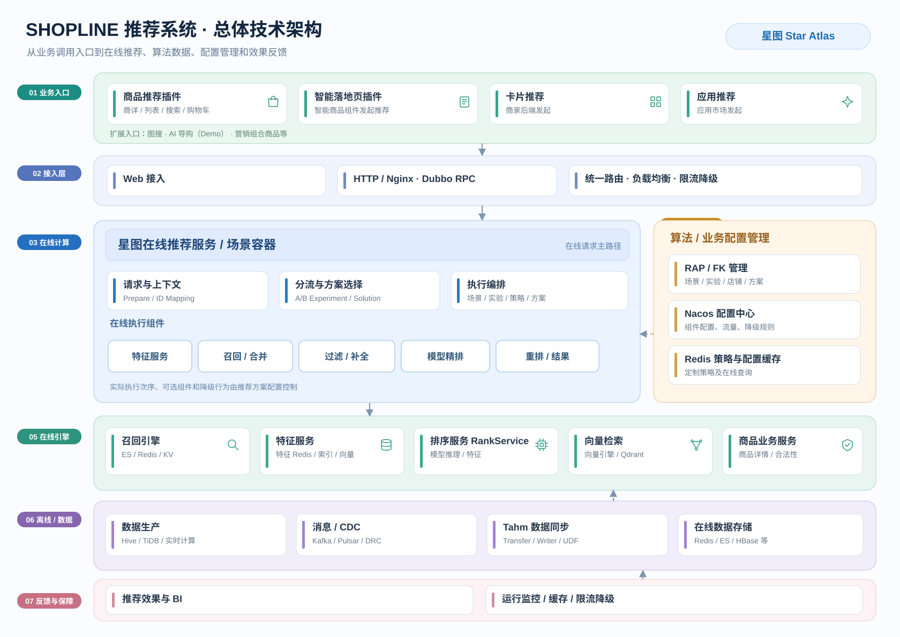
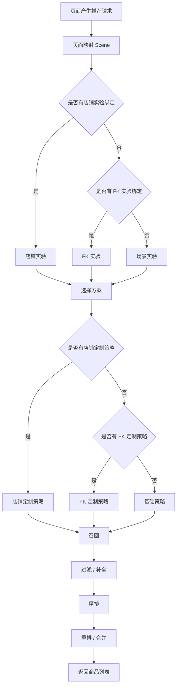
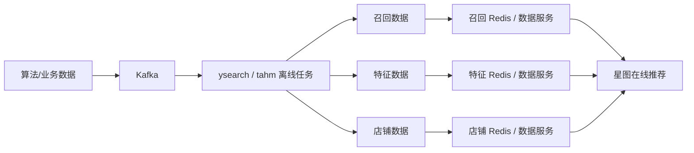
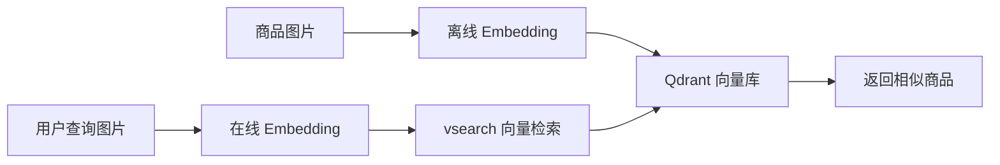

# 推荐工程整体业务背景

## 1. 业务定位

推荐工程面向 SHOPLINE 店铺，在不同页面和业务场景下为用户返回商品推荐结果。系统核心不是单一算法，而是一套从**场景识别、实验与策略选择、召回、过滤、排序到效果监控**的完整推荐链路。

当前业务按站点独立运行：

| 站点 | 业务范围 | 主要特点 |
| --- | --- | --- |
| EC10 | 港台推荐 | 已支持多页面场景、实验、店铺/FK 定制策略、店铺效果监控 |
| EC20 | 大陆推荐 | 与 EC10 数据、页面映射和业务维度独立 |

推荐分析、实验和配置都必须保留站点范围，不能跨站点混合。

---

## 2. 核心业务对象

| 对象 | 含义 |
| --- | --- |
| 店铺（Merchant / Store） | 推荐业务的基本租户和数据隔离单位 |
| 页面（Page） | 商品详情、商品清单、搜索、购物车等用户入口 |
| 场景（Scene） | 推荐服务内部使用的业务场景编号，由页面映射得到 |
| 实验（Experiment） | 控制不同方案或策略在指定流量中的生效范围 |
| FeatureKey（FK） | 用于进一步圈选特定商品/业务特征，并绑定定制实验或策略 |
| 方案（Solution） | 一组推荐执行配置，由场景和实验选择 |
| 策略（Strategy） | 定义一次推荐请求具体执行哪些召回、过滤、排序等能力 |
| 召回（Recall） | 从候选商品集合中取回可能相关的商品 |
| 特征（Feature） | 用户、商品、店铺等在线排序和策略判断需要的数据 |
| 推荐结果 | 最终返回给页面展示的商品列表 |
| 效果数据 | 曝光、点击、转化、订单、推荐引导 GMV 等推荐成效 |

EC10 当前常用页面包括商品详情页、商品清单页、搜索页、所有商品页、购物车页、mini 购物车页和 blog 页。

---

## 3. 整体架构



整体可以分成四部分：

- **配置控制面**：RAP 管理场景、实验、店铺/FK 绑定和定制策略，配置同步到 Nacos 和 Redis。
- **在线推荐面**：星图在线服务根据 Scene、实验和策略执行召回、过滤、补全、精排、重排和合并。
- **离线数据面**：算法和离线任务通过 Kafka、ysearch、tahm 等链路生成并同步召回数据和特征数据，供在线服务读取。
- **效果与稳定性**：离线产出每日推荐成效，工程侧按店铺和场景监控效果，同时通过限流、缓存、降级和扩缩容保证在线稳定性。

---

## 4. 在线推荐流程

一次推荐请求的核心决策分成三层：**先确定场景，再确定实验/方案，最后确定策略并执行推荐链路。**



当前优先级可以概括为：

```text
实验选择：店铺实验 > FK 实验 > 场景实验
策略选择：店铺定制策略 > FK 定制策略 > 基础策略
```

这套设计让平台保留统一基础策略，同时支持特定店铺或 FeatureKey 做局部定制。

---

## 5. 配置与实验体系

推荐配置主要由 RAP、Nacos 和 Redis 三部分组成。

### RAP

RAP 是业务配置入口，主要管理：

- 场景及实验配置
- 店铺与场景实验绑定
- FeatureKey 实验绑定
- 店铺定制策略
- FeatureKey 定制策略

### Nacos

Nacos 保存在线推荐运行需要的配置，核心包括：

| 配置 | 作用 |
| --- | --- |
| scene-configs | 场景及场景配置 |
| ab-configs | 实验、应用和策略配置 |
| solution-plugin-configs | 推荐方案配置 |
| flow-controls | 页面与 Scene 的映射 |
| data-sources / data-services-go | 数据源和数据服务 |
| recall-services | 召回能力配置 |
| filter-services | 过滤配置 |
| complement-services | 补全配置 |
| rank-services-go | 精排配置 |
| rerank-services | 重排配置 |
| recommend-strategies | 基础推荐策略 |
| base-strategies | 基础策略定义 |
| store-strategy-configs | 店铺定制策略 |
| cache-configs | 推荐缓存配置 |
| sentinel.rule | 限流和降级配置 |

### Redis

定制策略的具体内容会同步到 Redis，供在线推荐服务快速读取；Nacos 同时保留是否存在定制策略等控制信息。

---

## 6. 离线数据链路

推荐在线服务依赖大量提前生成的数据，主要包括召回数据、商品/用户特征和店铺数据。



港台推荐 ToAll 后，召回和特征从 Beta 数据逐步切换为全量数据，并通过独立 Kafka Topic 和 Redis 集群支撑线上推荐。

---

## 7. 推荐效果数据

推荐工程不仅负责“返回什么商品”，还需要持续判断推荐是否有效。

核心效果指标包括：

| 指标 | 含义 |
| --- | --- |
| 曝光 | 推荐商品被展示的次数 |
| 点击 | 推荐商品被点击的次数 |
| 转化 | 推荐带来的转化次数 |
| CTR | 点击 / 曝光 |
| CVR | 转化 / 点击 |
| CTCVR | 转化 / 曝光 |
| 推荐引导 GMV | 推荐链路产生的 GMV |

效果数据按日离线产出，当前分析口径以 T+1 为主。港台已经支持把推荐成效展示给商家，工程侧进一步按店铺和场景维护效果曲线，并监控明显突变，用于发现工程异常或辅助算法调整策略。

---

## 8. 在线稳定性

推荐服务支持四类主要干预方式：

- **限流降级**：通过 Sentinel 按页面或店铺限制流量等级。
- **缓存降级**：按 Scene 或店铺开启自动/手动缓存，降低后端压力。
- **排序降级**：模型或特征服务出现瓶颈时，可通过 rank 配置跳过精排。
- **扩缩容**：在线容器或 Redis 出现容量瓶颈时进行人工扩容。

稳定性控制的粒度与业务对象一致，主要围绕**页面、Scene、店铺和推荐执行阶段**展开。

---

## 9. 扩展能力

### FeatureKey 定制推荐

FeatureKey 用来表达更细的业务或商品特征条件。基础配置可以声明某个召回需要的 FeatureKey，RAP 再基于 FK 圈选实验和定制策略，实现比店铺粒度更细的推荐控制。

### 图搜 / 向量检索

港台图搜是推荐工程中的独立检索能力：



离线侧把商品图片向量写入 Qdrant；在线侧生成查询图片向量，通过 vsearch 检索相似商品。

---

## 10. 业务链路总结

推荐工程可以归纳成一条主链路：

```text
页面
→ Scene
→ 实验/方案
→ 策略
→ 召回
→ 过滤/补全
→ 精排
→ 重排/合并
→ 推荐结果
→ 曝光/点击/转化
→ 效果监控与策略调整
```

其中 RAP/Nacos/Redis 负责控制“**怎么推荐**”，Kafka/ysearch/tahm/数据服务负责准备“**拿什么数据推荐**”，星图在线服务负责执行“**本次请求具体推荐什么**”，效果数据和监控负责判断“**推荐得怎么样**”。


---

## 11. 业务分析口径与 Agent 公共背景

本节记录业务分析 Agent 的共同约束。**业务事实、指标定义、分析规则和权限边界应明确区分**：其中敏感指标限制属于 Agent 查询与输出约束，不代表数据仓库中不存在对应字段。

### 11.1 站点与页面映射

- **EC10**：港台推荐站点。
- **EC20**：大陆推荐站点。
- 两站的数据、页面映射和业务维度独立。店铺 ID 本身不能确定站点；缺少站点依据时不能默认选择，也不能跨站点混合分析。

| 页面名称 | EC10 场景编号 | EC20 场景编号 |
| --- | ---: | ---: |
| 全部 | 0 | 0 |
| 商品详情页 | 1 | 1 |
| 商品清单页 | 2 | 2 |
| 搜索页 | 3 | 4 |
| 所有商品页 | 4 | — |
| 购物车页 | 5 | 5 |
| mini购物车页 | 6 | 3 |
| blog页 | 7 | — |
| 订单完成页 | — | 7 |
| 404页 | — | 8 |
| 推荐落地 | — | 10 |

**规则**：仅允许在站点内部映射页面名称；未登记编号不可推断；mini购物车页和购物车页不能混为一谈；也不能仅凭页面名称反推站点。

### 11.2 效果指标与统计规则

| 指标 | 口径 |
| --- | --- |
| 推荐曝光量 | 推荐商品的曝光事件数 |
| 推荐点击量 | 推荐商品的点击事件数 |
| 推荐转化量 | 按对应推荐转化事件口径统计 |
| 推荐订单 | 推荐引导的订单相关指标，具体以查询字段定义为准 |
| CTR | 推荐点击量 ÷ 推荐曝光量 |
| CVR | 推荐转化量 ÷ 推荐点击量 |
| CTCVR | 推荐转化量 ÷ 推荐曝光量 |
| rec_gmv | 推荐引导 GMV；未限定的“GMV”按此含义理解 |

**禁止向分析 Agent 公开的指标**：store_gmv、store_gmv_per_user、rec_gmv_ratio。命中其中任一项时，整轮停止；不得生成查询、比较、排序、归因、计算或展示任务，也不得利用公开指标反推或偷偷改用替代指标。

统计与解释还需遵守：

1. **过滤、分组、比较是不同动作**。出现某维度不代表自动按它分组或对比。页面、店铺、推荐模式、策略、召回、实验分组各有不同业务角色。
2. **整体不能与子范围重复计算**。汇总比例必须按同口径汇总分子、分母后计算，而非直接平均各组比例；control/treatment 由本次请求明确赋予，不能猜测。
3. **数据状态不能混淆**。“无数据 / 覆盖不足 / 不可计算 / 能力不支持 / 查询失败 / 0”分别表达；null 依据返回状态解释，未返回的指标不能声称已返回。
4. **效果数据按日 T+1 产出**。未特别说明包含今天的最近 N 天，以昨天作为最新完整日；明确请求今天则保留今天；不能因无数据擅自扩大时间范围。这一口径不适用于实时运行流量。
5. **诊断数据不等于完整生产流量**。推荐请求量/PV、系统 QPS/耗时/错误率、店铺局部 Top 候选诊断捕获不能混算。未捕获不代表正常，capture_rate 不是真实故障率。
6. **结论与证据匹配**。异常、时间重合、变化贡献或数据结构变化，都不能单独证明原因；未查询、查询失败、无数据、证据不足、已排除是不同状态。

### 11.3 关键业务概念辨析

| 概念 | 回答的问题 | 例子 |
| --- | --- | --- |
| Scene / 页面场景 | 在什么推荐入口执行 | 商品详情页、搜索页 |
| 召回 Recall | 从哪里找候选商品 | 热门召回、协同过滤召回 |
| 排序 Rank | 如何给候选商品打分并排序 | ESMM 模型 |
| 重排 Rerank | 如何调整排序后结果 | 打散、约束、重新组织 |
| 策略 Strategy | 一次请求组合、执行哪些能力 | 哪些召回、过滤、排序、重排 |
| 实验 Experiment | 不同流量使用哪一套配置 | 场景实验、店铺圈选实验 |
| FK / FeatureKey | 用于定制配置匹配和分流的业务维度键 | 某个 FK 绑定对应实验或策略 |
| 特征 Feature | 模型和策略判断使用的数据 | 用户行为历史、商品属性 |

**特别注意**：实验不等于策略或召回；“按策略对比”和“按召回对比”也不自动等于 A/B 实验。FK 不是通常意义上的一个模型特征字段，而是这套推荐定制架构中的业务匹配键，具体语义由对应 FK 定义决定。

---

## 12. 推荐实验分流与分层绑定

### 12.1 原有实验选择

原有场景下，店铺可绑定圈选实验；否则按 FK 实验或场景实验进入分流。没有明确分组角色时，不应假设实验编号与 control / treatment 一一对应。

~~~mermaid
flowchart TD
    A[星图请求开始] --> B{存在店铺绑定实验?}
    B -- 否 --> C[使用场景实验分流]
    B -- 是 --> D{店铺绑定为层级绑定?}
    D -- 否 --> E[兼容旧绑定逻辑分流]
    D -- 是 --> F[读取该店铺已绑定的层级实验]
    F --> G[缺失层级由对应场景实验补齐]
    C --> H[生成本次实验方案]
    E --> H
    G --> H
    H --> I[执行推荐方案]
~~~

这里的旧逻辑兼容、场景兜底和层级拼装，是提供的《RAP 店铺绑定支持层级方案》的目标设计；**不代表已验证线上全部完成部署**。

### 12.2 为什么需要分层

**旧问题**：一个店铺只能参加一个圈选店铺实验组；如要调整召回、排序、重排，往往要在一个实验中同时组织三部分。

**新目标**：圈选店铺实验按三个层级拆分，一个店铺可以同时参加三个不同层级的实验，分别定制：

| 层级 | 枚举值 | 修改内容 |
| --- | --- | --- |
| 召回层 | recall | 候选商品怎么找 |
| 排序层 | rank | 候选商品怎么打分和排序 |
| 重排层 | rerank | 排序结果如何组织 |
| 兼容旧配置 | 空值 | 按旧绑定分流逻辑解释 |

同一个店铺在**同一场景、同一层级**最多参与一个圈选实验绑定；一个绑定只对应一个层级。不同层级的绑定最终组合成完整的推荐方案，缺失层级使用相应的场景实验补齐。

### 12.3 数据协议和改造范围

| 位置 | 改造内容 |
| --- | --- |
| MySQL：bind_scenes | 新增 bind_layer 字段，默认空 |
| Nacos：store-scene-configs | 绑定配置增加 bind_layer 字段，默认空 |
| RAP API / server / service | 绑定场景协议透传 bind_layer，支持分层 CRUD 和发布 |
| RAP 页面与校验 | 可选 recall / rank / rerank；同店铺同场景同层级最多配置一次 |
| 星图后端 | 读取 bind_layer；兼容空值；拼接多层店铺实验和场景缺省实验 |

发布顺序：**先升级星图后端兼容新旧协议 → 再发布 RAP → 算法同学将场景绑定配置逐步切到指定层级**。避免在新字段生效前让老服务读取无法理解的配置。

---

## 13. 推荐定制化架构演进

### 13.1 改造前

原推荐系统由星图统一承接请求，按四个主要在线服务能力执行推荐；定制能力和离线计算较多直接位于原架构中。

~~~mermaid
flowchart TB
    X[星图在线推荐] --> A[特征服务]
    X --> B[召回引擎]
    X --> C[配置管理]
    X --> D[排序服务]
    E[算法离线计算: 店铺策略 / 店铺实验 / 特征数据] --> F[Kafka]
    G[定制策略与实验库] --> F
    F --> H[tahm 数据同步]
    H --> A
    H --> B
    H --> C
    I[通用算法模型] --> J[模型同步]
    J --> D
~~~

- 特征服务：service、特征 Redis。
- 召回引擎：召回 ES、召回 Redis。
- 配置管理：动态配置、策略 Redis。
- 排序服务：Rank service、特征 Redis、模型。
- 数据同步：Kafka → tahm；模型走单独的模型同步链路。

### 13.2 改造后：算法运营平台与推荐执行解耦

~~~mermaid
flowchart LR
    subgraph FK[算法运营平台]
        UI[FK 管理页面] <--> S[FK service]
        S <--> DB[(FK 库)]
        S <--> CA[(Cache)]
        A[(业务 FK 库)] --> T[tahm]
        B[(智能 FK 库)] --> T
        T --> DB
    end
    S -- API --> C[星图在线服务/引擎层]
    S -- FK 流 / SDK --> O[算法离线计算层]
    O --> K[Kafka]
    K --> T2[tahm 同步]
    T2 --> C
    M[店铺定制模型] --> MS[模型同步]
    MS --> C
~~~

改造方向是：**把 FK 的管理和业务/智能 FK 数据来源集中到算法运营平台**；星图仍负责在线执行，离线计算仍负责店铺策略、实验、召回、特征、模型等结果准备。图中的 FK 管理页面、FK service、FK 库和 Cache 是控制面；不要将其误解成替代在线召回/排序的独立推荐引擎。

推荐定制能力覆盖：召回、排序、重排；离线侧可细分店铺定制策略、店铺定制实验、定制基础策略、店铺定制召回、店铺定制特征、店铺定制模型等。

### 13.3 FK 绑定与在线优先级

~~~mermaid
flowchart TD
    A[星图容器] --> B{是否有店铺实验绑定?}
    B -- 是 --> C[店铺绑定实验]
    B -- 否 --> D{是否有 FK 实验绑定?}
    D -- 是 --> E[FK 绑定实验]
    D -- 否 --> F[场景实验]
    C --> G[执行方案]
    E --> G
    F --> G
    G --> H{是否有店铺定制策略?}
    H -- 是 --> I[店铺定制策略]
    H -- 否 --> J{是否有 FK 定制策略?}
    J -- 是 --> K[FK 定制策略]
    J -- 否 --> L[基础策略]
    I --> M[执行策略]
    K --> M
    L --> M
~~~

这是提供的 FK 在线选择流程。**店铺绑定优先于 FK 绑定，FK 优先于场景默认；策略选择同样优先店铺定制，然后 FK，最后基础策略。**分层店铺实验是对第一步“店铺绑定实验”内部组装方式的扩展，不能直接把它理解成放弃原有优先级。

### 13.4 Roadmap（原方案规划，不视为当前完成状态）

| 阶段 | 规划 |
| --- | --- |
| Q1 | 对齐推荐 2.0 定制化能力 |
| Q2 | FeatureKey 定制能力开发（RAP、在线及算法运营平台）并灰度 |
| Q3 | 基于 FeatureKey 的定制解决方案 A/B 实验；离线计算定制化 |
| Q4 | 收集效果数据并检查目标达成情况 |

原始目标中“积累 X 个解决方案”和“单店铺成本从 $X 降到 $Y”属于**尚未给出数值的目标占位**，不能当作已实现结果。

---

## 14. 页面、召回与 Feature 配置实例

### 14.1 场景配置

原变更记录 **REC-819**：在 app-configs 中为商品清单页、搜索页、所有商品页新增场景及默认召回列表，在 flow-control 中配置场景编号。

| 场景配置 Key | 场景 ID | 主要召回 |
| --- | ---: | --- |
| collectionPage | 2 | 热门、近 24 小时热门、用户兴趣/历史、协同过滤、品类、搭配、列表相关 |
| searchPage | 3 | 热门、近 24 小时热门、用户兴趣/历史、协同过滤、品类、搭配 |
| allProducts | 4 | 热门、近 24 小时热门、用户兴趣/历史、协同过滤、品类、搭配 |

文档示例里的召回组件名：

~~~yaml
strategies:
  default:
    - storeHotRecall
    - store24HourHotRecall
    - userLikedItemRecall
    - userLikedItemCfRecall
    - userHistoryItemRecall
    - userHistoryItemCfRecall
    - userLikeCateRecall
    - userLongHistoryItemRecall
    - coAddonItemRecall
    - listRelatedRecall  # 原例仅 collectionPage 包含
~~~

其中 collectionPage 原始配置出现两次 userLikeCateRecall，整理时按不同召回组件去重展示；**不能由此判断实际运行时是否故意重复执行**。

原方案列出的特征需求：

~~~yaml
needFeatures:
  - userHistory
  - userLikeCate
  - userLikeTag
  - userRealtimeHistory
  - userLikeCateRealtime
  - userLikeTagRealtime
  - userLikeCateV3  # 原例在 collectionPage / allProducts 中列出
~~~

~~~yaml
flow-control:
  collectionPage:
    sceneId: 2
    percent: 1
    storeId: []
  searchPage:
    sceneId: 3
    percent: 1
    storeId: []
  allProducts:
    sceneId: 4
    percent: 1
    storeId: []
~~~

**注意**：这里的 sceneId 示例与 EC10 页面映射一致；配置里的 percent: 1、storeId: [] 应以当时配置协议解释，不要直接推断为生产流量百分比或店铺覆盖范围。

### 14.2 相关上线记录

| 任务 | 改动 | 涉及环节 |
| --- | --- | --- |
| REC-822 | 增加分类 / 列表相关召回 | 离线 ec15_rec_recall 发布 list_related_item_v1、Kafka/数据灌入检查；在线 data-services、recall-services；RAP 新增召回配置 |
| REC-821 | 库存可售判断改用 total_orderable_quantity | filter、complement、summary 的 filter |
| REC-820 | 增加每日推荐成效明细 | 离线 ysearch ec15_data_daily、灌入及校验；在线 ysearch ec15_rec_api |
| REC-819 | 新增三个页面推荐场景 | app-configs、flow-control、RAP 场景实验配置 |

任务编号只标识原文记录，**不能单凭记录推断已上线或当前使用的版本**。

---

## 15. 港台图搜与向量检索

图搜用于按图片相似度找商品，和基于业务场景配置的推荐链路相关，但并非同一条普通的召回-排序链路。

### 15.1 离线索引构建

~~~mermaid
flowchart LR
    P[商品图片表] --> K[Kafka]
    K --> E[离线 Embedding 生成]
    E --> K2[Kafka]
    I[商品基础信息] --> K2
    K2 --> T[tahm]
    T --> H[(HBase)]
    T --> Q[(Qdrant 向量引擎)]
~~~

- Embedding（向量）是将图片转换为可计算相似度的数值表示。
- 商品基础信息与图片向量一起参与入库与索引构建。
- HBase 与 Qdrant 在示意中分别承载相应数据；向量近邻查询由 Qdrant 完成。

### 15.2 在线查询

~~~mermaid
flowchart LR
    U[智能导购后端] --> V[vsearch 向量检索服务]
    V --> E[在线 Embedding 生成]
    V --> Q[(Qdrant 向量引擎)]
    E --> V
    Q --> V
    V --> R[返回相似商品候选]
~~~

调用入口是智能导购后端，vsearch 负责发起相似向量检索，在线生成查询图像 Embedding 后使用 Qdrant 找到近似商品。

---

## 16. 推荐算法能力开放

### 16.1 背景与现状

算法中心覆盖搜索、推荐、风控、NLP、图像等方向。以推荐为例，原资料称主站已有 **23 个推荐场景**，主要通过 product backend 包装成三种接入形态：

| 接入形式 | 使用方 | 当时的开放情况 |
| --- | --- | --- |
| 内部后端服务 | 推荐插件、营销插件及多数推荐场景 | 内部使用，未直接对外 |
| Ajax | 主题内推荐 | 可通过 Ajax 接入有限推荐能力 |
| Storefront GraphQL | 无头电商、第三方开发者 | 与 Ajax 能力相近 |

当时 Ajax 和 Storefront 主要开放**单商品相关商品推荐**，与大量内部场景能力不对等。以上属于方案调研时点的描述，并非对当前所有 API 能力的实时核验。

### 16.2 问题和设计方向

- **接口层级不合理**：推荐插件依赖内部 API，而插件对外能力应进入统一开放 API 体系。
- **交叉依赖**：营销插件等也依赖商品后端内部接口。
- **迭代成本高**：算法能力对外迭代需要多个业务方配合。

目标是将推荐开放能力统一管理，通过规范的对外接口提供能力，使算法能力演进与调用方相对解耦，减少跨服务交叉依赖。

原始方案提及推荐插件安装后可使用 Storefront API 及埋点接口，但资料同时标注**相关 Storefront 文档当时尚未公开**，不能视为已全面开放或保证权限可用。

### 16.3 相关链接

- [SHOPLINE Storefront 商品推荐接口](https://developer.shopline.com/zh-hans-cn/docs/storefront-api/products/queries/product-recommendations)
- [SHOPLINE Ajax 商品推荐接口](https://developer.shopline.com/zh-hans-cn/docs/ajax-api/product/product-recommendations)
- [Shopify Storefront 对照](https://shopify.dev/docs/api/storefront/latest/queries/productRecommendations)
- [Shopify Ajax 对照](https://shopify.dev/docs/api/ajax/reference/product-recommendations)
- [推荐能力开放需求：商品推荐开放 API](https://shopline.yuque.com/slpm/svh090/dfgr1si7g1wlg4yk?singleDoc#)
- [推荐埋点使用说明](https://docs.google.com/document/d/19ZDP_KfahYChX0FflDzMpqYuXjWZZVoxl_ymnKRlPX0/edit)
- [推荐能力相关产品文档](https://shopline.yuque.com/chkdwd/ocnnz4/xvpg6zqyyz9y169z?singleDoc#)

---

## 17. 推荐运行监控与操作预案

**区分两个层次**：下表是运行稳定性监控（在线接口、容器、Redis、Kafka），与按日 T+1 的推荐效果监控（曝光、CTR、CVR 等）不是同一统计口径。

### 17.1 星图在线服务告警（原文阈值）

| 告警项 | 原文判断条件 | 级别 | 电话 |
| --- | --- | --- | --- |
| 推荐平均时延 | 超过 500 ms | 紧急 | 是 |
| 推荐接口成功率 | 低于 99% | 紧急 | 是 |
| 大面积无结果 | 新加坡阈值 100、美国阈值 500 | 紧急 | 是 |
| Direct 内存使用 | 超过 500 M | 紧急 | 是 |
| CPU 使用 | 达到 70% | 紧急 | 是 |
| 内存使用 | 达到 85% | 紧急 | 是 |
| 磁盘使用 | 达到 85% | 紧急 | 是 |
| 兜底请求量 | 新加坡阈值 100、美国阈值 300 | 重要 | 否 |
| 小面积无结果 | 新加坡阈值 50、美国阈值 100 | 重要 | 否 |
| 请求量同比昨日 | 上升或下降 50% | 重要 | 否 |
| 大面积超时 | 新加坡超时数量 100、美国 200 | 紧急 | 是 |
| 小面积超时 | 新加坡超时数量 10、美国 20 | 重要 | 否 |
| 精排服务平均时延波动 | 时延增加 20% | 重要 | 否 |

“无结果 / 超时 / 兜底”的数量阈值在原截图中未列完整的统计窗口，**不要脱离现有监控规则臆造计数周期**。

### 17.2 Redis 与 Kafka 告警

| 组件 | 告警项 | 原文判断条件 | 级别 | 电话 |
| --- | --- | --- | --- | --- |
| Redis | 内存使用率 | 达到 85% | 紧急 | 是 |
| Redis | 慢日志出现 | 有慢日志 | 普通 | 否 |
| Redis | CPU 使用率 | 达到 80% | 紧急 | 是 |
| Kafka | 消费组积压 | 延迟 / 积压 10 万条 | 普通（原截图文字需核验） | 否 |

### 17.3 Sentinel 限流降级

配置入口：**Nacos 的 sentinel.rule**。

- **sentinelRuleFlowResource.bizPages.ec_product_rec.pages.productDetail.level3Qps**：商品详情页对应正常 level3 到降级 level2 的流控阈值；原示例将 50 调整为 20。
- **sentinelParamFlow.count**：店铺维度的限流阈值；原示例也可由 50 改为 20。

上述数字是操作预案里的人工干预示例，不是所有站点/页面的固定配置。

### 17.4 缓存降级

配置入口：**Nacos 的 cache-configs**。可按场景、店铺开启自动缓存，也可对突发流量的具体店铺强制开启缓存。

~~~yaml
open: true
cacheConfig:
  autoConfig:
    sceneList: ["1"]
    storeList: ["storeId1"]
  manualConfig:
    58e4736a9a76f0174c000278:
      sceneList: ["1"]
  ttl: 300
  allowList: []
cacheDataSource: storeRecallData
~~~

| 字段 | 作用 |
| --- | --- |
| open | 缓存总开关 |
| autoConfig.sceneList / storeList | 按场景或店铺自动使用缓存（配合流控） |
| manualConfig | 指定店铺与场景强制启用缓存 |
| ttl | 缓存有效时间，示例 300 秒 |
| allowList | 原文说明为“不使用缓存”的白名单 |
| cacheDataSource | 缓存数据来源，示例 storeRecallData |

### 17.5 精排（RS）降级

当特征 Redis 或 Rank Service 存在瓶颈时，操作预案通过配置 **rank-services-go** 控制精排能力是否可用，避免逐个修改每个定制策略。

~~~yaml
rankServices:
  hotScoreRankService:
    modelId: ec1_esmm_v0
    needLevel: 3
    timeout: 300
  directRankService:
    modelId: ec1_esmm_v0
    needLevel: 3
    timeout: 300
  esmmRankServiceV1:
    modelId: ec1_esmm_v1
    needLevel: 3
    timeout: 300
~~~

原文还给出各项的 version、模型服务 URL 以及 request 模板；其中请求上下文包含 userId、modelId、district、isMobile、storeId、appId、pageType、productsId、traceId，候选项包含 id、score、maxScore、recallIds。上例为了突出降级参数，只展示核心字段，**不是可直接覆盖部署的完整 YAML 配置**。

原预案指出，正常流量级别为 **level3**，将对应排序服务的 **needLevel 从 3 改为 4** 后，正常 level3 请求不再经过该精排服务。此为应急切换手段，恢复后需将阈值改回并观察排序调用率、时延、结果量与效果数据。

### 17.6 值班排查顺序

~~~text
推荐接口告警
→ 确认站点、场景、店铺及流量范围
→ 查看成功率 / 延迟 / 无结果 / 兜底
→ 检查 Redis、Kafka、精排服务及容器资源
→ 按预案选择限流、缓存或精排降级
→ 验证接口恢复，并记录操作与恢复时间
~~~

这属于**在线运行故障排查**；推荐 CTR、CVR、GMV 突变要结合 T+1 数据和实验/召回/策略配置另行分析，不能把技术告警阈值直接套用到业务成效指标。

---

## 18. 原始资料与术语索引

### 18.1 本次整理覆盖的资料

| 资料 | 核心内容 |
| --- | --- |
| 港台图搜技术方案及配图 | 商品图片离线向量、HBase / Qdrant、vsearch 在线检索 |
| RAP 店铺绑定支持层级方案 | 召回/排序/重排三层圈选实验、bind_layer 与发布顺序 |
| 推荐定制化 before / after 架构 | 星图四类服务、tahm、Kafka、FK 运营平台、店铺定制能力 |
| 推荐定制化 Roadmap | Q1—Q4 规划与目标 |
| 星图在线流程图 | 店铺实验 → FK 实验 → 场景实验；店铺策略 → FK 策略 → 基础策略 |
| 算法能力开放方案调研 | 内部推荐 API、Ajax、Storefront、插件及开放平台 |
| REC-819—822 | 场景、召回、可售库存及每日成效数据的变更记录 |
| 推荐操作预案及告警表 | Sentinel、缓存、精排降级与星图/Redis/Kafka 阈值 |
| 分析 Agent business_background | EC10/EC20 页面映射、指标和统计规则、安全限制 |

### 18.2 关联文档

- [RAP 店铺绑定支持层级方案（语雀）](https://shopline.yuque.com/rbxwgy/onb4p4/np6dg1gztyg5g7zn)

**资料边界**：各原方案、截图和预案来自不同时期，文中以“原文”、“方案”、“规划”、“示例”标注的内容，不直接断言为当前线上生效状态；生产配置、实验命中、阈值窗口应以运行服务和现行配置为准。
